# From Problem to Agent — The Complete Field Book

### Systems Thinking, Theory of Constraints and Throughput Accounting for Deciding Where AI Belongs — Nine Cases from Four Companies

*A self-study guide and workshop companion that merges four field books into one: Danfoss (procurement, quality, customs), Crestmount Refinery (maintenance planning), Meridian Industrial Systems (procurement under shock), and LoopCycle Nusantara (consumer commerce).*

---

> **How to read this book.** Every case is walked through the same disciplined arc. First we *understand the system* (Causal Loop Diagram → Stock & Flow). Then we *find where it hurts* (Theory of Constraints). Then we *quantify the prize* (Throughput Accounting). Then we *decide honestly what each step needs*: plain automation, a calibrated decision model, or an LLM agent. Only then do we *design the solution*. The analysis earns the solution. We never start with "let's add an AI agent". When we get there at all, we have already shown that it attacks the constraint.
>
> Part I teaches the method once. Parts II–V apply it to nine cases in four very different businesses. Part VI reads the nine side by side. The cross-case patterns are this book's most valuable finding, and no single source book could show them.

> **A note on the numbers.** Every figure comes from the dataset behind its case and is either *dataset-anchored* or *labelled as a modelled assumption*. Each case keeps its own currency (€, £, $, IDR) and its own period (per year, per month, per window). The cases are **not** converted to a common unit. Compare them by *direction, ratio and sign*, not by absolute size. Where this edition corrects or reconciles a source figure, the change is listed in [Appendix C](#appendix-c--editors-notes-and-reconciliations).

---

## Table of Contents

**Part I — The Method**
- [Chapter 1 — Why This Book Exists](#chapter-1--why-this-book-exists)
- [Chapter 2 — How to Use This Book](#chapter-2--how-to-use-this-book)
- [Chapter 3 — The Four Lenses](#chapter-3--the-four-lenses)
- [Chapter 4 — Automation, Decision Model, or Agent?](#chapter-4--automation-decision-model-or-agent)
- [Chapter 5 — Understanding Decision Models](#chapter-5--understanding-decision-models)
- [Chapter 6 — The Two Agent Patterns](#chapter-6--the-two-agent-patterns)
- [Chapter 7 — Sizing the Build: Break-even and Team Size](#chapter-7--sizing-the-build-break-even-and-team-size)

**Part II — Danfoss: Procurement, Quality and Logistics**
- [Chapter 8 — Meet Danfoss](#chapter-8--meet-danfoss)
- [Chapter 9 — Supplier Performance Review](#chapter-9--supplier-performance-review)
- [Chapter 10 — Faster Technical Customer Report (8D)](#chapter-10--faster-technical-customer-report-8d)
- [Chapter 11 — UK Customs Clearance Declaration](#chapter-11--uk-customs-clearance-declaration)

**Part III — Crestmount Refinery: Maintenance Planning**
- [Chapter 12 — Meet Crestmount Refinery](#chapter-12--meet-crestmount-refinery)
- [Chapter 13 — The Planner Bottleneck](#chapter-13--the-planner-bottleneck)

**Part IV — Meridian Industrial Systems: Procurement Under Shock**
- [Chapter 14 — Meet Meridian Industrial Systems](#chapter-14--meet-meridian-industrial-systems)
- [Chapter 15 — The Vendor-Pool Collapse](#chapter-15--the-vendor-pool-collapse)

**Part V — LoopCycle Nusantara: Consumer Commerce**
- [Chapter 16 — Meet LoopCycle Nusantara](#chapter-16--meet-loopcycle-nusantara)
- [Chapter 17 — The Delivery Disruption Monitor](#chapter-17--the-delivery-disruption-monitor)
- [Chapter 18 — Support Ticket and Contact-Centre Triage](#chapter-18--support-ticket-and-contact-centre-triage)
- [Chapter 19 — Cart and Conversation Recovery](#chapter-19--cart-and-conversation-recovery)
- [Chapter 20 — Content-to-Sales Planning](#chapter-20--content-to-sales-planning)

**Part VI — Synthesis**
- [Chapter 21 — Patterns Across Nine Cases](#chapter-21--patterns-across-nine-cases)
- [Chapter 22 — Running This as a Workshop](#chapter-22--running-this-as-a-workshop)

**Appendices**
- [Appendix A — Glossary](#appendix-a--glossary)
- [Appendix B — Artifact Index](#appendix-b--artifact-index)
- [Appendix C — Editor's Notes and Reconciliations](#appendix-c--editors-notes-and-reconciliations)
- [Appendix D — Sources and Credits](#appendix-d--sources-and-credits)

---

### The nine cases at a glance

| # | Company | Case | Domain | Actual constraint | Honest verdict |
|---|---|---|---|---|---|
| 9 | Danfoss | Supplier Performance Review | Procurement | Judgement-heavy meeting prep | Hybrid, leaning agentic |
| 10 | Danfoss | Technical Customer Report (8D) | Quality | Engineer classification + drafting labour | Hybrid — needs all three model classes |
| 11 | Danfoss | UK Customs Clearance | Logistics | Once-daily batch cadence | **Automation** — no LLM needed |
| 13 | Crestmount | Planner Bottleneck | Maintenance | Planner attention spent on noise and context-gathering | Hybrid, decision-model-heavy |
| 15 | Meridian | Vendor-Pool Collapse | Procurement | Responding / bidding vendor pool | Hybrid — and the top lever is a *policy* |
| 17 | LoopCycle | Delivery Disruption Monitor | Last-mile logistics | Detection latency | Hybrid, agentic nub |
| 18 | LoopCycle | Support Triage | Customer service | Triage latency + accuracy | Decision-model-heavy |
| 19 | LoopCycle | Cart Recovery | E-commerce | Checkout friction + reply latency | Automation-first hybrid |
| 20 | LoopCycle | Content-to-Sales Planning | Marketing | Broken attribution / learning loop | Decision model + measurement, **not** generative |

---

# Part I — The Method

## Chapter 1 — Why This Book Exists

Most "AI agent" projects start at the wrong end. Someone decides on the solution ("we need an agent") before anyone has described the problem as a *system*. Hand a team a growing backlog and the instruction "build an agent", and they choose a model, write a prompt, point it at the queue and measure tokens. Three hours later they have a demo and no idea whether it moved anything that matters. The result is an agent that automates a task nobody should have been doing, or that speeds up a step that was never the bottleneck.

This book inverts that order. Before a single line of agent code is justified, you owe four pieces of analysis:

1. **A Causal Loop Diagram (CLD).** What feedback structure makes this problem *persist* despite everyone's effort? Structure, not blame.
2. **A Stock & Flow model.** Where does work pile up, and which *rate* would a solution have to change to drain it?
3. **A Theory of Constraints (ToC) pass.** Which single step limits the whole system's throughput, and where will the constraint *move to* once you relieve it?
4. **A Throughput Accounting (TA) delta.** In money (ΔT, ΔI, ΔOE), what is the prize for elevating that constraint? Does the *sign* of the conclusion survive a sensible swing in the shakiest assumption?

Only after those four may a solution appear on the page. When it does, it is broken down honestly into three layers: **deterministic automation** (plain code), **decision models** (typed choices with calibrated confidence and the right to abstain), and **deep agents** (the reasoning and generation that only an LLM can do). The agent is never the hero of the story; the *constraint* is. Sometimes the agent is the most leverage-efficient way to elevate the constraint. Surprisingly often, it is not.

The source field books proved this four times over, in four different businesses. Read side by side, the nine cases produce the most useful sentence an AI practitioner can say, more than once: *"This part doesn't need AI."*

> If you take one idea from this book, take this one: **analysis is not overhead before the "real" engineering. Analysis tells you whether the engineering is worth doing at all, and where to point it.**

---

## Chapter 2 — How to Use This Book

This book serves two audiences with the same material.

### 2.1 As a self-study guide

Read Part I once. Then work the cases. Each case chapter starts with the raw problem and its dataset counts. **Before reading past §.1 (The Problem), try the four lenses yourself.** Compare your constraint and your automation/agentic verdict with the book's. The gap is the lesson.

For each case:

1. **Read the problem framing and resist the urge to design a solution.** Sit with the pain.
2. **Trace the CLD by hand.** Pick any variable, follow an arrow, and ask "and then what?" until you return to where you started. Say out loud whether each loop is vicious or virtuous.
3. **Redraw the Stock & Flow from memory.** If you can name the stocks and the rates that fill and drain them, you understand the system.
4. **Do the Five Focusing Steps yourself** before reading the chapter's answer. Guess the constraint. You will often be wrong in an instructive way, because the obvious bottleneck is frequently not the real one.
5. **Challenge the Throughput Accounting assumptions.** Every number is labelled as an assumption on purpose. Change one and see whether the conclusion survives.
6. **Fill the automation / decision / agentic scorecard** before reading §.6.
7. **Finally, run the artifact.** Most cases end with runnable commands; a few end with a pilot plan.

**Suggested reading order.** The cases are grouped by company, but they are not equally hard. A good learning path runs from the most intuitive constraint to the subtlest:

| Step | Case | Why here |
|---|---|---|
| 1 | [Ch 9 — Supplier Performance Review](#chapter-9--supplier-performance-review) | Most intuitive constraint: scarce human prep capacity |
| 2 | [Ch 13 — The Planner Bottleneck](#chapter-13--the-planner-bottleneck) | Capacity is 8× demand, yet the backlog grows. Nameplate ≠ effective |
| 3 | [Ch 11 — UK Customs Clearance](#chapter-11--uk-customs-clearance-declaration) | The constraint is a *cadence*, and the honest answer is "no LLM" |
| 4 | [Ch 18 — Support Triage](#chapter-18--support-ticket-and-contact-centre-triage) | A decision-model problem dressed up as an agent |
| 5 | [Ch 19 — Cart Recovery](#chapter-19--cart-and-conversation-recovery) | Half the prize is UX plumbing |
| 6 | [Ch 10 — Technical Customer Report (8D)](#chapter-10--faster-technical-customer-report-8d) | Needs all three model classes |
| 7 | [Ch 17 — Delivery Disruption Monitor](#chapter-17--the-delivery-disruption-monitor) | The one case where the LLM carries the prize |
| 8 | [Ch 15 — The Vendor-Pool Collapse](#chapter-15--the-vendor-pool-collapse) | A cascade: the shock enters in one place and the pain surfaces in another |
| 9 | [Ch 20 — Content-to-Sales Planning](#chapter-20--content-to-sales-planning) | Thinnest data, shakiest sign — an exercise in honesty |

### 2.2 As an in-classroom workshop

Every case is built to run as a group exercise. The golden rule is: **withhold the diagrams.** Participants must struggle to produce their own CLD before seeing the book's. Run-sheets, formats from a two-hour executive session to a three-day cohort, discussion prompts and per-repository pre-flight checklists are in [Chapter 22](#chapter-22--running-this-as-a-workshop).

### 2.3 Prerequisites

- No prior systems-thinking background. [Chapter 3](#chapter-3--the-four-lenses) teaches the lenses from scratch.
- For the runnable sections: Python 3.10+ (3.11+ for most cases), plus `pip install anthropic pytest pandas`. Some cases need extra packages; see [Appendix B](#appendix-b--artifact-index).
- An `ANTHROPIC_API_KEY` is needed only to *run* the LLM agents. All analysis, data generation and unit tests work without it.
- A Markdown viewer that renders [Mermaid](https://mermaid.js.org/) diagrams (GitHub renders them natively).

---

## Chapter 3 — The Four Lenses

Four tools are applied in a fixed order. Each answers a different question, and each sets up the next.

### 3.1 Causal Loop Diagram — *"Why does this persist?"*

A CLD is a picture of **feedback**. Variables are nodes, and the arrows between them are causal links signed `+` or `-`:

- `+` : cause and effect move **in the same direction** (more → more, or less → less).
- `-` : cause and effect move **in opposite directions** (more → less).

Trace any closed loop and **count the minus signs**:

- an **even** number (including zero) → a **reinforcing loop (R)**, a virtuous or vicious spiral that amplifies itself;
- an **odd** number → a **balancing loop (B)**, a goal-seeking loop that resists change.

The art is reading *which loops dominate and why*. Almost every stuck business process is a case of fast reinforcing loops out-running slow balancing loops. **Delays** (written `||`) are therefore first-class citizens in a CLD: a correcting loop that acts "eventually" loses to a vicious loop that acts "now". In this book's nine cases, the decisive delay appears again and again: a health score that lags late payments by a quarter, a disruption that reaches the operator only through a customer complaint, a critical notification that fails weeks after it aged.

**Leverage points** (after Donella Meadows) are places where a small change in structure produces a large change in behaviour. Usually that means changing a *loop's gain*, *shortening a delay*, or changing *who sees what information when*, rather than pushing harder on a variable.

### 3.2 Stock & Flow — *"Where does work pile up?"*

A CLD shows causality but hides accumulation. A Stock & Flow diagram makes accumulation explicit:

- A **stock** is a quantity that accumulates, like a bathtub: open complaints, unreviewed suppliers, abandoned carts, willing vendors.
- A **flow** is a rate that fills or drains a stock, like a tap or a drain: classification rate, review rate, detection rate.

The single most important fact about stocks: **a stock can only be changed by its flows.** You cannot "will" a backlog down. You can only raise its drain rate or lower its fill rate. That is why the question that matters is *"which rate does the solution change?"*. A solution that doesn't move a flow rate doesn't move a stock, and a solution that doesn't move a stock hasn't changed the system. (Meridian, [Chapter 15](#chapter-15--the-vendor-pool-collapse), gives the cleanest proof: the team's response, more invitations, moved *no* flow on any stock that mattered.)

### 3.3 Theory of Constraints — *"What limits the whole system?"*

Goldratt's insight is that every system has exactly **one** constraint at a time: the step that gates total throughput. Improving anything that is *not* the constraint is a mirage. It creates local efficiency and global inventory. ToC proceeds through the **Five Focusing Steps**:

1. **Identify** the constraint, the step with the least capacity relative to demand. Beware the obvious step: the loud bottleneck is often a symptom of a quiet one upstream.
2. **Exploit** it. Get maximum throughput from it without spending money; stop starving or wasting it.
3. **Subordinate** everything else to it, so the rest of the system works at the constraint's pace.
4. **Elevate** it. Now invest to raise its capacity. This is usually where automation, a model, or an agent enters.
5. **Repeat.** Once elevated, the constraint *moves*. Go back to step 1. Watching where it moves is often the most valuable output of the whole analysis.

### 3.4 Throughput Accounting — *"What is the prize, in money?"*

TA is Goldratt's replacement for cost accounting. It has three measures:

| Term | Factory meaning | Knowledge-work meaning (as used here) |
|---|---|---|
| **T — Throughput** | Rate money is generated through sales (revenue − truly variable cost) | Rate of value created by *finished* units of work (reviews done on time, complaints closed, shipments cleared, criticals processed in time) and the cost that value avoids |
| **I — Investment / Inventory** | Money tied up in stock and assets | Work-in-process tied up in the system (backlogs, unmitigated risk, carts parked, cash stuck in late payments), or the one-time build investment |
| **OE — Operating Expense** | Money spent turning I into T | Cost of running the process: loaded labour hours + tooling + API cost |

The decision rule is brutally simple: a change is good if it **increases T, decreases I, or decreases OE**, in that order of priority. Every case computes:

```
Net Profit (process P&L) = T − OE
ΔNet = ΔT − ΔOE
ROI  = ΔNet ÷ incremental spend
Payback = ΔI ÷ Δ(T − OE)          (when there is a one-time investment)
```

Every case also lists its assumptions in a numbered table (A1, A2, …), each with a value and a basis (*dataset* or *modelled*). Each case ends with a **sensitivity note**: which assumption is load-bearing, and does the *sign* of the conclusion survive a sensible swing in it?

> **The recurring lesson.** In knowledge work, the win almost always shows up in **ΔT**, not ΔOE. The solution rarely makes the process *cheaper*. It makes the same scarce people *produce more finished, valuable work*. Selling it as a cost-cutter is usually selling it short. When the win *is* pure OE, from repetitive consolidation, that is a strong hint the step is **automation**, not an agent. ([Chapter 21](#chapter-21--patterns-across-nine-cases) shows this held in all nine cases.)

> **Illustrative, not decision-grade.** Every euro, pound, dollar and rupiah in this book is an estimate built on explicitly labelled assumptions and grounded in each dataset's real structural counts. Treat direction and order of magnitude as the signal. A production business case must replace the assumptions with measured values from a pilot.

---

## Chapter 4 — Automation, Decision Model, or Agent?

The four lenses tell you *where* to act. This chapter tells you *with what*. Every case in this book was shipped, or pitched, as "an AI agent". That word hides an important truth: **not every step that is built as an agent needs to be one.**

### 4.1 The three-way test

For **every step** in a process, ask in order:

| Class | The test | Typical steps |
|---|---|---|
| **Automation** | Could it be a correct, *testable function* with no model? | Lookups, joins, boolean rule checks, fixed mappings, deterministic sorts, business-day maths |
| **Decision model** | Is it a *typed choice* over fixed options (or yes/no, or a rating) where you want **calibrated confidence** and the ability to **abstain**? | Classify, prioritise, route, severity 1–5, real-vs-false-positive |
| **Agentic (LLM)** | Does it need open-ended reasoning, synthesis, retrieval orchestration, or natural-language *generation*? | Drafting reports and emails, researching the open web, planning under a goal, explaining a root cause |

Two further classes appear in this book. Recognising them is part of the discipline:

- **Specialist foundation models.** Meridian's Oracle uses Google TimesFM, a time-series foundation model that forecasts zero-shot. It is neither an LLM nor a decision model. It handles *the knowable*, and it is blind to exogenous shocks ([§15.7](#157-solution-design--the-four-agents)).
- **Policy (no software at all).** Meridian's single highest-leverage intervention is *paying vendors on time*. Crestmount's first move is *rejection discipline*. LoopCycle's biggest cart win is *showing the shipping cost earlier*. Sometimes the right "AI strategy" for a step is a decision by a manager.

### 4.2 The effort-decision table

Pair each step's **nature** with its **throughput contribution** (from the TA lens) and its **build effort**. That turns a classification exercise into an investment decision: build what moves the money, skip what doesn't.

```
Step | Nature | Throughput contribution | Build effort | Build priority
```

The rule for build order, applied in every case:

1. **First, do the cheap enabling automation.** It is low effort and usually a prerequisite, even when it carries little ΔT directly.
2. **Put real effort into the row where the money and the irreducible model class coincide.** That might be the decision model, the generative nub, or, as in UC-3, neither.
3. **Be willing to conclude "this does not need an LLM at all".** Say so even when the deliverable is marketed as an agent.

### 4.3 Match the model class to the sub-problem

> **Typed choice → decision model. Generation or open-ended reasoning → LLM. Everything else → code.** Don't make one generative model do a scorer's job or a function's job.

The architecture that emerges again and again in Parts II–V has three layers: **an automation core**, sometimes **a decision-model front end**, and **a small, irreducibly agentic nub**, with a **human at the gate** for anything irreversible. *Decompose before you deploy.*

---

## Chapter 5 — Understanding Decision Models

So far the only AI discussed has been a **generative large language model** (LLM) such as Claude driving an agentic loop. But not every step needs a model that *writes*. Some steps need a model that *decides*. This chapter introduces that less famous class of model from first principles. Seven of the nine cases use one, and knowing when *not* to reach for an LLM is part of the same "match the tool to the problem" discipline.

### 5.1 Two ways a model can answer a question

Imagine a customer complaint arrives and you must decide: is this a brand-new issue, or a repeat of a known one?

**Way 1 — generate the answer as text (what an LLM does).** The model produces its answer one token (word-piece) at a time, left to right, with each token conditioned on the ones before it. This is **autoregressive generation**. It is astonishingly flexible, but it has three costs:

- **Latency.** Answering means generating a sequence token by token, and you pay for every token.
- **Parsing.** The answer is *prose*. To get a clean label, you must fish it back out of the text. That is brittle; it was exactly the weakness of UC-2's original agent.
- **Uncalibrated confidence.** The model can say "REPEAT" fluently and be completely wrong, with no honest signal of its own uncertainty.

**Way 2 — score the fixed options directly (what a decision model does).** If the only valid answers are SINGLE, MASTER, REPEAT and CA_FAILURE, you don't need generation. A decision model reads the input **once**, in a single forward pass, and outputs a **probability for each predefined option**:

```
SINGLE     0.04
MASTER     0.07
REPEAT     0.86   ← the answer
CA_FAILURE 0.03
```

This is a **typed choice**. The answer's *type* (one of four fixed labels) is set in advance, and the model's whole job is to put a calibrated probability on each option.

### 5.2 System 1 and System 2

The Meridian field book frames the same split in Kahneman's terms. It is a useful architectural vocabulary:

- **System 2, the deliberate analyst.** Large generative models such as Claude. They reason step by step, call tools, synthesise nuance and write prose. They are powerful but *slow and expensive*: 500 ms to several seconds per call, metered per token, and capable of hallucinating confidence they haven't earned. Use them for real reasoning: diagnosis, planning, negotiation, drafting.
- **System 1, the fast reflex.** Non-autoregressive decision engines built on bidirectional encoders, such as Laya. They don't *generate*. They place an input on a rubric and return calibrated probabilities in **tens of milliseconds** (Laya is quoted at ~33 ms) at very low cost. Because the output space is restricted to the predefined options, they cannot hallucinate free text. Use them for high-volume routing, scoring and triage.

The anti-pattern is a reflex dressed up as a deliberation: using a System 2 LLM to decide whether an email is spam. The robust architecture uses **System 1 to protect and orchestrate System 2**. The fast layer triages everything in milliseconds and forwards only the critical few to the slow, expensive reasoning layer.

### 5.3 What "encoder-only" and "non-autoregressive" mean

- **Non-autoregressive.** The model produces its whole output in one shot: one pass in, a probability vector out. That is why it is fast.
- **Encoder-only.** Transformers historically have an *encoder* that reads text into a rich internal representation and a *decoder* that generates text from it. LLMs are decoder-heavy, built to generate. Decision models keep only the "read and understand" half and add a small scoring head. They understand the input deeply but cannot write an essay, which is fine, because we only want them to *choose*. The encoders behind the models used here are in the BERT family: a few hundred million parameters, versus tens or hundreds of billions in a frontier LLM.

### 5.4 Calibration — the property that actually matters

A model is **calibrated** if its stated probabilities match reality. When it says "0.80" on a batch of cases, it is right about 80% of the time. A calibrated probability is an honest confidence signal you can set a policy on. Good decision models are trained against *proper scoring rules*, which reward honest probabilities and punish both over- and under-confidence.

### 5.5 Abstention — knowing when not to answer

Calibration unlocks the feature that makes decision models useful in a workflow: **abstention via confidence-gating**.

```
if top_probability >= threshold:   accept the model's answer   (AUTO)
else:                              route this one to a human    (ABSTAIN)
```

Instead of a system that is silently wrong on hard cases, you get one that is **right on the easy ones and honest about the hard ones**. Raising the threshold sends more cases to humans and makes the automated decisions safer. It is a dial you tune to your quality bar. In Crestmount ([Chapter 13](#chapter-13--the-planner-bottleneck)), abstention is *mandatory*: an over-confident rejection of a real failure near a tier-1 asset is the costliest error in the system.

### 5.6 Three primitives

The Laya engine exposes three question types that cover almost every typed decision in this book:

| Primitive | Returns | Used for |
|---|---|---|
| **`choice`** | One option from a dictionary (semantic routing) | Ticket category, email queue, 8D class, abandonment reason |
| **`score`** | Expected value on an ordinal rubric (e.g. 0–5) | Urgency "panic meter", severity 1–5, priority |
| **`noul`** | Calibrated P(true) for a direct boolean question | "Is this a false positive?", "Is this a duplicate?" |

A score of `4.2` from a `score` call is not an LLM guessing "sounds urgent". It is the expected value of the probability distribution the engine places over the rubric. That is the escape from the notoriously inconsistent "rate this 1–10" prompt. Because encoders read meaning, not keywords, multilingual routing comes almost for free ([§15.7](#157-solution-design--the-four-agents)).

### 5.7 Decision model vs LLM — side by side

| | **Decision model** (encoder-only, System 1) | **LLM** (generative, System 2) |
|---|---|---|
| How it answers | Scores fixed options in one forward pass | Generates text token by token |
| Output | Calibrated probability per option | Free-form text (+ tool calls) |
| Speed | ~tens of milliseconds | One or more full turns (seconds) |
| Confidence | Calibrated, actionable | None you should trust |
| Can abstain? | Yes — core feature | Not natively |
| Great at | Typed choice, yes/no, rating, rubric scoring | Reasoning, retrieval, long-form writing, planning |
| Cannot | Write a report or reason open-endedly | Classify cheaply with honest confidence |

They are **complements, not competitors**.

### 5.8 Two decision models you can actually use

- **Laya** (<https://github.com/NandhaKishorM/laya>, <https://laya.convaiinnovations.com/>): open-weights (Apache-2.0), **self-hosted**, encoder-only, calibrated. You run it on your own hardware, so sensitive data never leaves your environment. Right for complaint data, refinery data, masked customer PII and picker payment disputes.
- **Microsoft-Decision-1** (<https://commandline.microsoft.com/microsoft-decision-1-model-foundry/>): a **managed API** (via Microsoft Foundry and OpenRouter) built for structured decision tasks. It is priced per input token and needs no infrastructure, but your data goes to an external service.

The choice is the familiar self-hosted vs managed trade-off: **data residency and cost control** versus **zero-ops convenience**.

### 5.9 When to reach for a decision model

Use one for a step when **all** of these hold:

1. The answer is **one of a known, fixed set of options**, a yes/no, or a rating, not open-ended text.
2. You want a **calibrated confidence**, usually so you can **abstain or escalate** on hard cases.
3. The step is **high-volume or latency-sensitive**, so paying for LLM generation per item is wasteful.

If any of those fails, keep the LLM. Very often the best design uses **both**: a decision model as a fast, calibrated front end for the classification step, with an LLM behind it for the generative work. UC-2 ([Chapter 10](#chapter-10--faster-technical-customer-report-8d)) builds exactly that, end to end, benchmarked against ground truth.

---

## Chapter 6 — The Two Agent Patterns

When a step does need an LLM, there are two ways to build the loop. The choice is a **governance** decision, not a technical one.

### 6.1 Code-based agent — *you* drive the loop

Your code owns the agentic loop and calls `client.messages.create()` directly. The model decides *which* tool to call. Your code decides *when to stop*, *what to log*, and *where the approval gates are*.

```
User prompt
   ↓
Python: client.messages.create(messages, tools)
   ↓
Claude: returns tool_use block(s)
   ↓
Python: execute each tool, append tool_result
   ↓ (loop until stop_reason == "end_turn")
Claude: final text answer
```

**Best for:** full control, custom approval gates, audit logging and deterministic orchestration. Pick it when actions are irreversible, regulated, safety-relevant, or customer-facing. **Cost:** you maintain the loop.

### 6.2 Skill-based agent — the *harness* drives the loop

A Claude Code **skill** (a Markdown `SKILL.md`, sometimes with a thin tool server) exposes the tools, and the harness drives the loop. You add capability by writing a skill or registering a tool, not by touching orchestration code.

**Best for:** rapid iteration, exploration, internal-facing synthesis, and letting non-engineers invoke a workflow by name. **Cost:** weaker audit trails and less deterministic behaviour.

The cases show several flavours of "skill-based":

| Case | Flavour | Mechanism |
|---|---|---|
| Danfoss UC-1 | **SkillRegistry** | A `Skill` wraps a callable + JSON schema; `SkillRegistry.dispatch()` routes. Adding a capability means registering one function. |
| Danfoss UC-2 | **Declarative spec** | `8d-complaint.md` describes a decision-tree procedure that Claude Code follows by reading the JSON directly. There is no running loop. |
| Danfoss UC-3 | **Tool server** | `SKILL.md` + a stdin/stdout JSON tool server decouples the skill from the Python backend; a `--verify` harness proves correctness before deployment. |
| Meridian | **Packaged skills** | Nine pre-built skills (orchestrator, vendor selector, bid evaluator, email composer, disruption monitor, …) ship as `.zip` bundles. |
| LoopCycle delivery | **Hermes skill + scripts** | A skill-based web-research loop wrapped by deterministic Python scripts and a human approval gate. |

### 6.3 The decision you're really making

Code-based vs skill-based is not "advanced vs beginner". It is **where you want the loop to live**: in your code (control, auditability) or in the harness (speed, extensibility). The rule that emerges across all nine cases:

> **Skill-based where exploration or iteration is the point and a human reviews before anything has consequences. Code-based the moment an action is irreversible, regulated, or lands directly on a customer or a plant.**

The architecture comes *after* the problem, not before it.

---

## Chapter 7 — Sizing the Build: Break-even and Team Size

The automation-vs-agentic verdict has a direct headcount consequence: the cheaper the build (more automation, less bespoke agent), the smaller the team needed to break even. Every case therefore closes its effort decision with a **break-even / team-sizing** block, so the decision is expressed in developers and not just in adjectives.

### 7.1 The formula

Take four inputs, either sourced or clearly *labelled as assumptions*: **ARR per customer, customer count, time horizon, developer fully-loaded cost.**

```
Dev cost over horizon (1 dev) = loaded_cost × horizon_years × 1.10 (run/API uplift)
Revenue over horizon          = customers × ARR × revenue_years
                                (revenue_years ≈ horizon_years at full ramp;
                                 ≈ horizon_years × 2/3 conservative / staggered)
Max break-even team           = Revenue ÷ Dev-cost-per-dev
```

Then compare the max break-even team with the **build effort implied by the layers**. Automation is cheap (weeks). An *adopted* decision model is part-time work: labelling and threshold tuning on an off-the-shelf backend. The agentic nub is the main cost. The verdict reads: *"clears break-even at N developers."*

### 7.2 Three rules

1. **Team size is derived, never asserted.** If you can't show the formula, you don't have a team size.
2. **Give both readings,** conservative (staggered revenue) and full-ramp.
3. **Price and customer count move break-even far more than headcount does.** Build-once-reuse means sizing belongs at the *portfolio* level, across use cases and customers, not per use case.

### 7.3 Three economic frames you will meet

The same formula gives very different answers depending on *who is paying*:

| Frame | Seen in | Typical verdict |
|---|---|---|
| **Product vendor**: sell the solution to several customers | Danfoss (€35k ARR × 5, 18 mo), Crestmount ($150k ARR × 8, 3 yr) | Clears at 1–2.5 devs with margin |
| **Single internal tenant**: an SME funds the build from its own prize | LoopCycle (prize of $1.9k–$7.9k/yr per case) | Doesn't fund a developer alone; clears only as a portfolio or a reusable product |
| **Remediation ceiling**: the prize caps total spend on the fix | Meridian (~$303k break-even budget) | Most of the budget goes to *policy* (on-time payment), not software |

[§21.8](#218-break-even-across-the-portfolio) compares all nine cases on these frames.

---

# Part II — Danfoss: Procurement, Quality and Logistics

> **Source:** [`jayanthbagare/PBC2.0`](https://github.com/jayanthbagare/PBC2.0) (private repository; links resolve for collaborators). Three self-contained reference implementations, each shipped as a code-based **and** a skill-based agent, with full `analysis/` artifacts per use case.

Each Danfoss chapter follows the same map: **§.1 The Problem → §.2 CLD → §.3 Stock & Flow → §.4 ToC → §.5 Throughput Accounting → §.6 Automation vs Agentic → §.7 Solution Design → §.8 Run It Yourself.** Read them in order, because the constraints get subtler.

## Chapter 8 — Meet Danfoss

All three cases in this part are set inside **[Danfoss](https://www.danfoss.com/en/)**. You don't need to know the company to follow the method, but a little context sharpens every case. Each one lives in a *different* part of the business, and those differences explain why the three constraints turn out so different.

### 8.1 Who Danfoss is

Danfoss is a Danish engineering company founded in **1933** by Mads Clausen in **Nordborg, Denmark**, where it is still headquartered. It began as a one-man refrigeration-valve workshop and grew into a global industrial manufacturer. Three traits matter here:

- **Family-owned, long-horizon.** Danfoss remains controlled by the founding family through the Bitten & Mads Clausen Foundation. It optimises for durable operational excellence, not quarterly theatrics, which makes it fertile ground for systems thinking.
- **Global and physical.** It has ~**40,000 employees**, sales in **more than 100 countries**, and a worldwide network of factories and Application Development Centers (H1 2026 sales ~**EUR 5.3 billion**). Physical products crossing real borders are why UC-3 (customs) exists at all.
- **Purpose: competitive decarbonisation.** Danfoss engineers solutions that *"increase machine productivity, reduce emissions, lower energy consumption, and enable electrification."*

### 8.2 How the business is structured

| Segment | What it makes | Typical customers |
|---|---|---|
| **Power Solutions** | Mobile & industrial hydraulics, fluid conveyance, electrification, control software | Off-highway machinery, agriculture, construction, marine, data centers |
| **Climate Solutions** | Energy-efficient heating, cooling and refrigeration components | Buildings, cold chain / food retail, district energy, data centers |
| **Power Electronics and Drives** | Variable-speed drives, power semiconductor modules, power conversion | Industrial automation, HVAC, renewables, electrification |

Beneath the product segments run the **shared operational functions** of a global manufacturer: procurement, quality management, and supply chain/logistics. That is where this part's cases sit. By headcount, the workforce splits across three functions:

| Function | Share | ≈ headcount | This part's cases |
|---|---|---|---|
| **Finance & Operations** | **43.2%** | ~17,300 | UC-1 (procurement), UC-3 (supply chain) |
| **Engineering** | **29.0%** | ~11,600 | UC-2 (quality engineering) |
| **Sales & Marketing** | **27.8%** | ~11,100 | — (not addressed by these three; see LoopCycle, Part V) |

Hold on to one fact: the **largest** function, Finance & Operations, is also the one densest in repetitive, rule-based process work. [§21.7](#217-where-to-point-ai-workforce-and-data-density) returns to this.

### 8.3 Why these three cases, and why they differ

| Case | Danfoss function | Segment flavour | The constraint turns out to be… |
|---|---|---|---|
| **UC-1**: Supplier Performance Review | **Procurement** | Power Solutions components (hydraulics, pumps) | human **analysis/prep capacity** |
| **UC-2**: Technical Customer Report (8D) | **Quality Management** | Compressors & components | engineer **drafting labour** |
| **UC-3**: UK Customs Clearance | **Supply Chain / Logistics** | Physical goods, Denmark → UK | a once-daily **batch cadence** |

A procurement constraint is a *capacity* problem. A quality constraint is a *labour-and-rigour* problem. A logistics constraint is a *timing/cadence* problem. If the method only ever found "add an agent to go faster", it would be a cliché. Instead it finds three structurally different answers, which is the strongest argument for doing the analysis before reaching for the agent.

> Facts in this chapter are summarised from the [Danfoss website](https://www.danfoss.com/en/about-danfoss/company/) and public company sources, as stated in the source field book. Total headcount is approximate; consult the latest Danfoss annual report for current numbers.

---

## Chapter 9 — Supplier Performance Review

> **Project:** [`usecases/uc_1/`](https://github.com/jayanthbagare/PBC2.0/tree/main/usecases/uc_1) · **Analysis:** [`uc_1/analysis/`](https://github.com/jayanthbagare/PBC2.0/tree/main/usecases/uc_1/analysis) · **Domain:** Procurement · **Dataset:** 10 suppliers, 3 category managers, 91 action items, 120 targeted reviews/yr

### 9.1 The Problem

Danfoss category managers run periodic **Supplier Performance Reviews (SPRs)** across 10 suppliers. They assess quality (**PPM** defect rate), delivery (**OTD %**) and a composite quality score. The manual rhythm per supplier is: pull KPI data, read the trend, assemble a meeting agenda and talking points, conduct the meeting, summarise it, and track the resulting action items.

The dataset tells a stark story. **7 of 10 suppliers already sit at High overall risk.** Sun Hydraulics is at **1383 PPM**, and Bosch Rexroth at **1046 PPM / 71.5% OTD**. Only **16 of 91 action items are Closed (~18%)**. The team is not short of data, since the risk is plainly visible in the KPI series. It is short of the *hours* needed to turn visible risk into mitigated risk.

### 9.2 Lens 1 — Causal Loop Diagram

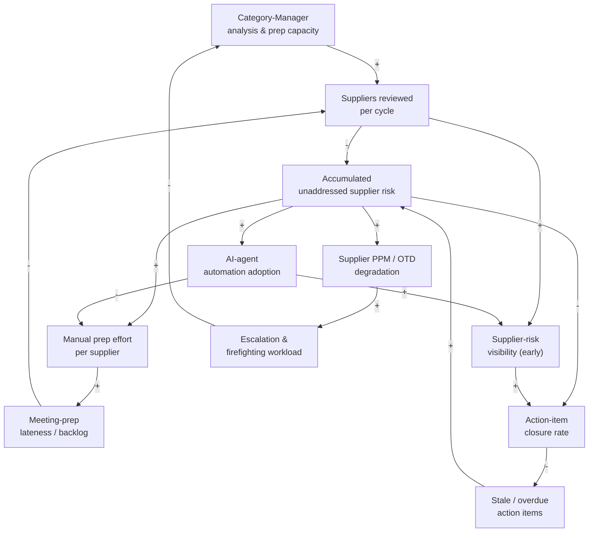

Three **reinforcing vicious loops** drive the pain:

- **R1, the Firefighting Death Spiral:** accumulated risk → defects → escalation → *less* capacity → fewer reviews → *more* accumulated risk. Escalation draws on the same finite pool of hours as proactive prep.
- **R2, the Prep-Debt Spiral:** higher-risk suppliers need more hand-assembled prep exactly when the backlog is largest. Late reviews mean staler data and more rework next time.
- **R3, Stale-Action Erosion:** at ~18% closure, the corrective actions that would bleed off risk go stale. That raises risk, which crowds out attention for closing *other* actions.

Against these stands one **balancing control loop, B1 (Review-Controls-Risk)**, which is what the whole SPR process is *for*: review → early visibility → corrective action → less risk. The trouble is that **B1 is choked by a capacity throttle (B2)**: 3 managers, 10 suppliers, recurring cycles. The intervention introduces **B3 (Automation Relief)**, which cuts prep effort and raises visibility *without* consuming manager hours.

> **Sign check** (edge by edge, as drawn): the review → visibility → closure path closes through `Escalation −→ CMcap` with two minus signs, so it is R1/R3 running in their *virtuous* direction, not a separate goal-seeking loop. The only loops that close with an odd count are the **adoption loops (B3)**. Read the diagram this way: without the intervention, nothing in the drawn structure brakes the spirals. B1 is the *intended* control loop, and its gap-to-goal ("reviews due vs done") is implicit. Drawing it explicitly is a good workshop exercise.

**Systemic insight:** the vicious loops out-run the one corrective loop *because that loop is capacity-limited*. The highest-leverage move is not "faster meetings". It is raising the **gain** of the capacity loop so the control loop can finally outpace the spirals.

### 9.3 Lens 2 — Stock & Flow

| Stock | Inflow (rate) | Outflow (rate) | Units |
|---|---|---|---|
| Unreviewed Suppliers | new cycle starts | review completion `r_rev` | suppliers |
| Meeting-Prep Backlog | prep requests | prep completion `r_prep` | prep-jobs |
| Accumulated Supplier Risk | risk accrual `r_in` | risk mitigation `r_mit` | risk-units |
| Open Action Items | action creation `r_open` | action closure `r_close` | items |

Accumulated risk is the integral of (`r_in` − `r_mit`). You can't reverse it by exhortation, only by **bending the rates**. The solution raises `r_rev` and `r_prep` (automated KPI pull + prep draft), raises `r_mit` and `r_close` (surfaced, chased actions), and lowers effective `r_in` (earlier detection). Because the stock responds to the *integral* of the gap, reversing the trend means moving several rates at once.

### 9.4 Lens 3 — Theory of Constraints

| Step | Manual hours/supplier | Capacity-limiting? |
|---|---|---|
| Pull KPI data | ~1.0 | no (data is available) |
| Analyse trend | ~1.0 | contributes |
| **Prepare meeting draft** | **~2.0** | **← the constraint** |
| Conduct meeting | ~1.0 | no (fixed slot) |
| Summarise | ~0.5 | contributes |
| Track actions | ongoing | downstream |

1. **Identify:** the constraint is **not** data availability or meeting slots, because the risk is already visible. It is the **judgement-heavy prep/draft step** (~2.0 h/supplier), which gates how many suppliers get a quality review per cycle.
2. **Exploit:** standardise prep, triage High-risk suppliers first, and stop re-pulling the same data.
3. **Subordinate:** align cadence and data refresh to the prep step's pace.
4. **Elevate:** automated KPI pull + draft cuts the full review from **~5.5 h → ~1.5 h/supplier**.
5. **Repeat:** once prep is cheap, the constraint **migrates to action-item closure** (the ~18% rate). If the freed hours aren't redeployed to chasing the 75 open actions, throughput under-delivers. *This migration is the most important output of the analysis.*

### 9.5 Lens 4 — Throughput Accounting

> Full model: [`analysis/throughput-accounting.md`](https://github.com/jayanthbagare/PBC2.0/blob/main/usecases/uc_1/analysis/throughput-accounting.md), with 13 explicitly labelled assumptions.

Grounded in real counts (10 suppliers, 3 managers, 120 targeted reviews/yr, 91 action items):

| Metric | Before (manual) | After (AI) | **Δ** |
|---|---|---|---|
| **T** — risk value mitigated/yr | €277,200 | €453,600 | **+€176,400** |
| **OE** — process cost/yr | €27,225 | €27,366 | **+€141** |
| **I** — unmitigated-risk WIP tied up | €562,800 | €386,400 | **−€176,400** |
| Open action items (WIP count) | 75 | ~30 | **−45** |
| Reviews completed at quality/yr | 66 | 108 | **+42** |
| **Net Profit = T − OE** | €249,975 | €426,234 | **+€176,259** |

**ROI ≈ €176,259 ÷ €15,216 incremental spend ≈ 11.6× in year one.**

**The lesson in one line:** OE barely moves (+€141). This is a **throughput amplifier**, not a cost-saver: it reallocates the *same* manager hours from data-wrangling to risk-mitigating reviews. The result survives a 4× swing in the key assumption (the value of an unmitigated High-risk supplier-year), and the sign never flips.

### 9.6 Automation vs Agentic — An Honest Assessment

| Step | Nature | Throughput contribution | Build effort | Build priority |
|---|---|---|---|---|
| Pull KPIs, trends, action items | **Automation** | enables T (no direct Δ) | Low | **Do first** (cheap, unblocks everything) |
| Flag vs thresholds; risk-rank | **Automation** | enables triage (subordinate step) | Low | **Do first** |
| Draft meeting agendas / talking points / risk narratives | **Agentic** | **the bulk of ΔT ≈ +€176k/yr** | Medium | **Highest value — the reason to build** |
| Summarise meetings into follow-ups | **Agentic** | lifts action closure (R3) → protects T | Medium | High |

**Effort decision.** ΔT ≈ **+€176k/yr**, ΔOE ≈ **+€141** (flat), ROI ≈ **11.6×**. Almost all of the prize sits on the two *agentic* rows, the generation steps. The automation rows are cheap plumbing that merely *enable* them. So the build order is clear: stand up the deterministic data layer quickly, then put the real engineering into prep/summary **generation**. That is where the throughput lives, and therefore where an LLM is justified.

**Break-even.** At €35k ARR × 5 customers over 18 months and ~€44k/dev loaded (SAP Labs India; both *stated assumptions*), the sustainable team is **~2.4–3.6 developers**. UC-1's hybrid build needs **~2** (one on the data/automation layer, one on the agentic nub), so it **clears break-even at a 2-developer team**.

**Verdict: Hybrid, leaning agentic.** The data layer is automation and should stay deterministic. UC-1's *value*, the reason it earns an LLM at all, is the generation step: no rules engine writes a good talking point.

### 9.7 Solution Design

The analysis dictates the design. The agent must **attack the prep constraint** and **surface stale actions** (the migration). Both patterns expose the same six tools, and the skill-based version adds a seventh.

| Tool | Layer | Elevates… |
|---|---|---|
| `list_suppliers` | automation | triage (subordinate capacity to High-risk first) |
| `get_supplier_details` | automation | prep step (data) |
| `get_kpi_trend` | automation | analysis step (data) |
| `prepare_meeting_draft` | **agentic** | **the constraint** (prep/draft) |
| `get_action_items` | automation | R3 / action closure, **the migrated constraint** |
| `get_meeting_summary` | **agentic** | summarise step |
| `record_meeting_notes` *(skill-based only)* | automation | conduct → close the loop |

- **Code-based** ([`agent_code_based.py`](https://github.com/jayanthbagare/PBC2.0/blob/main/usecases/uc_1/agent_code_based.py)): manual loop with explicit tool dispatch. Best when you want approval gates before a draft is shown to a supplier.
- **Skill-based** ([`agent_skill_based.py`](https://github.com/jayanthbagare/PBC2.0/blob/main/usecases/uc_1/agent_skill_based.py)): `SkillRegistry` dispatch; you add a capability by registering one `skill_*()` function. Supports the end-to-end `full_workflow` task.

### 9.8 Run It Yourself

```bash
cd usecases/uc_1
python generate_synthetic_data.py                 # no API key needed
python agent_code_based.py --task dashboard        # risk-ranked triage (the "subordinate" step)
python agent_code_based.py --task at_risk          # deep-dive the 7 High-risk suppliers
python agent_code_based.py --task prepare --supplier "Bosch Rexroth AG"   # elevate the constraint
python agent_skill_based.py --task full_workflow --supplier "Parker Hannifin Corp"
python test_agents.py --category unit              # ~100 tests, no API key
```

**Watch for:** the `prepare` task doing in seconds the ~2.0 h/supplier step that the ToC analysis named as the constraint. That is the elevate move, made concrete.

---

## Chapter 10 — Faster Technical Customer Report (8D)

> **Project:** [`usecases/uc_2/`](https://github.com/jayanthbagare/PBC2.0/tree/main/usecases/uc_2) · **Analysis:** [`uc_2/analysis/`](https://github.com/jayanthbagare/PBC2.0/tree/main/usecases/uc_2/analysis) · **Domain:** Quality Management · **Dataset:** 40 complaints (10 SINGLE, 6 MASTER, 16 REPEAT, 8 CA_FAILURE), 8 master issues, 8 Q2 + 8 Q3 investigations

### 10.1 The Problem

Danfoss receives customer complaints (**FC records**) about compressors. Each must be **classified** (SINGLE / MASTER / REPEAT / CA_FAILURE), **investigated** by pulling internal (Q3) and supplier (Q2) investigations from QIR Cloud, and **reported** back as an 8D Technical Customer Report (D1–D8). Done manually, this takes **days**.

Mean `days_to_root_cause` is ≈ **45 days** (range 21–87), and warranty exposure is ≈ **€257k** across the masters. In the data, the symptom, root cause and corrective action are deliberately *decoupled*: the agent must reason, not pattern-match an index.

### 10.2 Lens 1 — Causal Loop Diagram

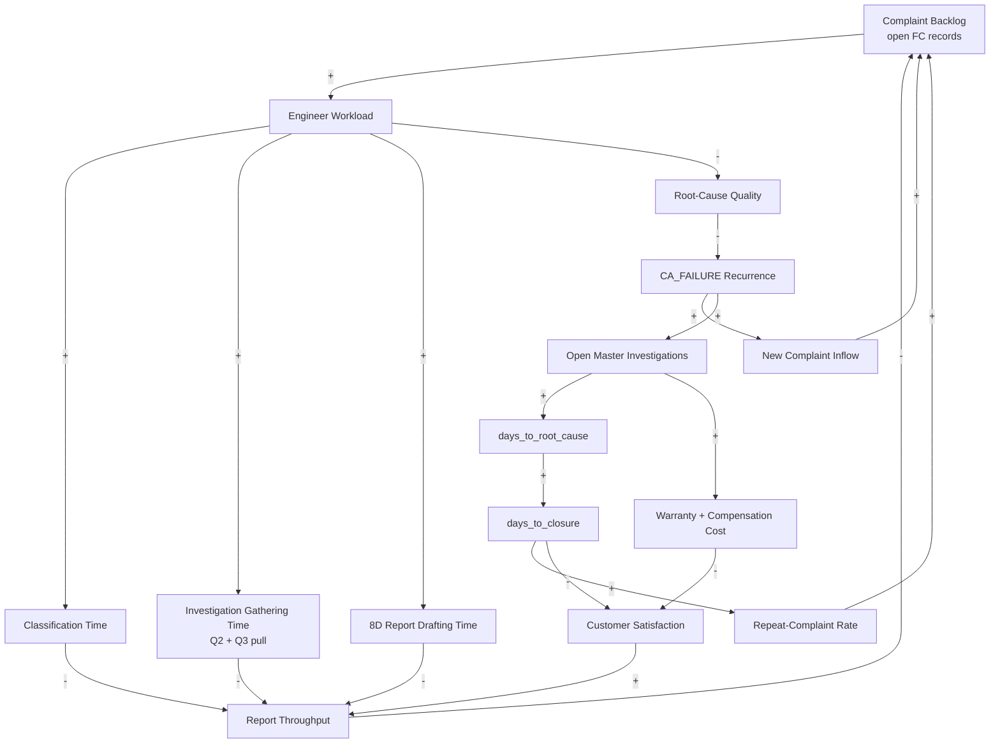

- **R1, Backlog Overload (reinforcing):** more backlog → engineers spread thinner → slower classify/gather/draft → lower throughput → more backlog.
- **R2, Rushed Root Cause → CA Failure (reinforcing, and the dangerous one):** overload → weaker 5-Why rigour → corrective actions that don't hold → **CA_FAILURE** recurrence → new masters and complaints → more backlog. Its damage is *hidden* because it surfaces only after `clean_date`.
- **B1, Closure Drains Repeats (balancing, long delay):** closing a master removes the condition producing repeats, but only after `days_to_root_cause` (~45 d) plus validation. While a master is open, every match lands as a REPEAT.
- **B2, Satisfaction / Warranty Pressure (balancing, lagging):** slow closures and warranty cost erode satisfaction, which *eventually* forces resourcing.

> **Sign check** (edge by edge, as drawn): all seven loops in this diagram close with an *even* number of minus signs, so B1 and B2 are reinforcing *as drawn*. B1 needs an explicit `master closed −→ REPEAT inflow` edge to become balancing, and B2 needs a `satisfaction pressure −→ engineer workload` (resourcing) edge. The text describes both; the diagram omits them. The finding sharpens the insight below: in the structure as it stands, *nothing* brakes the backlog. That makes the decision-model abstention gate (§10.7.1) a designed balancing loop.

**Systemic insight:** the vicious loops act *immediately*, while the stabilising loops correct only after long root-cause and closure delays. So **backlog growth is the system's default behaviour.** The fix is to attack the *fast* edges, classification time and drafting time, where a small cut compounds.

### 10.3 Lens 2 — Stock & Flow

| Stock | Inflow | Outflow | Units |
|---|---|---|---|
| Open Complaints Backlog | new FC inflow + repeat re-inflow | classification + close `f2` | complaints |
| Open Master Investigations | master opened | master closed | investigations |
| Unclosed 8D Reports | report started | report completed `f4` | reports |
| Accumulated Warranty Cost Exposure | exposure accrual | closure drains exposure | € |

The pipeline is a **series chain**: complaints → classification → investigation gathering → drafting → closure. The solution doesn't change the chain's *structure*. It is a **rate multiplier** on three flows: `f2` classify, `f3` gather, `f4` draft. Because the stocks are in series, speeding those flows lowers *all* downstream WIP **and** shrinks warranty exposure and the repeat re-inflow.

### 10.4 Lens 3 — Theory of Constraints

| Pipeline stage | Nature | Lead time |
|---|---|---|
| Classify | engineer labour | hours |
| Gather Q2 + Q3 from QIR Cloud | engineer labour | hours |
| **Draft 8D report (D1–D8)** | **engineer labour** | **longest sub-step** |
| Confirm root cause (lab) | physical | ~45 d, but *parallel* |
| Close master | validation | days |

1. **Identify:** the constraint is **quality-engineer labour** concentrated in classify + gather + draft (~8 h/report), with **drafting the single longest sub-step**. The long physical `days_to_root_cause` is *not* the constraint, because it runs in parallel across masters.
2. **Exploit → Subordinate → Elevate:** the solution compresses the ~8 h labour step to ~0.6 h, a capacity gain of roughly **13×** (187 → 2,500 reports per engineer-year).
3. **Repeat:** once labour is elevated, the **next** constraint is the physical root-cause/lab time. That is a different kind of constraint, and no amount of drafting speed can fix it.

### 10.5 Lens 4 — Throughput Accounting

> Full model: [`analysis/throughput-accounting.md`](https://github.com/jayanthbagare/PBC2.0/blob/main/usecases/uc_2/analysis/throughput-accounting.md), with 12 labelled assumptions. The key ones are: 8.0 h → 0.6 h per report at €75/h; 480 reports/yr (A7: the 40-complaint dataset treated as one month × 12); €1,200 value per on-time report; a 12% warranty/repeat reduction.

| Metric | Before (manual) | After (AI) | **Δ (annual)** |
|---|---|---|---|
| **OE**, engineer labour + tooling | €288,000 | €27,792 | **−€260,208** (−90%) |
| **T**, report value (on time 70% → 98%) | €403,200 | €564,480 | **+€161,280** |
| **T**, avoided warranty/repeat cost | — | — | **+€370,493** |
| **I**, WIP tied up in open reports | €38,400 | €3,840 | **−€34,560** (carrying saving €5,184/yr) |
| **Net gain (ΔT + ΔOE saved + carry)** | — | — | **≈ +€797k/yr** |
| Net gain **excluding** warranty | — | — | **≈ +€426k/yr** |

**ROI ≈ 28.7× on the full model, and ≈ 9.4× on OE alone** (€260,208 ÷ €27,792). The case is positive **even if the warranty benefit is zero.** Unlike UC-1, where OE was flat, here OE *does* fall ~90% because the manual step was so labour-heavy. The largest *and softest* term is avoided warranty cost: at a 4% reduction it falls to ~€123k, and at 20% it rises to ~€617k.

**Honest caveats.** (1) The stored `days_to_closure` fields are negative, a synthetic-data artifact, so closure improvement is modelled from `days_to_root_cause` instead. (2) If the dataset actually spans the ~6 months shown in receipt dates, annual volume is nearer 80 than 480. That scales all absolute figures down ~6× but leaves the ROI *ratios* unchanged.

### 10.6 Automation vs Agentic — An Honest Assessment

The three steps of the 8D pipeline are three *different kinds* of problem, and only one of them needs a generative LLM.

| Step | Nature | Throughput contribution | Build effort | Build priority |
|---|---|---|---|---|
| Classify SINGLE / MASTER / REPEAT / CA_FAILURE | **Decision model** (not an LLM) | gates the OE collapse + protects T (fewer CA failures) | Low–Med (adopt Laya/Decision-1) | **High — small spend, large leverage** |
| Retrieve master / Q2 / Q3 records | **Automation** | enables T (no direct Δ) | Low | **Do first** (prerequisite plumbing) |
| Draft the 8D report (D1–D8, portal prose) | **Agentic** | the OE collapse + report-speed value | Medium | **Highest value — the generative nub** |

**Effort decision.** The money splits across two layers, not one. A *cheap* decision model unlocks the OE collapse and dampens the dangerous CA-failure loop, while the *agentic* drafting step captures the report-speed and quality value. The retrieval row is nearly free and merely enables the rest. So fund the decision model early (highest leverage per euro) and make the drafting agent the main build. Don't waste effort "agentifying" the retrieval.

**Break-even.** Under the same Danfoss assumptions (€35k ARR × 5, 18 months, ~€44k/dev), the sustainable team is **~2.4–3.6 devs**. UC-2 needs **~2–2.5**: automation, plus a *part-time* decision-model integration that you adopt rather than train, plus the drafting agent. It **clears break-even at ~2–2.5 developers**.

**Verdict: Hybrid. This is the most interesting Danfoss case because it needs all three model classes.** Classification is a typed choice routed to a decision model. Gathering is pure automation. The one irreducibly **agentic** step is drafting. "Put an agent on it" is the wrong instinct; break the work down instead.

### 10.7 Solution Design

| Tool / layer | Layer | Attacks… |
|---|---|---|
| Decision model (Laya / Decision-1) | **decision** | classification (R1 fast edge) with calibrated confidence + abstention |
| `search_complaints_by_symptom` / `find_similar_issues` / `list_all_master_ids` | automation | the evidence the classifier/agent reasons over |
| `get_master_issue` | automation | investigation gathering (`f3`) |
| `get_q2_investigation` / `get_q3_investigation` | automation | the two-source QIR Cloud pull (`f3`) |
| 8D report drafting | **agentic** | the generative nub: portal-correct D1–D8 prose |

- **Code-based** ([`agents/complaint_agent.py`](https://github.com/jayanthbagare/PBC2.0/blob/main/usecases/uc_2/agents/complaint_agent.py)): hybrid by default. The decision model classifies first, then the agent investigates and drafts. Results are **scored against ground truth** (`--all --sample N`), which makes this the best case for *measuring* accuracy. `--no-classifier` runs the legacy all-LLM path.
- **Skill-based** ([`skills/8d-complaint.md`](https://github.com/jayanthbagare/PBC2.0/blob/main/usecases/uc_2/skills/8d-complaint.md)): a *declarative spec*. Claude Code follows a decision tree and reads the JSON directly, with no running loop.

#### 10.7.1 Sharpening the classify step with a decision model

The original agent classified by having the LLM write text and then scanning that text for a keyword. UC-2's own technical guide flags this as brittle: no structured output, no confidence, easy to fool. Classifying an FC into one of four classes is a **typed choice over fixed options**, exactly what [Chapter 5](#chapter-5--understanding-decision-models) introduced.

| Step | Nature | Best tool |
|---|---|---|
| Classify (SINGLE / MASTER / REPEAT / CA_FAILURE) | typed choice | **decision model** |
| Gather Q2 / Q3 from QIR Cloud | retrieval / tool use | automation (called by the agent) |
| Draft the 8D report (D1–D8) | long-form generation | Anthropic agent |

This buys three things the keyword scan cannot: **structured output**, a **calibrated confidence**, and, most important for the systems story, **abstention**. A model that *refuses to guess* on ambiguous REPEAT-vs-CA_FAILURE cases turns a silent wrong guess into an explicit, flagged escalation. That attacks loop **R2** at its source instead of its symptom.

**This is wired into the agent, not bolted on.** `complaint_agent.py` calls the decision model first, then gives the agent a system prompt that says *"the classification is already made — do not re-classify; investigate and draft."* If the decision model abstained, the agent opens its report with a `LOW CONFIDENCE — HUMAN REVIEW REQUIRED` banner. The pluggable classifier (a real `LayaBackend` plus a dependency-free offline `HeuristicBackend`) benchmarks itself against UC-2's ground-truth labels. It reports overall accuracy, *auto-processed* accuracy and abstention rate, so the confidence gate works as a dial. The full design, and an honest account of what the offline prototype does and does not prove, is in [`analysis/decision-model-architecture.md`](https://github.com/jayanthbagare/PBC2.0/blob/main/usecases/uc_2/analysis/decision-model-architecture.md).

> **The lesson in method terms:** the ToC analysis said classification is a *fast reinforcing-loop edge*. A decision model doesn't just make that edge faster. It adds *calibrated doubt*, which is what actually dampens the dangerous loop.

### 10.8 Run It Yourself

```bash
cd usecases/uc_2
python generate_data.py                      # creates data/ (seed 42, reproducible)
python agents/validate_data.py               # structural validation, no API calls
python agents/complaint_agent.py --fc FC-0E64D259     # hybrid: decision model classifies, agent drafts
python agents/complaint_agent.py --fc FC-0E64D259 --no-classifier   # legacy all-LLM path
python agents/complaint_agent.py --all --sample 5     # batch + accuracy + abstention vs ground truth
python agents/complaint_agent.py --all --sample 5 --threshold 0.8   # stricter gate → more human-review flags
python agents/decision_classifier.py --benchmark      # the classifier alone, scored offline
pytest tests/ -v                             # tests, no API key
# Skill-based, inside Claude Code:  /8d-complaint random
```

**Watch for:** the **decision model classifying before the agent speaks**. Then raise `--threshold` and watch complaints get flagged `⚠ABSTAIN → HUMAN REVIEW`: the system choosing to escalate rather than guess.

---

## Chapter 11 — UK Customs Clearance Declaration

> **Project:** [`usecases/uc_3/`](https://github.com/jayanthbagare/PBC2.0/tree/main/usecases/uc_3) · **Analysis:** [`uc_3/analysis/`](https://github.com/jayanthbagare/PBC2.0/tree/main/usecases/uc_3/analysis) · **Domain:** Supply Chain / Logistics · **Dataset:** ~89 shipments, ~405 deliveries over 30 days, ~353 CDS rows, 62 validation issues

### 11.1 The Problem

Post-Brexit, every Danfoss shipment from Denmark to the UK needs import customs clearance. Danfoss's UK GS Back Office team produces a **daily** UK Customs Clearance Declaration Preparation Report for DSV, its customs broker and carrier. Today the work is **fully manual, every working day**. The team merges two SAP sources (GTS export + CDS View) joined on `delivery_number`, validates against four business rules, flags criticals, and produces a DSV-ready report.

The dataset averages **~13.5 lines/day**. Its ~353 CDS rows have gaps that are *clustered* by plant and category. There are **62 validation issues** (52 EORI_MISSING, 7 LICENCE_MISSING, 3 malformed HS codes). A report is **READY TO SUBMIT** only when `critical_count == 0`. The pain: the manual merge is error-prone, delays block clearance and transport, and the task is pure rule-based consolidation with *no added value*.

### 11.2 Lens 1 — Causal Loop Diagram

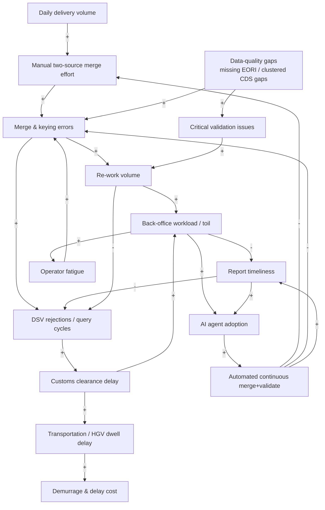

- **R1, the Merge-Error / Fatigue Death Spiral (reinforcing):** manual merge → errors → rework → workload → fatigue → *more* errors. The clustered CDS gaps feed it constantly, because the operator can't tell a "legitimately absent row" from "I missed the join" without manual cross-checking.
- **R2, the Rejection → Delay → Late-Report Spiral (reinforcing):** errors → DSV rejections → clearance delay → workload → *worse* timeliness → more rejections. A defect missed before the daily cut-off costs about a full working day.
- **B1, the Validation Gate (balancing):** the four rules catch defects before submission, but the gate's strength is capped by human capacity and weakens exactly when overload is highest.
- **B2, Automation Relief (balancing, the intervention):** continuous merge+validate → fewer errors, better timeliness → more trust → more adoption.

**Systemic insight:** two reinforcing spirals run against a single, capacity-limited **once-daily batch**, and the batch cannot out-run them. The deepest lever is **not "merge faster"**. It is *collapsing the batch delay* and *decoupling rework from the production team*.

### 11.3 Lens 2 — Stock & Flow

| Stock | Inflow | Outflow | Units |
|---|---|---|---|
| Unmerged Deliveries Backlog | daily delivery arrivals (~13.5/day) | merge rate `f2` | deliveries |
| Open Validation Issues | issues flagged `f4` | issues resolved | issues |
| Shipments Awaiting Clearance | merged & submitted | DSV clearance | shipments |
| Rejected / Reworked Lines | DSV rejection `f7` | rework completion | lines |

The manual process is a **once-daily batch valve**. Inflow is continuous (~13.5 lines/day) but drains in a single evening pulse, so a backlog is *structurally guaranteed*, independent of operator skill. The value lies almost entirely in **`f2` (batch → continuous)**, plus shifting defect detection from **`f7` (external DSV rejection)** to **`f4` (internal flag)**.

### 11.4 Lens 3 — Theory of Constraints

| Pipeline stage | Nature | Constraint? |
|---|---|---|
| Fetch GTS rows | automatable | no |
| Fetch CDS rows | automatable | no |
| **Manual merge + validate (once/day, one team)** | **human batch** | **← the constraint** |
| Submit to DSV | handoff | no |
| Clear customs | external (DSV/HMRC) | downstream |

1. **Identify:** the binding constraint is **one Back-Office team doing the manual merge+validate once per day.** The *hidden* throttle is the **batch cadence itself**, the daily quantisation, not just the per-line effort.
2. **Exploit → Subordinate:** run the merge as early as the data allows, and triage the 62 criticals.
3. **Elevate:** move to **near-continuous processing** instead of a once-daily pulse. This is about *cadence*, not speed.
4. **Repeat:** the constraint then **migrates upstream to SAP CDS data quality**: 18 of 30 report-days are blocked by missing CDS rows. *The win only locks in if Danfoss then fixes the source gaps.*

### 11.5 Lens 4 — Throughput Accounting

> Full model: [`analysis/throughput-accounting.md`](https://github.com/jayanthbagare/PBC2.0/blob/main/usecases/uc_3/analysis/throughput-accounting.md), in GBP.

| Metric | Before (manual) | After | **Δ** |
|---|---|---|---|
| **OE**, analyst hours/mo | 94.8 h | 21.5 h (−77%) | **≈ −£2,788/mo** |
| **T**, delay value recovered | baseline | — | **≈ +£2,250/mo** |
| **I**, avg WIP (cash-cycle) | high | low | **≈ −£3.94M** |
| **ΔNet** | — | — | **≈ +£5,038/mo** |

**ROI ≈ 3.4×, payback ≈ 1.2 months.** Crucially, the **labour saving alone** (−£2,788 against ~£1,480 spend) justifies the change *even if the softer delay-cost estimates are wrong*, so the sign never flips. Unlike UC-1, OE *is* the clear win here, because the manual task was pure, repetitive consolidation: the textbook profile for automation.

### 11.6 Automation vs Agentic — An Honest Assessment

Be blunt: **UC-3 is automation, not an agentic problem.** The test, *could you write this step as a correct, testable function with no LLM?*, comes out "yes" for every step.

| Step | Nature | Throughput contribution | Build effort | Build priority |
|---|---|---|---|---|
| Fetch GTS rows / fetch CDS rows | **Automation** | enables T | Low | Do (plain code) |
| Merge on `delivery_number` | **Automation** | **ΔOE −£2.8k/mo** (−77% analyst hrs) | Low | **Do (plain code)** |
| Validate the 4 rules | **Automation** | shifts defects to internal flag → delay value | Low | Do (plain code) |
| Produce the DSV report | **Automation** | timeliness | Low | Do (plain code) |
| *Investigate clustered CDS gaps* | analysis (lightly agentic) | attacks the **next** constraint (18/30 blocked days) | Medium | **Where any AI effort belongs** |

**Effort decision.** Every row that earns the money is **automation**: a scheduled script captures the entire prize at low effort. Spending LLM-agent effort on the consolidation would add cost and non-determinism for **zero extra throughput**. The only row worth AI effort is the data-quality investigation, the migrated constraint, and even that is analysis rather than autonomous agency.

**Break-even.** Against the same ~2.4–3.6-dev sustainable team, UC-3's build needs **~1 developer**. That is the widest margin of the three, so it breaks even first.

**Verdict: Automation.** There is no ambiguity to reason over and no prose to generate. In the repo's own words, it is *"pure rule-based data consolidation... no added value."* A deterministic scheduled job is the **correct** production architecture: faster, cheaper, auditable, and *repeatable*, which an LLM is not. Repeatability is vital for customs compliance.

### 11.7 Solution Design

UC-3 ships as an agent for teaching contrast, but the honest production design is a deterministic pipeline. All eight tools are automation, and the agent framing simply lets you drive and verify them conversationally:

| Tool | Layer | Role |
|---|---|---|
| `list_available_dates` | automation | orient |
| `get_gts_declarations` | automation | fetch source 1 (SAP P53) |
| `get_cds_view_data` | automation | fetch source 2 (CDS supplementary) |
| `merge_and_build_report` | automation | **the constraint**: the two-source join on `delivery_number` |
| `validate_report` | automation | the B1 validation gate (4 rules) |
| `get_shipment_details` | automation | drill-down |
| `get_open_issues_summary` | automation → **analysis** | **surface clustered gaps** → attack the *next* constraint |
| `export_dsv_report` | automation | DSV-ready output |

- **Code-based** ([`agent_code_based.py`](https://github.com/jayanthbagare/PBC2.0/blob/main/usecases/uc_3/agent_code_based.py)): manual loop with `max_iterations=15`. It always states READY TO SUBMIT vs BLOCKED and flags criticals in ALL CAPS.
- **Skill-based** ([`agent_skill_based.py`](https://github.com/jayanthbagare/PBC2.0/blob/main/usecases/uc_3/agent_skill_based.py) + [`SKILL.md`](https://github.com/jayanthbagare/PBC2.0/blob/main/usecases/uc_3/.claude/skills/customs-clearance/SKILL.md)): a **tool server** (stdin/stdout JSON) decouples the skill from the Python backend. A `--verify` harness proves tool correctness *with no API key* before the skill is trusted.

> **Design takeaway:** for production, implement UC-3 as plain scheduled code and point any AI effort at the data-quality investigation, not the consolidation.

### 11.8 Run It Yourself

```bash
cd usecases/uc_3
python generate_synthetic_data.py                     # 7 JSON files, seed 42, ~30s
python agent_code_based.py --task today               # full report for latest date
python agent_code_based.py --task validate --date 2025-10-31   # ready-to-submit check
python agent_code_based.py --task issues              # cross-date gap summary (the NEXT constraint)
python agent_skill_based.py --verify                  # 29 correctness tests, NO API key
# Skill-based, inside Claude Code:  /customs-clearance 2025-10-31
```

**Watch for:** `--task issues`. It surfaces the clustered CDS gaps, pointing at the constraint that *migrates upstream* once the merge is automated. That is ToC Step 5 (Repeat) in action.

---

# Part III — Crestmount Refinery: Maintenance Planning

> **Source:** [`jayanthbagare/synthetic_oil_gas`](https://github.com/jayanthbagare/synthetic_oil_gas). A seed-42 synthetic refinery dataset (14-table SQLite DB), a reference agent pipeline with an evaluation harness, and a Streamlit bottleneck dashboard. Every number in this part is computed from the generated database and the evaluation harness; [§13.8](#138-run-it--reproduce-the-figures) shows how to reproduce them.

## Chapter 12 — Meet Crestmount Refinery

Crestmount is a fictional mid-sized refinery in West Texas, processing ~100,000 barrels/day at design capacity. The dataset mean is **89,675 bbl/day** across 730 days; the gap is derates, turnarounds and unplanned downtime. It runs **500 physical assets** across process units, tiered by criticality:

| Tier | Assets | Share | Meaning |
|---|---|---|---|
| T1 | 25 | 5.0% | Plant-stopping; 24 h SLA |
| T2 | 74 | 14.8% | Unit-stopping |
| T3 | 120 | 24.0% | Significant |
| T4 | 163 | 32.6% | Routine |
| T5 | 118 | 23.6% | Cosmetic / deferrable |

The maintenance organisation is paced by a **planning team of six**. Notifications about asset problems arrive from four sources: operators (4,894), sensors (3,506), inspection rounds (2,417) and predictive models (1,183). A planner must triage each one, classify it, scope the work, identify parts, crew skills and permits, then draft and release a work order. That judgement work is the subject of this part.

The dataset spans **24 months** (2024-10-14 → 2026-10-13): 12,000 notifications, 8,565 work orders, 1,200 failure events, 940 sensors with 676,800 hourly readings, a 1,581-edge P&ID connectivity graph, and daily weather and production. Two columns, `ground_truth_severity` and `ground_truth_category`, hold the *actual* answers and are reserved for evaluation only. The observed fields disagree with ground truth **12.5%** of the time. That noise is the problem made visible.

> **The workshop brief vs the data.** The workshop README dramatises the scene ("~1,900 notifications/week", "backlog growing ~600/week"). The *dataset* tells a quieter and more interesting story: inflow is ~154/week against a nameplate capacity of 1,260/week. This part follows the data, and the gap between the two stories is itself the lesson of [§13.1](#131-the-problem).

---

## Chapter 13 — The Planner Bottleneck

> **Project:** [`synthetic_oil_gas`](https://github.com/jayanthbagare/synthetic_oil_gas) · **Domain:** Refinery maintenance planning · **Dataset:** 12,000 notifications · 8,565 work orders · 1,200 failures · 500 assets · 6 planners · 676,800 sensor readings (seed 42)

### 13.1 The Problem

Crestmount's maintenance pipeline is paced by six planners doing cognitively intensive triage-and-scope work. Notifications arrive at **~154/week** (2,000 raised in the trailing 90 days). Together the planners have a nameplate capacity of **252 notifications/day → 1,260/week**, at ~20–25 minutes each. On paper, capacity (1,260) dwarfs inflow (154). So why is the backlog **1,866 open**, with the oldest item **90 days** old and **15 tier-1 criticals** aging past their 24-hour SLA?

Because nameplate capacity is not *effective* capacity. 12.5% of notifications carry the wrong observed severity. 12.0% are false positives and 5.2% are duplicates, and both consume judgement before being rejected. And the planner's real time sink is *context-gathering*, not deciding. The constraint is not throughput of easy items. It is the planner's attention on the *hard and critical* ones, and that attention is being spent on noise. Rolling-12-month unplanned downtime cost is **$24.1M** (1,200 events over 24 months total **$46.96M**), and a material slice of it traces to criticals that aged in this very queue.

| Metric | Value | Source |
|---|---|---|
| Open backlog (open + in_review) | 1,866 | `notifications.status` |
| Oldest open item | 89.9 days | `MAX(now − raised_at)` |
| Tier-1 criticals in backlog | 15 | join `assets` |
| Tier-2 criticals in backlog | 342 | join `assets` |
| Avg planning time / item | 24.9 min (median 20.1) | `planning_duration_minutes` |
| Planner weekly capacity | 1,260 | 6 planners × 252/day ÷ wk |
| Weekly inflow | ~154 | last-90-day raise rate |
| Observed ≠ ground-truth severity | 12.5% | eval columns |
| False positives / duplicates | 12.0% / 5.2% | terminal statuses |
| Rolling-12mo downtime cost | $24.1M | `failure_events` |
| Implied downtime cost | $9,376 / hour | cost ÷ hours |

### 13.2 Lens 1 — Causal Loop Diagram

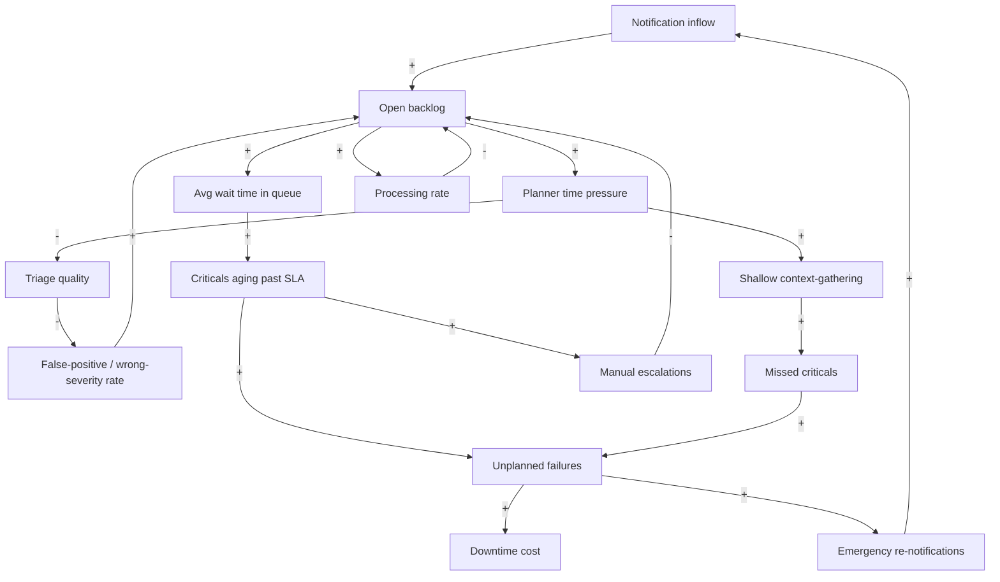

- **R1, the rework spiral (reinforcing).** `INFLOW → + QUEUE → + WAIT → + AGING → + FAIL → + REWORK → + INFLOW`. Zero minus signs, so the loop is reinforcing. Every critical that ages into a failure generates *new* emergency notifications, which lengthen the very queue that caused the failure. This is the dominant vicious loop.
- **R2, the quality collapse (reinforcing).** `QUEUE → + PRESSURE → − QUALITY → − FALSEPOS → + QUEUE`. Two minus signs, so reinforcing. A fuller queue pressures planners and degrades triage quality, which *raises* the false-positive and wrong-severity rate and feeds more junk back into the queue. The backlog manufactures its own noise.
- **R3, the missed-critical spiral (reinforcing).** `QUEUE → + PRESSURE → + SHORTCUT → + MISSCRIT → + FAIL → + REWORK → + INFLOW → + QUEUE`. Pressure forces shallow context-gathering, shallow gathering misses the subtle criticals, and those become the expensive failures. This is the costliest loop in dollars.
- **B1, the processing drain (balancing).** `QUEUE → + PROC → − QUEUE`. The planners draining the queue are the system's primary corrective. That drain is **capacity-limited**, and its gain is sapped by R2 (noise it must process) and R3 (depth it can't afford).
- **B2, the escalation relief valve (balancing).** `AGING → + ESCALATE → − QUEUE`. Manual escalation pulls aged criticals forward, but it is reactive, fires only after aging, and steals capacity from B1.

**Delays** (`||`): between `AGING` and `FAIL` (criticals don't fail the day they age; they fail weeks later), and between `PROC` and queue relief. The cost of a shortcut shows up long after the shortcut was taken, so the feedback that should discipline it arrives too late.

**Leverage points** (Meadows, strongest first):
1. **Reduce the gain of R2/R3 by filtering noise *before* the planner.** Strip the 17.2% false-positive-plus-duplicate load and correct the 12.5% severity noise. This is a structural change to information flow.
2. **Shorten the context-gathering delay.** A pre-assembled brief turns R3's "shortcut" into "informed in 30 seconds".
3. **Raise B1's effective gain** by returning planner minutes lost to noise and gathering, not by hiring.

**Systemic insight:** the backlog is not an inflow problem (154 ≪ 1,260). It is a *noise-and-depth* problem. R2 and R3 drag the planner's effective capacity far below nameplate, and the delays hide the damage.

### 13.3 Lens 2 — Stock & Flow

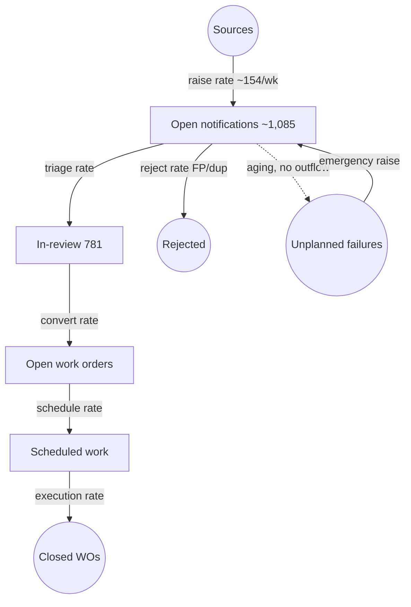

| Stock | Inflow(s) | Outflow(s) | Units |
|---|---|---|---|
| Open notifications (with in-review: 1,866) | Source raise rate (~154/wk) + emergency re-raises | Triage rate (→ in-review), reject rate (→ FP/dup) | notifications |
| In-review | Triage rate | Convert rate (→ WO), reject rate | notifications |
| Open work orders | Convert rate | Schedule rate | work orders |
| Scheduled work | Schedule rate | Execution rate | work orders |
| (Leak) Unplanned failures | Aging of un-triaged criticals | Emergency raise → back to Open | failures |

**Which flow rate does the solution move?** The constraint stock is **open notifications**, and its outflows are the *triage rate* and the *reject rate*. The solution raises the **effective triage rate** in two ways: (1) a decision-model reject lane removes the 17.2% FP+dup load from the planner's path, and (2) a context brief shortens per-item triage time. It also seals the **leak**, the dashed aging path that turns un-triaged criticals into failures that come back as emergencies (R1). There is no new tap and no new drain: the same six planners, pointed only at real work, with the context pre-fetched.

### 13.4 Lens 3 — Theory of Constraints

| Stage | Effective capacity / wk | Demand | Utilisation |
|---|---|---|---|
| Sources (raise) | — | — | — |
| **Planner triage/scope** | **1,260 nameplate → ~940 effective** | ~154 steady + 1,866 backlog | **constraint** |
| Scheduler (fit to ops window) | ~2,000 | = planner output | slack |
| Crew (execute) | ~1,500 | = scheduled | slack |
| Closure | high | = executed | slack |

1. **Identify.** The constraint is the **planner station**: not crews, not parts, not the scheduler. The sharper finding is that nameplate capacity (1,260) is not the binding number. *Effective* capacity is ~940/wk once you subtract the 17.2% consumed by FP/duplicate judgement and the depth tax on criticals. The constraint is **planner attention on real, correctly prioritised work**, a cognitive resource rather than a clock.
2. **Exploit.** Stop feeding the planners noise. Rejection discipline alone returns ~17 percentage points of capacity, and no model is needed for clear duplicates (exact-match detection is a function). Reorder the queue by throughput-weighted criticality so T1/T2 items never age past SLA.
3. **Subordinate.** The scheduler and crews have slack. They should pull from a planner output ranked by business intent and never push rework back up. Parts and permit lead times get pre-checked *for* the planner.
4. **Elevate.** Elevation is *not* more planners. It is removing the two taxes the CLD identified: a decision-model noise filter (R2) and an automated context brief (R3). That raises effective capacity from ~940 back towards 1,260+ without new headcount.
5. **Repeat: the constraint migrates** **downstream to the scheduler and to parts/permit lead times.** Once planners emit clean, well-scoped work orders at full rate, the binding question becomes *can the plant execute them within ops windows, with parts in stock and permits approved?* The design (§13.7) explicitly instruments this migration.

### 13.5 Lens 4 — Throughput Accounting

**Definitions here.** **T** = business value the maintenance system converts per year, chiefly *avoided unplanned-downtime cost* from processing criticals in time. **I** = the one-time investment to build and productionise the solution. **OE** = the annual cost of running it.

| # | Assumption | Value | Basis |
|---|---|---|---|
| A1 | Rolling-12mo unplanned downtime cost | $24.1M | dataset `failure_events` |
| A2 | Implied downtime cost | $9,376/hr | cost ÷ hours, dataset |
| A3 | Share of downtime from criticals that **aged in-queue** (addressable) | **35%** | **modelled** (R1/R3 attribution) |
| A4 | Fraction of that the solution captures (timely processing) | **40%** | **modelled** (recall-limited) |
| A5 | FP+duplicate load removed from planners | 17.2% | dataset terminal statuses |
| A6 | Planner fully-loaded cost | $120k/yr each (6 = $720k) | modelled, US refinery band |
| A7 | Per-notification model/decision cost | $0.01 avg | modelled from prompt sizes |
| A8 | Annual notification volume | ~8,000 | ~154/wk × 52 |
| A9 | Build effort | 3.5 dev-months → $70k + $20k integration/security | modelled |

| Term | Before | After | Δ |
|---|---|---|---|
| **T**, addressable aged-critical downtime captured (A1 × A3 × A4) | $0 | $3.37M | **+$3.37M/yr** |
| **OE**, planner labour | $720k | $720k | 0 (unchanged headcount) |
| **OE**, inference (A7 × A8) | $0 | $80 | +$80 |
| **OE**, monitoring/eval/retraining (~10% of I) | $0 | $9k | +$9k |
| **I**, one-time build (A9) | — | $90k | **$90k** |

- **ΔT ≈ +$3.37M/yr** (= $24.1M × 0.35 × 0.40). A **ΔT win, not a ΔOE win**: the solution amplifies six scarce planners rather than cutting their cost.
- **ΔOE ≈ +$9.1k/yr. ΔI ≈ $90k one-time.**
- **Δ(T − OE) ≈ $3.36M/yr. Payback ≈ $90k ÷ $3.36M ≈ 10 days. First-year ROI ≈ ($3.36M − $90k) ÷ $90k ≈ 36×.**

A **conservative floor** that doesn't depend on the modelled downtime attribution comes from **recovered planner capacity**: A5 returns ~17% of 1,260/wk ≈ 214 notification-equivalents per week, worth roughly $720k × 0.17 ≈ **$122k/yr** of planner time redirected to depth on criticals.

**Sensitivity.** The load-bearing assumptions are **A3** and **A4**. At a pessimistic A3 = 20% and A4 = 25%, ΔT = **$1.21M/yr**, still a ~27-day payback and ~13× first-year ROI. The sign holds because ΔI and ΔOE are tiny compared with even one avoided tier-1 failure (an average 4.17-hour failure ≈ $39k). *A production case must replace A3/A4 with piloted measurements.*

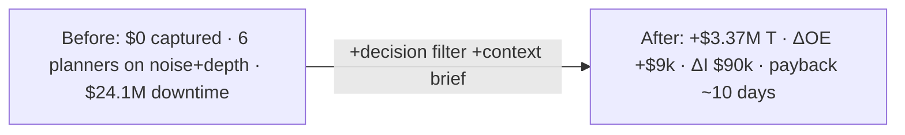

### 13.6 Automation vs Agentic — An Honest Assessment

| Step | Nature | Throughput contribution | Build effort | Build priority |
|---|---|---|---|---|
| Deduplicate notifications (exact/near match) | **Automation** | High (5.2% load removed) | Low | **1** |
| Pull asset history, failures, parts, permits, weather, downstream P&ID | **Automation** (joins/lookups) | High (kills R3 context delay) | Low–Med | **1** |
| Rank queue by throughput-weighted criticality | **Automation** (deterministic sort) | High (SLA protection) | Low | **1** |
| Predict *true* severity 1–5 from raw text | **Decision model** | High (fixes 12.5% noise) | Medium | **2** |
| Classify false-positive vs real | **Decision model** | High (12.0% load removed) | Medium | **2** |
| Root-cause category hypothesis | Decision model *or* light LLM | Medium | Medium | 3 |
| Draft work-order text + reasoning trail | **Agentic (LLM)** | Medium (planner → editor) | Medium–High | 3 |
| Final convert/reject/escalate verdict | **Human** (keep) | — (governance) | — | — |

**Effort decision.** The prize sits overwhelmingly in the **Automation** and **Decision model** rows. Removing noise (dedup, FP classification) and killing the context-gathering delay (lookups, briefs) are what return planner attention to criticals. The single agentic row, WO drafting, is real but is the *smallest* dollar contributor and the *most* expensive to build. **Build order:** (1) ship the deterministic automation in days, capturing the $122k floor immediately; (2) add the two decision models, which unlock the bulk of the $3.37M; (3) only then add LLM drafting, and keep the final verdict human.

**Verdict: Hybrid, decision-model-heavy.** *Most of this "agent" is plain code and two calibrated classifiers. The LLM earns one job, drafting, and even that stays under a human.*

**Break-even.** Four *stated assumptions*: ARR per customer **$150k** (a refinery maintenance-ops contract), **8** customers, a **3-year** horizon, developer fully-loaded cost **$180k/yr**.

```
Dev cost over horizon (1 dev) = $180k × 3 × 1.10 (run/API uplift) = $594k
Revenue (full-ramp)           = 8 × $150k × 3        = $3.60M
Revenue (conservative, ×2/3)  = 8 × $150k × 2        = $2.40M
Max break-even team (full)    = $3.60M ÷ $594k ≈ 6.1 devs
Max break-even team (consv.)  = $2.40M ÷ $594k ≈ 4.0 devs
```

The build effort implied by the layers is ~1 dev for automation (weeks), ~0.5 dev for an *adopted* decision model (labelling and threshold tuning), and ~1 dev for the agentic nub: **≈ 2.5 devs.** Against a conservative break-even of 4.0 and a full-ramp 6.1, the programme **clears break-even at ~2.5 developers** with comfortable margin. Doubling customers to 16 doubles break-even to ~8–12 devs, while build effort barely changes.

### 13.7 Solution Design

Everything exists to return **planner attention to real, correctly prioritised work** and to **surface the next constraint**.

**Automation layer** (plain code, built first):
- `dedupe(notification) → {is_duplicate, canonical_id}`: exact + near-match on asset + text window.
- `gather_context(notification) → brief`: joins `assets`, `failure_events`, `spare_parts` (lead time + stock), `permits`, `weather` and downstream `asset_connections` (P&ID cascade) into a 30-second brief. **The single highest-leverage automation** (it kills R3).
- `rank_queue(notifications) → ordered`: a deterministic sort by `criticality_tier`, age vs SLA, and downstream blast radius.
- `check_execution_readiness(wo) → {parts_available, permit_lead_time, next_ops_window}`: *the migration probe*. It instruments the downstream constraint from §13.4 step 5, so you see it coming.

**Decision-model layer** (typed choice, calibrated, abstains; this is where the dollars are):
- *Severity:* "What is the true severity 1–5?" → a rating with confidence; **abstain below threshold → human**. Target: beat the baseline MAE of **1.024** (72.4% within ±1).
- *False positive:* "Is this a real failure or a false positive?" → yes/no with confidence. The baseline is weak (FP F1 **51.7%**, precision only **36.5%**). *An over-confident rejection of a real failure is the costliest error in the system*, so the abstention policy is mandatory: **never auto-reject near a T1/T2 asset**.
- *Duplicate:* baseline precision is already **100%** (F1 70.6%). Keep auto-reject only on exact matches, and route near-matches to a human.
- Backend: **Laya** (self-hosted, on-prem for sensitive plant data) or **Microsoft-Decision-1** (managed).

**Deep-agent layer** (built last, kept bounded):
- A **code-based loop** (for audit): given the brief and the decision-model outputs, the LLM drafts WO text, a crew-skills rationale and a reasoning trail. Tools: `lookup_asset`, `recent_failures`, `parts_for_symptom`, `downstream_impact`. System prompt: *"draft for a planner's review; cite the brief; never assert a reject on a critical asset."*
- The LLM **never issues the final verdict**. The planner moves from author to editor.

**Back to the constraint:** every tool either returns planner minutes (dedup, brief, ranking) or improves the quality of planner attention (severity/FP decisions). Each raises the *effective triage rate*, the one flow that drains the one constrained stock. `check_execution_readiness` is the deliberate hook for the migrated constraint.

The reference implementation in [`data_generator/agents/`](https://github.com/jayanthbagare/synthetic_oil_gas/tree/main/data_generator/agents) ships these roles as `TriageAgent`, `ContextGatherer`, `PlannerAssistant` and an `Evaluator`.

### 13.8 Run It / Reproduce the Figures

```bash
# 1. Generate the canonical dataset + SQLite DB (seed 42 → byte-identical)
python data_generator/generate_data.py --seed 42 --output-dir ./output --build-db

# 2. Run the reference agent pipeline + evaluation harness
python data_generator/run_agents.py --db ./output/crestmount.db --run-date 2026-06-30
#    → severity MAE 1.024 · within±1 72.4% · P@K 47.3% · FP F1 51.7% · dup F1 70.6%

# 3. Launch the bottleneck dashboard
streamlit run data_generator/dashboard/app.py -- --db ./output/crestmount.db

# 4. Reproduce the anchor figures directly
sqlite3 output/crestmount.db \
  "SELECT COUNT(*) FROM notifications WHERE status IN ('open','in_review');"      # 1866
sqlite3 output/crestmount.db \
  "SELECT SUM(downtime_cost_usd) FROM failure_events WHERE failed_at>='2025-10-14';"  # 24.1M
```

**Pilot plan to replace the modelled assumptions (A3/A4):** run the decision filter + brief in shadow mode for 4 weeks against live planner decisions. Measure (a) planner minutes returned, (b) which criticals the system surfaced in time vs which still aged, and (c) the false-reject rate near T1/T2 assets. Only then convert A3/A4 from modelled to measured and re-run §13.5.

---

# Part IV — Meridian Industrial Systems: Procurement Under Shock

> **Source:** [`itsbharathp/RFQ_Agent_Workshop`](https://github.com/itsbharathp/RFQ_Agent_Workshop). An 18-month synthetic procurement dataset (24 CSVs), six independent challenges (Theory of Constraints, Throughput Accounting, Watchdog, Tactician, Oracle, Front Door), nine packaged Claude skills, Laya routing demos and reference solutions. Every figure is computed from `output_v2/`, with the pre-constraint period = months 0–7 (Jan–Aug 2024) and the constraint period = months 8–17 (Sep 2024–Jun 2025). This edition re-verified the headline figures against the CSVs ([Appendix C](#appendix-c--editors-notes-and-reconciliations)).

This part differs in shape from the others. Meridian is a single case told as a **cascade**: a shock enters the system at one point, and the damage surfaces somewhere else entirely, weeks later and in disguise. It also deliberately builds *four different kinds of machine intelligence* (a monitoring agent, a planning agent, a forecasting foundation model and a reflex-speed decision model), which makes it the best case in the book for comparing model classes.

## Chapter 14 — Meet Meridian Industrial Systems

**Meridian Industrial Systems** does not exist. It manufactures CNC machines and robotic assembly cells. Eighteen months of its procurement life, January 2024 through June 2025, have been reconstructed in synthetic detail: every vendor, request-for-quote, bid, late payment, clarification email and commodity price tick. That adds up to twenty-four CSV files, over four thousand email threads, and a complete event log.

Somewhere in late 2024, Meridian broke. Deliveries slipped. Purchase prices crept up. The procurement team worked harder and harder and still felt they were falling behind. And, most importantly, *nobody could name the cause.* Every individual measurement looked more or less fine. The failure lived in the relationships *between* the measurements.

### 14.1 The cast

Meridian buys from **24 vendors** worldwide, grouped into categories such as Mechanical Parts, Electrical Components and Raw Materials. Each vendor has a behavioural archetype and a *relationship arc*: `stable`, `improving`, `declining`, `new_proving`, or `collapse`.

| Vendor | Country | Category | Arc | Why they matter |
|---|---|---|---|---|
| **Kovacs Precision GmbH** (V001) | Germany | Mechanical Parts | `declining` | A nine-year, reliable partner on `Net60` terms: the kind of vendor you don't notice until they wobble. |
| **Tanaka Electrical KK** (V002) | Japan | Electrical Components | `stable` | The dependable anchor of the electrical pool. |
| **Patel Alloys Pvt Ltd** (V003) | India | Raw Materials | `improving` | A relationship-focused supplier climbing the health rankings, and the one worth locking in early. |

The human cast: **Priya Nair**, Head of Procurement ("Tell me where the system is breaking down. I want one constraint, named with evidence.") and **Arjun Desai**, CFO ("Procurement feels slow, yes. But our costs haven't exploded. Show me the business case."). The competitor **Hexagon AG** buys in the same categories.

### 14.2 The data at a glance

Everything is keyed by `month_index` (0 = Jan 2024 … 17 = Jun 2025).

| File | Rows | What it holds |
|---|---|---|
| `01_vendors.csv` | 24 | The cast: archetypes, risk tiers, relationship arcs, payment terms |
| `02_vendor_performance.csv` | 416 | Monthly KPI snapshots per vendor |
| `03_commodity_prices.csv` | 790 | Weekly prices + `shock_flag` for steel, copper, rare earths |
| `04_market_signals.csv` | 18 | Tariffs and capacity announcements: the exogenous events |
| `05_sales_orders.csv` | 225 | Customer revenue (the **R** in Throughput) |
| `07_work_orders.csv` | 202 | Internal work orders; each triggers an RFQ |
| `09_rfq_events.csv` | 202 | RFQ issue dates, deadlines, cycle times, invite counts |
| `10_rfq_vendor_invites.csv` | 1,424 | Who was invited and whether they responded |
| `12_bids.csv` | 1,120 | Actual bids: the real measure of competition |
| `13_bid_evaluation.csv` | 1,120 | Scored, ranked bids |
| `14_purchase_orders.csv` | 202 | Winning bids → POs (the **TVC** in Throughput) |
| `16_vendor_disputes.csv` | 9 | Late-delivery and quality disputes |
| `20_payment_events.csv` | 202 | Meridian's own payment behaviour (`days_late`) |
| `22_rfq_admin_burden.csv` | 1,424 | Clarification rounds per RFQ |
| `23_vendor_health_scores.csv` | 416 | Monthly composite health, `trend_3mo`, `alert_flag` |
| `24_event_log.csv` | 4,466 | The complete timeline, in order |

The volume matters. Over 4,000 email threads and 4,400 log events is more than a human can read, which sets up the agent half of the case.

---

## Chapter 15 — The Vendor-Pool Collapse

> **Project:** [`RFQ_Agent_Workshop`](https://github.com/itsbharathp/RFQ_Agent_Workshop) · **Domain:** Industrial procurement / supplier relationships · **Dataset:** 24 vendors · 202 RFQs · 1,424 invitations · 1,120 bids · 225 sales orders · 4,466 events over 18 months

### 15.1 The Problem

The dataset's generator leaves a note, a spoiler the workshop asks you to *prove* rather than accept:

> *"Sep 2024 tariff shock → Meridian cash-flow stress → late payments → vendor health scores drop → response rates fall → RFQ pool shrinks → procurement has to work harder → constraint becomes visible."*

Read the chain carefully. The shock is a **tariff**: external, exogenous, and visible in the market-signals data. The pain shows up as **an exhausted procurement team and higher prices**, three or four links downstream. If you looked only at the pain, you would try to fix the team's workload or renegotiate prices, and you would fail, because neither is the constraint.

A second shock lands in **April 2025**: a rare-earth / neodymium-magnet price spike. By then the system is still fragile.

### 15.2 Lens 1 — Causal Loop Diagram

A monthly table tells you *what* changed. It doesn't tell you *why the change fed on itself.* Meridian's crisis was not a one-time hit that the system absorbed. It was a **vicious circle** that a tariff shock set in motion and that then ran under its own power.

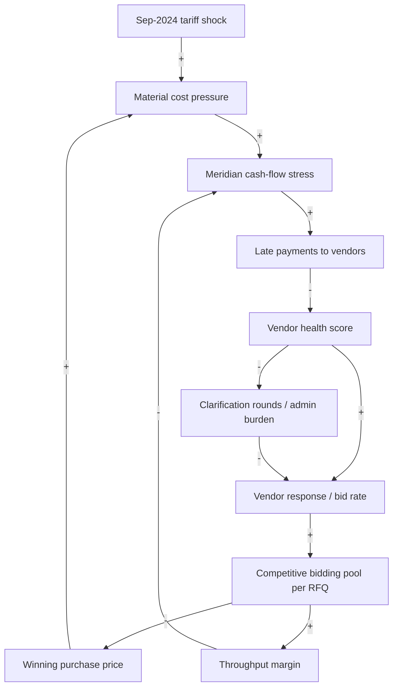

- **R1, the margin death spiral (the dominant loop).** `CASH → + LATE → − HEALTH → + RESP → + POOL → + MARGIN → − CASH`. Two minus signs, so it is **reinforcing**. Cash stress makes Meridian pay late. Late payment erodes vendor health. Unhealthy vendors stop bidding. A thin pool loses price competition, margin falls, and falling margin *deepens* cash stress. This loop turned a one-month tariff into a ten-month decline. Data signature: bids/RFQ **6.40 → 4.50 (−30%)**, T-margin **20.0% → 16.4%**.
- **R2, the price-cost ratchet.** `POOL → − PRICE → + COST → + CASH → + LATE → − HEALTH → + RESP → + POOL`. Two minus signs, so **reinforcing**. A thin pool raises the winning price, which *is* material cost, which feeds the same cash stress that thinned the pool. The tariff didn't need to stay elevated, because pool shrinkage kept prices high on its own.
- **R3, admin firefighting.** `HEALTH → − CLAR → − RESP → + POOL → + MARGIN → − CASH → + LATE → − HEALTH`. **Four** minus signs, so this loop is also **reinforcing**, even though the source book labels it a balancer (B1). As health drops, clarification rounds rise, which further *suppresses* response: the loop feeds the decline instead of correcting it. Admin burden isn't the disease; it's the fever. (Clarification rounds barely move, 3.37 → 3.62. The team worked harder per round, which is why they felt exhausted while the metric looked flat.)
- **The missing balancing loop.** The source also describes a "response-rate governor" (B2): if health recovers, response recovers. Traced edge by edge, though, that path is R1 run in its virtuous direction (two minus signs), not a separate corrective loop. **As drawn, every loop in Meridian's structure is reinforcing.** That is exactly why the decline ran for ten months. The partial recovery after month 10 (vendor pool 17 → 20) comes from *outside* the drawn loops: tariff pressure fading, and some vendors' own improving arcs.

> **Check the signs yourself.** This is the most instructive correction in the book. A system whose loops are all reinforcing has no internal brake. The solutions in §15.7 are best understood as *designed balancing loops*: the Watchdog and the on-time-payment policy together form `vendor health falls → detected early → repair / pay on time → health recovers`. That is a corrective loop Meridian never had.

**The delays are the whole story.** Health scores are a `trend_3mo`, so they lag the payment behaviour that drives them by months. By the time health visibly dropped (trough 85.6 at month 10) and alerts fired (4 → **28**), the late payments behind it were a quarter old. Fast reinforcing loops with no timely correction are the textbook recipe for a system that overshoots and stays down.

**Leverage points, ranked (Meadows-style):**

1. **Break the `LATE → − HEALTH` edge (highest leverage).** Paying on time, or signalling payment reliability, cuts R1 and R2 at their root. It is a *structural* change to loop gain, and it needs no software.
2. **Shorten the health-information delay, and so create the missing balancing loop.** A monitoring agent that detects decline from *payment* signals (the cause), rather than waiting for the 3-month health trend (the lagged effect), lets a human correct course before R1 wins. **This is the Watchdog.**
3. **Add an external information inflow** (TimesFM / market signals). Seeing the *next* shock before it hits lets you pre-empt the cost spike that would restart R2. **This is the Oracle.**
4. **Weaken `HEALTH → − CLAR` (lowest leverage).** Tightening the clarification loop slows R3, but it is a symptom-level fix.

> **Systemic insight:** the crisis persisted because the reinforcing loops are fast, and the system's only correction came from outside its own structure, slowly. You don't fix this by working harder inside the loops (more invites, more chasing); that's running on the treadmill the loops define. You fix it by *changing the structure*: cut the late-payment edge, and shorten the information delay.

### 15.3 Lens 2 — Stock & Flow

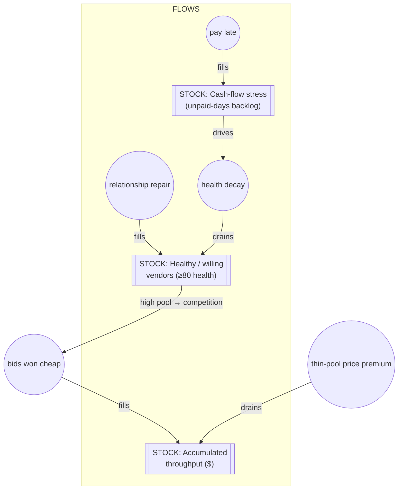

| Stock | Inflow(s) | Outflow(s) | Units | What the data shows |
|---|---|---|---|---|
| **Healthy / willing vendor pool** | relationship repair; on-time payment | health decay (driven by late payment) | vendors ≥ 80 health | 21 (m5) → **17 (m10)** → 20 (m17): the pool drained at the trough and only partly refilled |
| **Cash-flow stress** | late / disputed payments | margin recovery; new revenue | stress index | peaks at **0.05 in month 10**, the same month the vendor pool bottoms |
| **Accumulated throughput** | cheap competitive wins | thin-pool price premium | $ | **≈ $289K** of throughput bled out over 10 months |

**Which flow rates does each intervention move?** This test tells you whether an intervention is real or cosmetic:

- **Pay on time (exploitation)** turns *off* the `health decay` drain on the vendor-pool stock. It is the highest-leverage move because the vendor-pool stock feeds the margin stock.
- **The Watchdog** doesn't change a flow directly. It *shortens the detection delay* on the decay drain, so a human can open the "repair" inflow before the stock empties.
- **The Oracle** adds an inflow of *information* that lets the Tactician pre-buy, blunting the `thin-pool price premium` drain when the next shock lands.
- **More invitations (what Meridian actually did)** moves *no* flow on any of these stocks. The invite count was never the tap. That is the structural proof of why effort inside the loop didn't help.

### 15.4 Lens 3 — Theory of Constraints

The system has several moving parts: invites per RFQ, vendors responding, bids arriving, clarification rounds, bid timeliness, bid quality. The discipline is to separate the constraint from the loud symptoms. The workshop plants a deliberate trap:

> *One of these numbers barely moves while the system falls apart. A metric that stays comfortable is not evidence of health. It is a blind spot with a green light on it.*

That number is **vendors invited per RFQ.** Meridian keeps inviting 6 to 8 vendors every single month. The raw count never leaves the band `{6, 7, 8}`, and the monthly average drifts only between **6.2 and 7.7**. Watch the invitation gauge and everything looks fine. Watch what actually *arrives* and the floor falls out:

| Signal | Pre-constraint (m0–7) | Constraint period (m8–17) | Peak → trough |
|---|---|---|---|
| Vendors invited / RFQ | 6.96 | 7.10 (+1.9%) | rangebound 6.2–7.7 (**the green light**) |
| **Bids received / RFQ** | **5.73** | **5.43** | **6.40 (m5) → 4.50 (m15) = −30%** |
| Vendor response rate | 82.4% | 76.3% | **87.5% (m3) → 66.7% (m11)** |
| Avg composite health | 89.0 | 88.1 | dips to 85.6 (m10) |
| Health alert flags raised | **4** | **28** | a **7× jump** |
| Avg RFQ cycle time (days) | 11.4 | 11.7 | essentially flat |

1. **Identify.** **The constraint is the responding/bidding vendor pool, not the invitation process.** Everything the team *does* (send invites) looks healthy, while everything the system *produces* (competitive bids) is starving.
2. **Exploit (zero budget).** The elegant answer is not "find new vendors"; that is elevation, and it costs money. It is *stop paying your existing vendors late and tighten the clarification loop*, because those are what drive response rates down.
3. **Subordinate.** Make the RFQ process serve the pool's health: prefer `improving` vendors, deprioritise `collapse`-arc vendors before their scores go critical, and widen bid windows when competitors tighten capacity.
4. **Elevate.** Detect decline earlier (Watchdog), plan RFQs adaptively (Tactician), and see knowable shocks coming (Oracle).
5. **Repeat: the constraint migrates** *(editor's reading)*. With the pool restored, the binding limit becomes **foresight about exogenous shocks**. The Oracle shows that statistics can see the April 2025 rare-earth spike but not the September 2024 tariff. The next constraint is causal reasoning over market signals, which is why the Oracle must be paired with the Tactician.

**Name names.** The pool splits cleanly: **15 stable**, 4 new/proving, **3 improving** (Patel Alloys, Indra Copper Works, Rajasthan Rare Earths), **1 declining** (Kovacs Precision GmbH) and **1 in outright collapse** (Guangzhou Mech & Elec Co.). Kovacs is the quiet tragedy: a nine-year reliable partner whose composite health decays from **88.8 (m0) → 79.9 (m8) → 73.7 (m12) → 68.6 (m17)**, a slow bleed that no single month's snapshot would flag as alarming.

### 15.5 Lens 4 — Throughput Accounting

The CFO thinks in cost accounting. You have to answer in **Throughput Accounting**, which asks a different question: not *"what does this cost?"* but *"what does this constraint do to our ability to make money?"*

| Measure | Definition | At Meridian |
|---|---|---|
| **T, Throughput** | Revenue − Truly Variable Cost | Sales-order revenue − PO material spend |
| **I, Investment** | Cash tied up in the system | Cash stuck in slow/disputed payment cycles |
| **OE, Operating Expense** | Everything else (fixed) | The procurement team's admin time |

**Assumptions given to participants:** $150 per clarification round (1.5 h @ $100/h), and a 0.8%/month holding cost on outstanding PO value.

Here is the counter-intuitive insight: **the pain is not in Operating Expense.** Clarification rounds *feel* like the problem, because the team is exhausted, but salaries are fixed whether the team answers one clarification or ten. The real damage is in **T**. When the vendor pool shrinks, competitive pressure drops and Meridian pays more for the same materials. You are bleeding margin, not overtime.

| Measure | Pre-constraint (m0–7) | Constraint period (m8–17) |
|---|---|---|
| **Throughput margin** (T ÷ Revenue) | **20.0%** | **16.4%**, a **3.6-point** erosion |
| OE friction (clarification cost) | $5,119 / mo | $6,555 / mo (≈ flat) |
| Investment tied up (late-payment cash) | $253 / mo | $438 / mo |

Over the 10-month constraint period Meridian earned **$1,622,124** of actual Throughput. Had it held its pre-constraint 20.0% margin on the *same* revenue, it would have earned **$1,910,780**.

> **▶ The number the CFO needs**
> **Throughput lost to margin erosion ≈ $288,656** over ten months. OE barely moved (≈ $14,362 incremental).
>
> **Break-even statement:** *"Meridian could spend up to ≈ $303,000 fixing vendor health (outreach, early payments, forecast sharing) and still come out ahead."* ( = $288,656 lost Throughput + $14,362 incremental OE.)

That sentence turns a vague feeling of slowness into a six-figure budget authorisation.

**Sensitivity, and a warning against a too-tidy story.** Two secondary metrics *contradict* the clean narrative, and the honest response is to say so:

- The **bid-price spread** (max − min bid per RFQ) *widens* from ~$9,300 to ~$10,200, when intuition says a shrinking pool should narrow it.
- Average **`days_late`** is roughly flat (2.3 → 2.1), even though late payment drives the causal story.

The clean signal is the **T-margin ratio**, the measure closest to the money. Treat the others as texture, not proof. The `days_late` observation also tells you something about the solution: a *fleet average* hides the per-vendor payment pattern that matters. That is exactly why the Watchdog checks payment history vendor by vendor ([§15.7](#157-solution-design--the-four-agents)).

### 15.6 Automation vs Agentic — An Honest Assessment

> *Editor's addition.* The source field book frames Meridian as a sequence of challenges and does not include this section or a break-even block. Both are added here in the house style so that Meridian can sit in the cross-case scorecard. They are derived only from figures in the source and are labelled where modelled.

| Step | Nature | Throughput contribution | Build effort | Build priority |
|---|---|---|---|---|
| **Pay vendors on time; signal payment reliability** | **Policy** (no software) | **Cuts R1/R2 at the root; the highest-leverage move** | Near zero (carrying cost of the I line: ~$253–438/mo) | **0: do before building anything** |
| Monthly health snapshot, trends, payment/dispute/participation history | **Automation** (joins, aggregates) | Enables detection | Low | 1 |
| Threshold and trend flags (level, slope, `thin_data_flag`) | **Automation** (rules) | Enables triage | Low | 1 |
| Triage the shared inbox: queue, urgency 0–5, language | **Decision model** (System 1: `choice`, `score`) | Protects System 2 cost and latency; surfaces the critical ~5% | Low–Med (adopt Laya) | 2 |
| Explain a vendor's decline: self-inflicted (our late payment) vs genuine distress | **Agentic** (System 2 reasoning across tools) | Shortens the detection delay → opens the repair inflow early | Medium | **2: the nub** |
| Plan an RFQ under a degraded pool, market spike and competitor pressure | **Agentic** (goal-directed planning) | Protects T on each new work order | Medium–High | 3 |
| Forecast commodity prices; flag breaches of the 95% band | **Specialist foundation model** (TimesFM) | Pre-buy before knowable shocks (blunts R2) | Low–Med | 3 |
| Anticipate exogenous shocks (tariffs) | **Agentic** (causal reasoning over market signals) | The migrated constraint | Medium | 4 |

**Effort decision.** The prize is ≈ **$289k of lost Throughput in ten months** (≈ $346k/yr annualised), against **$14k** of OE movement. The highest-leverage row is not a model at all. It is a **payment policy** whose carrying cost (the I line) runs to *hundreds* of dollars a month, against tens of thousands a month of lost T. *Caveat:* in the causal story, late payment is itself a *symptom* of cash stress, so "just pay on time" may need a short-term bridge. Even so, the bridge is small compared with the margin it protects. After the policy, the build order is: cheap automation for the health and payment data layer; a decision-model front door to keep LLM spend proportionate; then the two reasoning agents (Watchdog first, because detection latency is the delay that let R1 win); and the forecaster last.

**Break-even** *(editor-modelled)*. Use the **remediation-ceiling** frame from [Chapter 7](#chapter-7--sizing-the-build-break-even-and-team-size). The total justified spend over the period is the ~$303k break-even budget. At a labelled assumption of **$150k/yr** fully-loaded developer cost × 1.10 uplift, that budget would fund **~1.8 developer-years**, but only if *none* of it went to the payment policy and vendor outreach, which carry the real leverage. Build effort implied by the layers: data layer ~0.5 dev, adopted decision model ~0.25 dev, Watchdog + Tactician ~1 dev, Oracle ~0.25 dev, **≈ 2 devs for a few months**. That fits within the ceiling with room left for outreach and early payments. As in every case, the binding question is not headcount but whether the policy lever is pulled first.

**Verdict: Hybrid. The highest-leverage fix is a policy, not a model.** The agents are real and useful: the Watchdog and the Tactician need genuine System 2 reasoning, and the Front Door is a textbook decision model. But they *shorten delays* in a structure whose root edge is a human payment decision. *Decompose before you deploy, and sometimes the first component is a memo from the CFO.*

### 15.7 Solution Design — The Four Agents

Four challenges, four distinct patterns, each matched to a different kind of cognition.

#### 15.7.1 The Watchdog — a monitoring agent (System 2)

> *Meridian was blindsided. Vendor health deteriorated for months before the RFQ pool shrank. The data was there; it just wasn't being watched.*

This is a Claude-powered agent that ingests vendor health each month and fires an alert *before* a vendor becomes unusable. It follows the **sensor-to-alert loop**: `Observe → Analyse → Classify → Recommend → Alert`. It chooses among five read tools:

| Tool | Returns |
|---|---|
| `get_health_snapshot(month_index)` | Every vendor's composite score this month |
| `get_vendor_trend(vendor_id, n_months)` | A vendor's score history |
| `get_payment_history(vendor_id, n_months)` | *Meridian's own* payment behaviour towards the vendor |
| `get_dispute_history(vendor_id)` | Open delivery/quality disputes |
| `get_rfq_participation(vendor_id, n_months)` | Invite / response / win rates |

The difficulty is in the judgement calls, not in fetching data:

- **Trend beats level.** A vendor at 62 and *falling* is scarier than one stable at 55 for months.
- **Root-cause direction.** Is the vendor struggling on its own, or is Meridian *paying it late* and causing the problem? The agent must check the payment tool to tell self-inflicted wounds from genuine supplier distress.
- **Don't over-alert on new vendors.** A `thin_data_flag` / `new_proving` vendor is *supposed* to have low early scores.

A **bad** Watchdog alerts on every vendor below 70 and parrots the numbers. A **good** one alerts only where the data tells a coherent story, explains the *mechanism*, and recommends something specific. Each alert is structured JSON: `vendor_id`, `alert_severity`, `composite_score`, `trend`, `root_cause`, `supporting_evidence`, `recommended_action`, `urgency`. **Stretch:** a `positive_alerts` mode that surfaces vendors improving faster than expected (Patel Alloys, trending up 8 points) and recommends locking them in with a forecast-sharing arrangement.

#### 15.7.2 The Tactician — a planning agent (System 2)

> *A new Work Order just landed. Issue an RFQ in 24 hours. But the Watchdog flagged four vendors as unhealthy, copper spiked last week, and the competitor Hexagon AG is buying in the same category right now.*

Where the Watchdog *observes*, the Tactician *acts under a goal*: `Goal → Assess → Plan → Adapt → Execute`. It has seven tools, including an output tool: `get_work_order`, `get_vendor_pool`, `get_vendor_health`, `get_market_signals`, `get_commodity_prices`, `get_competitor_activity`, and `create_rfq_plan(...)`. The plan contains a prioritised `vendor_shortlist` with rationale, `n_vendors_to_invite` (possibly fewer than 8), `rfq_terms` with tunable `evaluation_weights` and `bid_window_days`, `market_context`, `risk_flags`, and the tell-tale sign of real adaptation: `adaptation_notes`.

The decisions that separate a planner from a ranker: **pool shortfall** (invite unhealthy vendors, expand to adjacent categories, or delay?), **market timing** (re-weight evaluation during a commodity spike), **competitor pressure** (widen the bid window), and **arc awareness** (prefer `improving` vendors over merely `stable` ones).

**The twist: run it three times.**

| Month | Conditions | What good adaptation looks like |
|---|---|---|
| 5 (Jun 2024) | Pool healthy | Standard playbook: 8 invites, balanced weights |
| 10 (Nov 2024) | Constraint active, pool degraded | Fewer healthy vendors, re-weighted terms, risk flags raised |
| 15 (Apr 2025) | Partial recovery + rare-earth shock | Market-aware budget adjustment, cautious shortlist |

If the agent produces the same plan in all three months, it isn't thinking; it's fetching. **Stretch, "what-if" mode:** re-plan with Kovacs removed, the budget cut 15%, or urgency bumped to critical.

#### 15.7.3 The Oracle — zero-shot forecasting with TimesFM

**Google TimesFM** is a *time-series foundation model*. It is pre-trained on ~100 billion real-world time-series points, so it forecasts **zero-shot**, with confidence intervals and no feature engineering.

- **Task 1, commodity anomaly detection.** Feed in the weekly price history of Neodymium Magnets through Feb 2025 and forecast 12 weeks ahead. When the *actual* April prices breach the upper 95% bound, fire a `MARKET_SHOCK_DETECTED` alert into `shock_alerts.json`, a payload the Tactician can use to pre-buy *before* the spike. The Oracle sees April 2025 coming.
- **Task 2, lead-time forecasting, and the lesson in failure.** Forecast RFQ cycle times just as the September 2024 tariff lands. **The zero-shot forecast does *not* predict the explosion.** Cycle times were stable for nine months, so a purely statistical, *univariate* model confidently projects more of the same. It is blind to an **exogenous causal event** that leaves no trace in the historical series.

That failure *is* the lesson. **Statistics (the Oracle) must be paired with causal reasoning (the Tactician).** Prediction handles the knowable; reasoning handles the novel.

#### 15.7.4 The Front Door — System 1 triage with Laya

> *The shared inbox `vendors@meridian.com` is drowning: thousands of emails a day, from invoices and delay notices to furious cancellation threats, engineering questions and spam. Running Claude on every one costs hundreds of dollars a day, takes ~3 seconds each, and keeps hitting rate limits.*

The fix is a **Front Door**: a System 1 reflex engine that triages everything instantly and forwards only the critical few to System 2.

1. **Semantic queue assignment (`choice`).** Route each email to `engineering` / `logistics` / `finance` / `procurement` / `spam` by *meaning*, not keywords.
2. **The Panic Meter (`score`).** A 0–5 ordinal urgency rubric, from 0 = routine spam or automated notification, through 3 = significant disruption or price increase, to 4 = severe threat to the partnership, a credit hold, or a supply-chain shock. The score is a calibrated expected value, not "sounds urgent".
3. **Multilingual routing.** `laya.Router(preload=True)` triages the German and Japanese emails in `vendor_inbox.json` *natively*, with no translation API and no per-language regex. You cannot write a keyword dictionary for every language on earth, but a semantic encoder reads intent regardless of script.
4. **Filter and hand off.** Keep only emails scoring ≥ 4.0 and write `critical_alerts.json`. **That file is the exact input to the Watchdog and the Tactician.** System 1 filters and System 2 reasons, closing the pipeline end to end.

**Back to the constraint.** The Watchdog shortens the delay on the vendor-pool decay drain, the leverage point ranked #2. The Tactician protects T on each new RFQ by planning around the degraded pool. The Oracle adds the external information inflow (#3) and, by failing, reveals the migrated constraint. The Front Door keeps System 2 affordable at inbox scale. None of them replaces leverage point #1.

### 15.8 Run It Yourself

```bash
pip install pandas matplotlib anthropic      # Challenges 1–4
pip install timesfm                           # Challenge 6 (needs Hugging Face creds on first run)
pip install "laya>=0.3.3"                     # Challenge 7
export ANTHROPIC_API_KEY="your-key-here"      # Challenges 3 & 4 only
```

Challenges 1 and 2 are fully standalone, with no API key needed. For each challenge, read `BRIEFING.md` before touching code, read the whole `starter.py`, run it as-is (it prints data shapes as a sanity check), work the TODOs in order, and write conclusions in prose, explaining the *why* and not just the numbers. Reference solutions are in `solutions/` (PDFs for 1–4, guides and code for 6 and 7).

**Reproduce the diagnosis:**

```python
import pandas as pd
D = "output_v2/"
rfq  = pd.read_csv(D+"09_rfq_events.csv")
bids = pd.read_csv(D+"12_bids.csv")
so   = pd.read_csv(D+"05_sales_orders.csv")
po   = pd.read_csv(D+"14_purchase_orders.csv")

# Bids per RFQ per month (the real competition signal)
bpr = bids.groupby("rfq_id")["bid_id"].count()
br  = rfq[["rfq_id","month_index"]].merge(bpr.rename("n"), on="rfq_id", how="left").fillna(0)
print(br.groupby("month_index")["n"].mean())          # m5 6.40 → m15 4.50

# Throughput margin, before vs after
rev = so.groupby("month_index")["total_value_usd"].sum()
tvc = po.groupby("month_index")["po_value_usd"].sum()
margin = ((rev - tvc) / rev)
print("pre %.1f%%  post %.1f%%" % (margin.loc[0:7].mean()*100, margin.loc[8:17].mean()*100))  # 20.0 / 16.4
```

**Watch for:** the Front Door's `critical_alerts.json` flowing into the Watchdog and the Tactician. At that point, the thing you diagnosed in §15.4 is finally being watched by the agents you built in §15.7.

---

# Part V — LoopCycle Nusantara: Consumer Commerce

> **Source:** [`itsbharathp/LoopCycle`](https://github.com/itsbharathp/LoopCycle). Synthetic datasets for orders, abandoned carts, support tickets, calls, social posts and comments (June–September 2026), plus the **Hermes delivery-disruption-monitor** skill with four Python scripts and an answer key. Monetary values are in **IDR** (approximate rate **1 USD ≈ 15,800 IDR**). A "window" is the four-month data window (June–September 2026); annual figures use ×3.

## Chapter 16 — Meet LoopCycle Nusantara

**LoopCycle Nusantara** is a waste-to-value social enterprise in Bandung, West Java, Indonesia, founded in 2015. Its core business is a traceable recycling supply chain. It formalises **3,500 informal waste pickers**, buys their sorted plastic at fair-trade rates through **12 collection hubs** across West Java, pelletises it, and sells recycled resin to FMCG packaging makers. Turnover is roughly **$4.2M USD** across **160 staff**.

On top of that industrial core sits a **consumer brand**: the *Loop Tote*, a recycled-plastic tote bag sold direct-to-consumer and across nine channels (Shopify, Instagram DM/WhatsApp, Shopee, Tokopedia, TikTok Shop, Lazada, Blibli, Amazon, and a physical Bandung store). The tote is both a product line and the company's marketing engine, the visible, Instagrammable face of an otherwise invisible resin business.

| Domain | Dataset | Scale |
|---|---|---|
| Orders | `loopcycle_tote_orders.csv` | 2,867 orders, ~849M IDR revenue, 45.9% GP |
| Abandoned checkouts | `shopify_abandoned_checkouts.csv` | 1,326 (7.4% recovered) |
| Abandoned conversations | `instagram_abandoned_conversations.csv` | 979 (7.4% recovered) |
| Support | `loopcycle_support_tickets.csv` | 37 tickets, 32% SLA breach |
| Calls | `loopcycle_call_centre_log.csv` | 26 calls |
| Social | `loopcycle_instagram_posts_flat.csv` + comments | 30 posts, 1,515 comments |
| Delivery agent | `Data/Agent/hermes-delivery-disruption-monitor/` | 100 demo orders |

**Why these four cases, and why they differ.** They land in *different places* on the honest-assessment scorecard. The delivery monitor is genuinely agentic (open-web research and judgement). Support triage is a decision-model problem wearing an agent costume. Cart recovery is mostly automation with a thin generative edge. Content planning is a decision-model-and-measurement problem that the market would happily sell you as "generative AI". Reading them side by side is the fastest way to absorb the three-way split.

LoopCycle also fills a gap left by the Danfoss cases: it addresses **sales, marketing and customer service**, the function Danfoss's three cases left untouched ([§8.2](#82-how-the-business-is-structured)).

---

## Chapter 17 — The Delivery Disruption Monitor

> **Project:** [`Data/Agent/hermes-delivery-disruption-monitor/`](https://github.com/itsbharathp/LoopCycle/tree/main/Data/Agent/hermes-delivery-disruption-monitor) · **Domain:** last-mile logistics / proactive customer comms · **Dataset:** 100 demo open orders (34 Ordered · 36 Packed · 30 In-Transit); 85 Indonesian + 15 international destinations; the answer key marks 31 orders at disrupted destinations (21 "email customer", 10 monitor-only) and 69 controls.

### 17.1 The Problem

LoopCycle ships ~2,867 Loop Tote orders per window across six couriers (SiCepat, JNE, J&T, GoSend/Grab, in-store, platform couriers), with a mean ship→delivered time of **2.6 days**. West Java is exposed to floods, volcanic ash, haze, strikes and protests that stall deliveries *without the courier flagging a problem*: the parcel simply sits. The small ops/CX team finds out when the **customer complains**. "Delivery delay" is the single largest support category (5 of 37 tickets), and delivery issues drive both the angriest calls and the goodwill compensation (37 tickets carry **25.1M IDR** of compensation, a mean of **679k IDR** each).

The repo's Hermes skill reframes the problem as: *which open orders will be late, why, by how much, and what do we do?*, answered **before** the customer notices. It searches the live web for disruptions at each destination, verifies sources, estimates delay, and drafts customer emails for approval (never sending them itself).

### 17.2 Lens 1 — Causal Loop Diagram

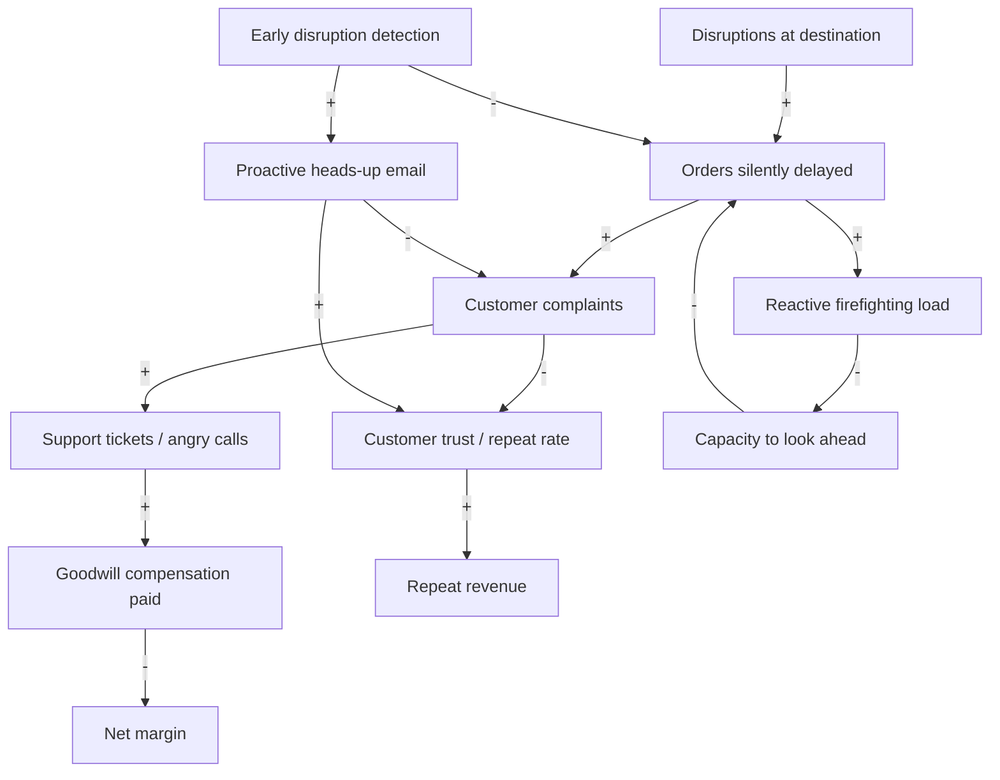

- **R1, the firefighting spiral (reinforcing).** `Orders silently delayed → + Reactive firefighting load → − Capacity to look ahead → − Orders silently delayed`. Two minus signs, so reinforcing. The busier the team gets cleaning up late deliveries, the less time it has to *anticipate* them, so more go undetected. This is the vicious engine, and it is the only loop that closes in the diagram.
- **R2, trust erosion.** Complaints → (−) trust → (−) repeat revenue. Lower repeat revenue pushes the team to chase new orders rather than nurse existing ones, which feeds complaints. *(The return edge isn't drawn; it is a narrative loop.)*
- **B1, the compensation thermostat.** Complaints → compensation → (−) margin. Goodwill payments buy back some trust but drain margin. It caps the damage without fixing the cause, a classic "shifting the burden" brake.
- **B2, the proactive-detection brake (the one we want).** Early detection → (−) orders silently delayed, and proactive email → (−) complaints / (+) trust. *Detection enters the diagram as an exogenous lever:* the intervention *is* the brake.

**Delays.** The killer delay is between a disruption *starting* and LoopCycle *learning* about it. Today that path runs through the customer and a support ticket (hours to days). B2 collapses it from "customer-complaint time" to "web-search time".

**Leverage points (strongest first).** (1) **Information flow:** give the operator sight of disruptions *before* the customer has it. (2) **Delay length:** shrink detection lag from days to one 6-hour scheduled run. (3) **Loop gain on B2:** a proactive heads-up converts an angry complaint into a trust-building touch.

**Systemic insight.** R1 dominates today purely because of a *delay*: detection sits downstream of the complaint. Nothing is wrong with the team's effort; *the information arrives too late to act on*.

### 17.3 Lens 2 — Stock & Flow

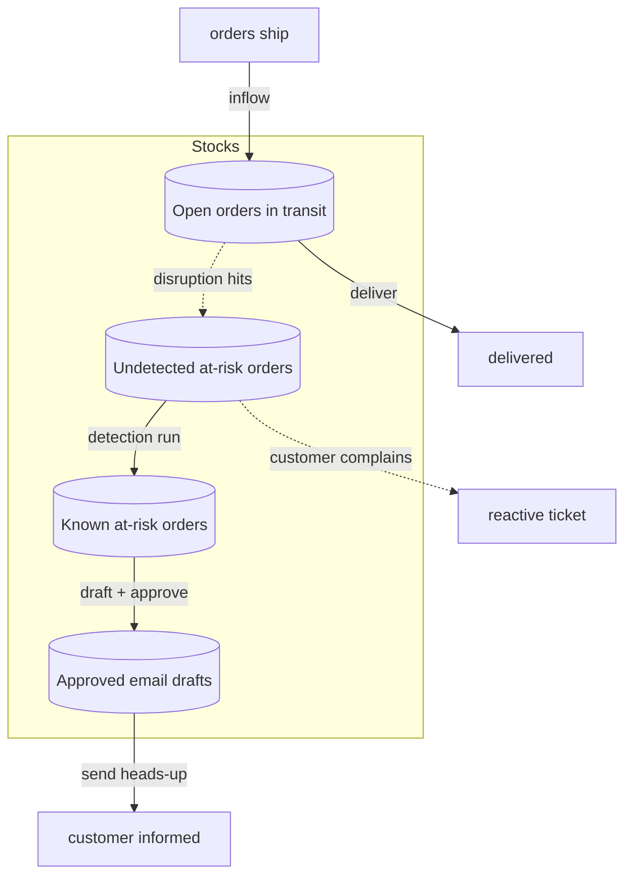

| Stock | Inflow(s) | Outflow(s) | Units |
|---|---|---|---|
| Open orders in transit | orders ship | delivered | orders |
| **Undetected at-risk orders** | disruption hits an open order | detection run **or** customer complaint | orders |
| Known at-risk orders | detection run | draft + approve | orders |
| Approved email drafts | operator approval | send heads-up | emails |

**Which flow rate the solution moves.** Exactly one: the **detection outflow** from *undetected at-risk orders*. Today that stock drains almost entirely through the slow, damaging path ("customer complains"). The agent adds a fast drain ("detection run", every 6 hours), so orders leave the undetected stock *through LoopCycle's eyes, not the customer's inbox*. It cannot change how many disruptions occur (that inflow is the weather). It changes **how fast at-risk orders are discovered, and by whom.**

### 17.4 Lens 3 — Theory of Constraints

| Stage | What happens | Capacity / lead time today |
|---|---|---|
| 1. Detect disruption | Learn a destination is disrupted | **Reactive: hours–days (via complaint)** ← constraint |
| 2. Map to orders | Which open orders go there | Minutes (a `JOIN`) |
| 3. Estimate delay | Days late, revised window | Minutes (rubric + business-day maths) |
| 4. Decide action | Email / monitor / escalate | Minutes (rules + operator) |
| 5. Communicate | Draft + send heads-up | Minutes to draft; approval-gated |

1. **Identify.** The constraint is **Stage 1, detection latency**: not writing emails, not the maths. Every downstream stage is already fast; they just start too late.
2. **Exploit.** Run the team's awareness on a *schedule* and *group orders by destination*, so one search covers many orders (the demo's 100 orders collapse into a handful of destination groups).
3. **Subordinate.** `load_orders.py` pre-builds the search plan and source hints, so searching is frictionless the moment a run fires. `assess_orders.py` turns a finding into assessments, a report and drafts with no extra latency.
4. **Elevate.** Invest where capacity is genuinely missing: **open-web research and source verification at machine speed**, the irreducibly agentic nub.
5. **Repeat: migration.** Once detection is continuous, the binding constraint moves to **source quality / verification trust** (is the finding real and official?), and then to **operator approval throughput** (can a human approve drafts fast enough during a big event?).

### 17.5 Lens 4 — Throughput Accounting

**T** = margin saved by preventing delay-driven complaints. **I** = at-risk orders sitting undetected. **OE** = API/search cost + operator approval time.

| # | Assumption | Value | Basis |
|---|---|---|---|
| A1 | Orders per window | 2,867 | dataset |
| A2 | Share of orders hitting a disruption | 5% | modelled (the demo key's 31/100 is deliberately enriched) |
| A3 | At-risk orders / window | ~143 | A1 × A2 |
| A4 | GP per order | 135,811 IDR | dataset (GP ÷ orders) |
| A5 | Compensation per escalated delay | 679,000 IDR | dataset (mean comp/ticket) |
| A6 | Share of at-risk that escalate to comp **without** heads-up | 25% | modelled |
| A7 | Heads-up reduces escalation share to | 8% | modelled |
| A8 | Repeat-rate lift from proactive save | 10% of GP on saved orders | modelled, conservative |
| A9 | Operator approval time / run | 15 min, ~1.2 runs/day reviewed | modelled |
| A10 | Loaded ops cost | 150,000 IDR/hr | modelled |
| A11 | Search/API + infra | 1.5M IDR / window | modelled |

- **Before:** compensation = 143 × 25% × 679k = **24.3M IDR / window**.
- **After:** compensation = 143 × 8% × 679k = **7.8M IDR** → **ΔT_comp ≈ +16.5M IDR**. Repeat lift ≈ **+0.33M IDR**, deliberately conservative.
- **ΔOE:** approval 1.2 runs/day × 0.25 h × ~120 days × 150k ≈ **5.4M IDR**, plus search/infra **1.5M**, giving **≈ 6.9M IDR / window**.

| Metric | Before | After | Δ |
|---|---|---|---|
| T (margin saved) | 0 | +16.8M | **ΔT ≈ +16.8M IDR** |
| OE | ~0 (hidden in firefighting) | 6.9M | **ΔOE ≈ +6.9M IDR** |
| **Net = ΔT − ΔOE** | | | **≈ +9.9M IDR / window (~$627)** |

**ROI** = 9.9M ÷ 6.9M ≈ **1.4×** per window, before counting the unpriced trust loop.

**Sensitivity.** The load-bearing assumption is **A2, the disruption base rate**. At 2%, ΔT roughly halves to ~6.7M and Net goes to about zero. At 8%, Net clears 20M. **The sign holds for any base rate above ~3%**, and West Java's flood and haze seasonality makes 3%+ plausible. *A pilot must replace A2/A6/A7 with rates measured over one real season.*

### 17.6 Automation vs Agentic — An Honest Assessment

| Step | Nature | Throughput contribution | Build effort | Build priority |
|---|---|---|---|---|
| Load orders, filter in-scope statuses | **Automation** | Enabler | Low (`load_orders.py`) | 1 (done) |
| Group destinations, build search plan + source hints | **Automation** | Enabler | Low | 1 (done) |
| **Search the web, open & verify sources, find active disruptions** | **Agentic (LLM)** | **Carries ΔT** | High | **2 (the nub)** |
| Classify severity (High / Med / Low) | **Decision model** | Gates which orders get notified | Medium | 3 |
| Estimate delay range; compute revised window (business days, skip holidays) | **Automation** | Converts finding → action | Low (`assess_orders.py`) | 1 (done) |
| Decide action (email / monitor / escalate) | **Automation (rules) + operator** | Governs | Low | 1 |
| Draft customer email | **Agentic (LLM), human-approved** | Realises the save | Medium | 3 |
| Score against the answer key | **Automation** | Test harness | Low (`evaluate_against_key.py`) | 1 (done) |

**Effort decision.** ΔT ≈ +16.8M, ΔOE ≈ +6.9M, Net ≈ +9.9M, ROI ≈ 1.4×, and *all* of ΔT flows through one row: **open-web disruption research with verified sources.** Everything else is cheap deterministic plumbing that already exists in `scripts/`. Severity classification is a genuine *typed choice*, so it should be a **decision model** and not be left to the generative LLM. It gates customer contact, so you want calibration and abstention, not prose.

**Verdict: Hybrid, agentic nub.** This is the one LoopCycle case where the LLM carries the prize. Even so, ~70% of the surface area is automation, and the most expensive mistake would be letting the generative model also do the severity scoring and the business-day maths.

**Break-even.** This agent protects *consumer* margin, so size it on the prize: **~9.9M IDR/window ≈ 29.7M IDR/yr (~$1,880/yr)** for one LoopCycle-sized tenant. At a labelled **$45,000** loaded developer cost × 1.10 = **$49,500/dev-year**, one tenant funds **≈ 0.04 developers**. *As a bespoke build for LoopCycle alone, it does not clear break-even.* It clears only as a **product**: at $1,880/yr × N tenants, one full-time developer needs **N ≈ 26 tenants** (full-ramp) or **~40** (conservative). That is precisely why it ships as a reusable Hermes *skill* and not a LoopCycle-internal script.

### 17.7 Solution Design

**Automation layer** (deterministic and testable; already in `scripts/`):
- `load_orders.py(orders, statuses, as_of) → orders_in_scope.csv, destinations.json, search_plan.md`: filters scope, groups destinations, emits ready queries + `SOURCE_HINTS` per country.
- `assess_orders.py(orders, findings, as_of, holidays) → assessment.{csv,json}, report.md, customer_emails.csv`: joins findings to orders, applies `RUBRIC_DELAY`, computes revised windows with `common.py` business-day maths, and sets `send_allowed` blocks (opt-out, no address, demo domains).
- `evaluate_against_key.py`: scores a run against the facilitator's answer key. This harness keeps the agentic layer honest.

**Decision-model layer.** **Severity classification** (High / Medium / Low) over a finding, using a fixed rubric and a confidence threshold, with **abstain → operator review** when sources conflict or confidence is low. The skill already encodes "use the more cautious severity" and "flag single-source High as `verified:false`". Backend: **Laya** (order PII stays local) or **Microsoft-Decision-1**.

**Deep-agent layer** (the irreducible nub). A **skill-based** web-research loop. For each destination group: run queries → **open** sources (not snippets) → apply four tests (active, located, logistics-relevant, sourced) → write `findings.json` with `verified`/`confidence` flags and cited sources. It **never invents**, and it says *"none found"*, never *"safe"*. Tools: `web_search(query)`, `fetch_page(url)`, `write_findings(schema)`. Customer-email drafting is a **code-based, human-gated** step, precisely because sending is irreversible and customer-facing.

**Back to the constraint.** The agentic layer elevates detection latency. The decision model and the `verified` flags address the **migrated** constraint (source trust). Severity-filtered, batched, approval-gated drafts address the *next* migration (operator approval throughput).

### 17.8 Run It Yourself

```bash
cd Data/Agent/hermes-delivery-disruption-monitor
# Offline dry run (no web search — exercises the deterministic pipeline):
python3 scripts/load_orders.py   --orders examples/demo_orders.csv --out run --as-of 2026-10-13
python3 scripts/assess_orders.py --orders examples/demo_orders.csv \
        --findings examples/sample_findings.json --out run --as-of 2026-10-13
# Score the pipeline against the facilitator key:
python3 scripts/evaluate_against_key.py --assessment run/assessment.csv \
        --key examples/demo_answer_key.csv --out run/evaluation.md
```

Live: in Hermes, connect a web-search/fetch tool and say **"check delivery disruptions."** Review `report.md`, and approve drafts before anything is sent.

---

## Chapter 18 — Support Ticket and Contact-Centre Triage

> **Project:** [`Data/CallCentre_Ticket_Data/`](https://github.com/itsbharathp/LoopCycle/tree/main/Data/CallCentre_Ticket_Data) · **Domain:** customer-support operations / SLA management · **Dataset:** 37 tickets (2026-06-03 → 09-27), 155 threaded messages, 26 inbound calls. **32% SLA breach** (12/37); first-response median **145 min** (mean 387); resolution median **49.4 h**; CSAT mean **3.74/5**; **9 reopens**; compensation **25.1M IDR** total.

### 18.1 The Problem

LoopCycle's support runs across six channels (Phone, WhatsApp, Email, Web form, Instagram DM, Marketplace chat) feeding one ticket queue. The small CX team triages by hand: read the ticket, guess the category, set priority, route to a team, respond. The data shows the cost of doing this by hand under load. The SLA breach rate is **32%**. The first-response distribution has a **mean 2.7× its median** (387 vs 145 min), the signature of a few tickets rotting at the back of the queue. And **9 reopens** signal misrouted or half-resolved cases. With 22 distinct categories across 37 tickets, from "Delivery delay" to "Picker payment delay" to "CoA documentation", a mis-triage can send a B2B resin-quality issue to the consumer team while the clock runs out.

### 18.2 Lens 1 — Causal Loop Diagram

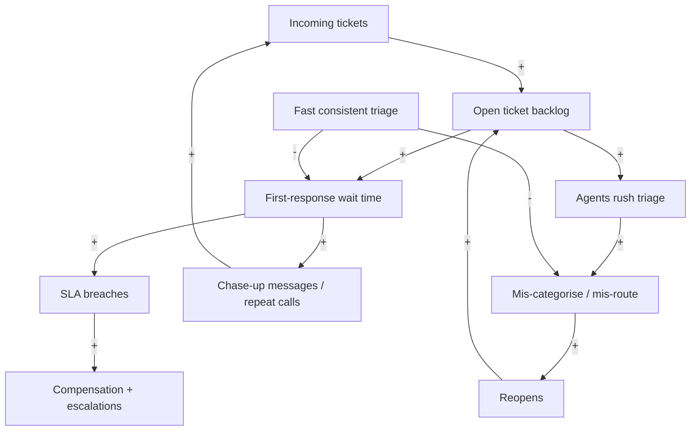

- **R1, the chase-up flood (reinforcing).** `Backlog → Wait → Chase-ups → Incoming → Backlog`. Slow first response *manufactures its own inbound volume*. The 26 calls and 155 messages against only 37 tickets show this multiplication.
- **R2, rush and reopen (reinforcing).** `Backlog → Rush → Mis-route → Reopens → Backlog`. Under pressure, agents triage faster and worse, and the 9 reopens flow straight back into the queue.
- **B1, the SLA/compensation brake.** Breach → compensation, which placates customers but drains margin (25.1M IDR): relief, not a fix.
- **B2, the fast-triage brake (the lever).** Fast, consistent triage → (−) wait, (−) mis-route. As in Chapter 17, *the intervention enters as an exogenous lever*: it is the brake the structure lacks.

**Delays.** The damaging delay is between *ticket arrival* and *correct routing*. Every minute there feeds both R1 and R2.

**Systemic insight.** The breach rate is not first a staffing problem. It is a *triage-latency and triage-consistency* problem that *creates* phantom volume (R1) and rework (R2).

### 18.3 Lens 2 — Stock & Flow

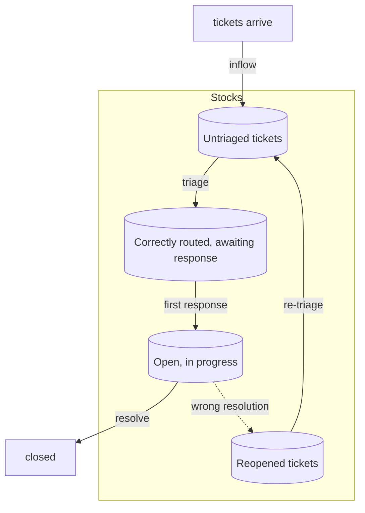

| Stock | Inflow(s) | Outflow(s) | Units |
|---|---|---|---|
| **Untriaged tickets** | tickets arrive; reopens | triage | tickets |
| Correctly routed | triage | first response | tickets |
| Open, in progress | first response | resolve / wrong-resolve | tickets |
| Reopened | wrong resolution | re-triage | tickets |

**Which flow rate the solution moves.** It raises the **triage outflow** from *untriaged tickets*, both its speed and its accuracy. Accuracy shrinks the `wrong-resolution → Reopened → re-triage` recirculation. The scarce resource being amplified is **agent attention**.

### 18.4 Lens 3 — Theory of Constraints

| Stage | What happens | Capacity / lead time today |
|---|---|---|
| 1. Intake | Ticket lands from a channel | Instant |
| 2. **Triage** (categorise, prioritise, route) | Human reads & classifies | **Serial on scarce agent attention** ← constraint |
| 3. First response | Agent replies | Median 145 min (tail to many hours) |
| 4. Resolve | Agent works the case | Median 49.4 h |
| 5. Close / reopen | Outcome | 9 reopens recirculate |

1. **Identify.** **Stage 2, triage.** It draws on the same scarce agent attention that Stages 3–4 need, and its errors create Stage-5 rework that re-enters Stage 2. The loud symptom (SLA breaches at Stage 3) sits downstream.
2. **Exploit.** Enforce a triage *template* (fixed category list, priority rubric, routing table), and work the queue by SLA clock rather than arrival order.
3. **Subordinate.** A correctly routed ticket with a suggested-response draft means the responding agent starts 60% of the way there.
4. **Elevate.** Add triage capacity that doesn't consume agent attention: a classifier that attaches category + priority + route the instant a ticket lands. This is where a **decision model** earns its place.
5. **Repeat: migration.** The constraint moves to **Stage-4 resolution capacity** and, for the hardest categories (resin quality, CoA, rate disputes), to **domain expertise**. The design must route *those* to humans rather than pretend to resolve them.

### 18.5 Lens 4 — Throughput Accounting

**T** = retained margin from avoided churn + avoided compensation. **I** = tickets sitting untriaged or open. **OE** = agent labour + classifier infra. *This case is scaled:* 37 tickets is a sample window, so the model reasons about 300 tickets per window.

| # | Assumption | Value | Basis |
|---|---|---|---|
| A1 | SLA breach rate (baseline) | 32% | dataset (12/37) |
| A2 | Compensation per breach-ish ticket | 679,000 IDR | dataset mean comp |
| A3 | Reopen rate | ~24% (9/37) | dataset |
| A4 | Agent triage time (manual) | 6 min/ticket | modelled |
| A5 | Agent first-response + resolve time | 45 min/ticket avg | modelled |
| A6 | Classifier auto-triage accuracy | 85%, abstains on 15% | modelled (decision-model target) |
| A7 | Breach rate after triage-at-arrival | 15% | modelled |
| A8 | Reopen rate after accurate routing | 12% | modelled |
| A9 | Loaded agent cost | 150,000 IDR/hr | modelled |
| A10 | Classifier infra (self-hosted) | 1.0M IDR / window | modelled |
| A11 | Tickets / window (consumer + picker + B2B) | 300 | modelled scale-up from the 37-ticket sample |

| Line (per 300 tickets / window) | Before | After | Δ |
|---|---|---|---|
| Compensation (300 × breach × 679k) | 65.2M | 30.6M | **ΔT ≈ +34.6M IDR** |
| Triage labour (humans triage only the 15% abstentions) | 4.5M | 0.68M | −3.8M |
| Reopen rework (300 × reopen × 45 min) | 8.1M | 4.05M | −4.05M |
| Classifier infra | — | 1.0M | +1.0M |
| **OE total** | 12.6M | 5.73M | **ΔOE ≈ −6.87M (saved)** |
| **Net = ΔT − ΔOE** | | | **≈ +41.5M IDR / window** |

**ROI** = 41.5M ÷ ~4.0M incremental spend (infra + ~3M integration amortised) ≈ **~10×** per window.

**Sensitivity.** The load-bearing assumption is **A7, the post-triage breach rate**, which drives nearly all of ΔT. If triage moves breach only from 32% to 25%, ΔT ≈ 14.3M and Net ≈ +21M. Even if the breach rate **did not move at all**, the labour saving alone (≈ +6.9M) keeps Net positive. *That restates the source's sensitivity line; see [Appendix C](#appendix-c--editors-notes-and-reconciliations).* A2 is dataset-anchored. *A pilot must measure A6/A7 over one real month and confirm the 300-ticket scale-up.*

### 18.6 Automation vs Agentic — An Honest Assessment

| Step | Nature | Throughput contribution | Build effort | Build priority |
|---|---|---|---|---|
| Ingest ticket from channel, normalise fields | **Automation** | Enabler | Low | 1 |
| **Categorise** into a fixed category list | **Decision model** | **Carries ΔT** (routing accuracy) | Medium | **2** |
| **Prioritise** (Urgent / High / Normal / Low) | **Decision model** | Carries ΔT (SLA focus) | Medium | **2** |
| **Route** to team | **Automation** (category → team map) | Converts decision → action | Low | 1 |
| Compute SLA clock, flag at-risk | **Automation** | Focuses the queue | Low | 1 |
| Draft first response | **Agentic (LLM), human-approved** | Speeds Stage 3 | Medium | 3 |
| Resolve hard cases (resin / CoA / disputes) | **Human expert** | — (route, don't automate) | — | — |
| Detect reopen risk / sentiment escalation | **Decision model** | Protects CSAT | Low | 3 |

**Effort decision.** The prize sits almost entirely in **getting category + priority right at arrival**: two *typed choices*. That is the textbook decision-model problem, **not** a generative-LLM problem. You want a fixed label set, calibrated confidence, and an **abstain → human** path for the ~15% of hard cases. The first-response draft is the only generative step, and it boosts *speed* rather than producing ΔT, so build it third, human-approved.

**Verdict: Decision-model-heavy, with a thin agentic drafting edge.** Putting "a support chatbot" on it would spend generation cost and latency on a *classification* job and lose the calibration and abstention that keep a wrong auto-route from reaching a customer. *The money is in the scorer, not the writer.*

**Break-even.** This is an internal ops tool, so size it on the Net prize: **≈ 41.5M IDR/window ≈ 124.5M IDR/yr (~$7,880/yr)**. One dev-year at $45k × 1.10 = **$49,500**, so a single tenant funds **≈ 0.16 developers**, about a **1.9-month** build for one developer that pays for itself within the first year. Price and volume (ticket count × compensation) move break-even far more than headcount does.

### 18.7 Solution Design

**Automation layer:**
- `ingest(channel_payload) → normalised_ticket`: unifies the six channels' fields.
- `route(category) → team`: a fixed category → team table (Delivery → Logistics CX, Resin quality → B2B tech, Picker payment → Hub ops, …).
- `sla_clock(ticket) → {due_at, at_risk_bool}`: deterministic SLA maths that sorts the queue by time-to-breach, not arrival.

**Decision-model layer (the core):**
- **Q1, category:** a typed choice over the category list (the dataset shows ~22; consolidate to ~10 routable buckets). **Abstain → human triage** below threshold.
- **Q2, priority:** a typed choice {Urgent, High, Normal, Low} with a rubric (keywords, `requester_type`=B2B, sentiment, order value). Abstain → default Normal + flag.
- **Q3, reopen/escalation risk:** binary; routes high-risk tickets to a senior agent.
- Backend: **Laya** (tickets carry masked PII and picker/B2B data best kept on-prem) or **Microsoft-Decision-1**.

**Deep-agent layer (thin, human-gated):** a **code-based** loop that drafts the first response *conditioned on the decided category* and pulls the matching macro or past-resolution snippet. The agent proposes and a human sends.

**Back to the constraint.** The decision-model layer elevates triage. The SLA clock subordinates the queue to it. The explicit **human route for hard categories** answers the *migrated* constraint.

### 18.8 Run It Yourself

No runnable artifact ships for this case yet; it is a design. A pilot plan:

```bash
# 1. Build a labelled set from the 37 tickets + 155 messages (category, priority).
# 2. Configure a decision model (Laya) on the label set; hold out 20%.
# 3. Measure accuracy, calibration and abstention; require abstain < 20% and
#    accuracy > 85% on held-out data before routing anything automatically.
# 4. Shadow-run for one window: classify live, compare to human triage, do not act.
# 5. Go live on category + priority + route; keep first-response drafting human-approved.
```

---

## Chapter 19 — Cart and Conversation Recovery

> **Project:** [`Data/Sales_Data/Abandoned_Carts/`](https://github.com/itsbharathp/LoopCycle/tree/main/Data/Sales_Data/Abandoned_Carts) · **Domain:** e-commerce conversion recovery · **Dataset:** 1,326 Shopify abandoned checkouts (**7.4% recovered**, mean cart **274,973 IDR**) + 979 Instagram DM/WhatsApp abandoned conversations (**7.4% recovered**, mean quote **271,805 IDR**, agent first-reply median **24 min**). Top Shopify reasons: unexpected_shipping_cost 226, payment_failed 225, distracted 163. Top IG reasons: price_concern 221, **slow_agent_reply 189**, colour/sold-out 114, shipping_cost 113.

### 19.1 The Problem

There are two parallel leaks. On the Shopify storefront, **1,326 checkouts** were started and abandoned, and only **98 (7.4%)** were recovered. On Instagram DM/WhatsApp, **979 sales conversations** reached a quote and died, and only **72 (7.4%)** were recovered. The abandonment *reasons* tell the story. On web, the top two, **unexpected shipping cost (226)** and **payment failed (225)**, are *structural and fixable without AI*. On social, the standout avoidable reason is **slow_agent_reply (189)**. At a mean cart of ~275k IDR and 45.9% GP (≈ 126k GP per cart), 1,228 unrecovered web carts park **≈ 155M IDR** of GP in a bathtub.

### 19.2 Lens 1 — Causal Loop Diagram

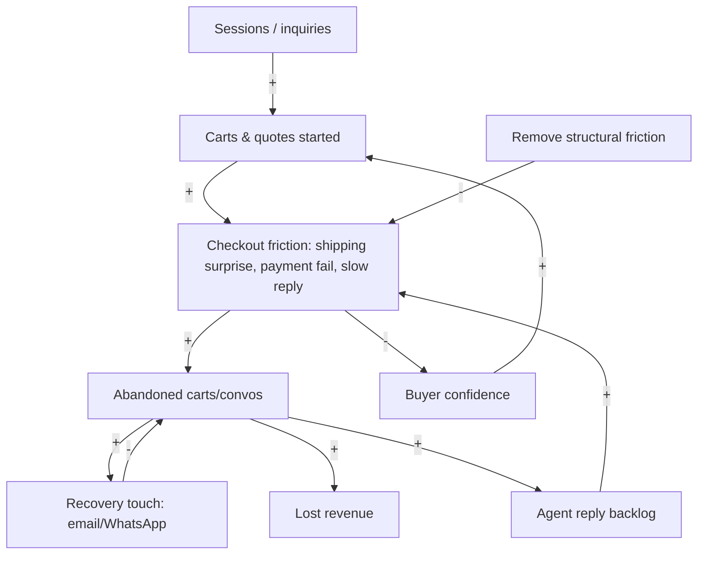

- **R1, friction → abandon → backlog (reinforcing).** `Abandoned convos → + reply backlog → + friction → + abandon`. On social, every un-replied inquiry worsens the backlog that causes the next slow reply. slow_agent_reply (189) is this loop made visible.
- **B3, the confidence ceiling (balancing: a limit to growth).** `Friction → − buyer confidence → + carts started → + friction`. One minus sign, so **balancing**. (The source labels it "R2, confidence erosion"; see [Appendix C](#appendix-c--editors-notes-and-reconciliations).) The behaviour is the same either way: shipping surprises and payment failures teach buyers to distrust checkout, and the loop settles the business at a *lower* level of cart starts. It is a ceiling, not a spiral.
- **B1, the recovery-touch brake (balancing).** `Abandon → recovery touch → − abandon`. It is weak today: a 7.4% recovery rate means B1 barely brakes.
- **B2, the fix-the-friction brake (the strongest lever, and *not* AI).** Remove structural friction → (−) friction. Showing shipping cost earlier and fixing the payment path attack the two biggest web reasons at the source.

**Delays.** Recovery touches that arrive hours after abandonment miss the buyer's intent window. That delay in B1 is why its gain is low.

**Systemic insight.** The headline instinct is "AI to recover carts". But the two biggest web reasons are *structural* (B2: automation/UX), and the biggest avoidable social reason is *latency* (R1: an auto-acknowledge + fast quote, barely any AI). The genuinely model-shaped slice, personalised and well-timed recovery copy, is real but *third* in size.

### 19.3 Lens 2 — Stock & Flow

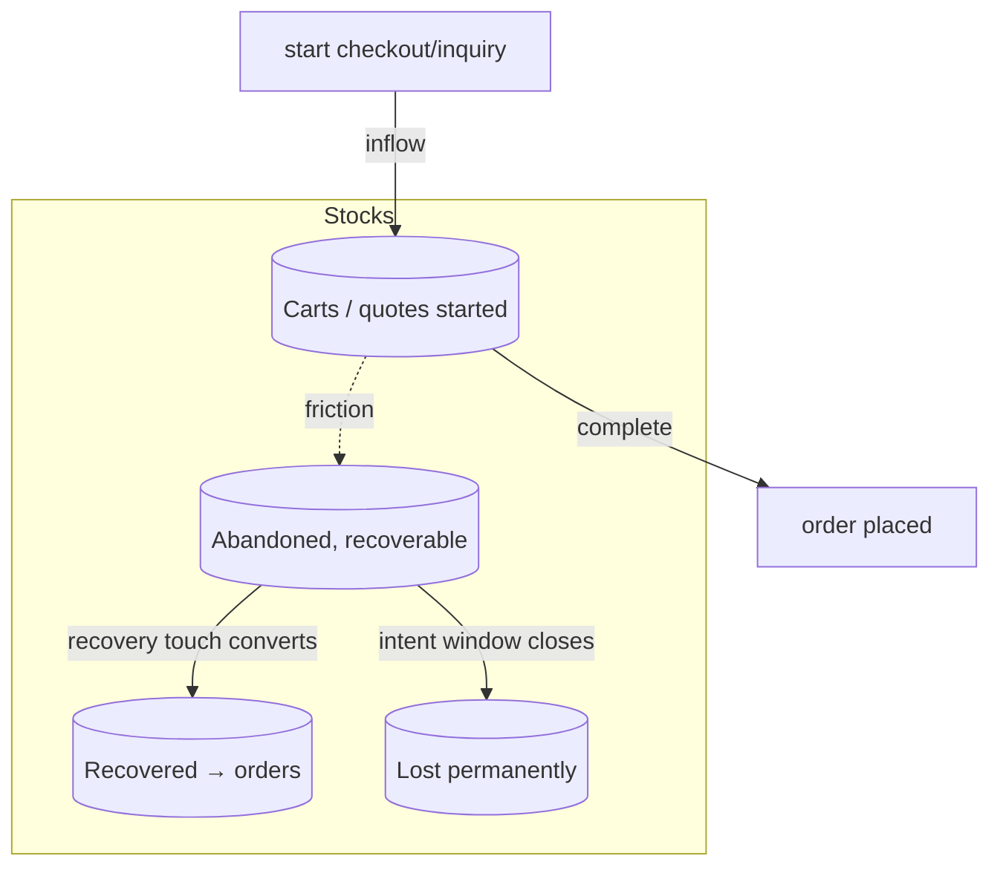

| Stock | Inflow(s) | Outflow(s) | Units |
|---|---|---|---|
| Carts / quotes started | start checkout/inquiry | complete / abandon | carts |
| **Abandoned, recoverable** | friction | recovery conversion / permanent loss | carts |
| Recovered → orders | recovery touch converts | — | orders |

**Which flow rate the solution moves.** Two rates, with two different interventions. **(a)** Reduce the **abandon inflow** by removing structural friction (B2, automation/UX, the biggest effect). **(b)** Raise the **recovery conversion outflow** before the intent window closes (B1: a fast auto-touch + a thin layer of personalised copy). The scarce resource is **buyer intent**, which decays fast, so *timing* matters more than cleverness.

### 19.4 Lens 3 — Theory of Constraints

| Stage | What happens | Capacity / lead time today |
|---|---|---|
| 1. Attract | Session / inquiry arrives | OK |
| 2. **Convert checkout** | Buyer completes payment | **Structural friction: shipping surprise + payment fail (451 of 1,326 reasons)** ← web constraint |
| 2′. **Reply to inquiry** (social) | Agent quotes & answers | **slow_agent_reply (189)** ← social constraint |
| 3. Recover | Touch brings buyer back | 7.4%: weak |

1. **Identify.** There are *two* constraints on two channels. On web it is **checkout friction**: 451 of the reasons are structural, not persuasion. On social it is **agent reply latency**. Recovery copy is *not* the constraint; it sits downstream of both.
2. **Exploit.** Surface the shipping quote on the product page; add an instant payment-retry link on failure; auto-acknowledge every IG inquiry in under a minute with price and colours.
3. **Subordinate.** Recovery touches fire within minutes, pre-filled with the exact cart or quote, so the buyer can complete in one tap.
4. **Elevate.** Only *here* does a model help: choosing the *best recovery message or offer per abandoned cart*. Even this leans towards a decision model (pick the template/offer) more than open-ended generation.
5. **Repeat: migration.** Fix friction and latency and the constraint migrates to **offer economics** (is a voucher worth the margin?) and **inventory** (colour sold out, reason #3 on social, 114 cases): a *merchandising* constraint no recovery message can solve.

### 19.5 Lens 4 — Throughput Accounting

| # | Assumption | Value | Basis |
|---|---|---|---|
| A1 | Web abandoned carts / window | 1,326 | dataset |
| A2 | Social abandoned convos / window | 979 | dataset |
| A3 | GP per cart | ~126,000 IDR | dataset (45.9% of 274,973) |
| A4 | Baseline recovery rate | 7.4% | dataset (both channels) |
| A5 | Share of web abandons that are structural (shipping + payment) | 34% | dataset (451/1,326) |
| A6 | Friction removal recovers this share of structural abandons | 40% | modelled |
| A7 | Recovery rate after fast touch + personalisation | 14% | modelled |
| A8 | Personalisation infra + touch sends | 3.0M IDR / window | modelled |
| A9 | One-off friction/UX dev | 20M IDR, amortised over 10 windows → 2.0M | modelled |

- **Structural friction removal (B2, automation):** 1,326 × 34% × 40% × 126k ≈ **22.7M IDR GP / window**. *No model involved.*
- **Recovery-rate lift (B1, fast touch + light model):** 2,305 abandoned × (14% − 7.4%) × 126k ≈ **19.2M IDR GP / window.**

| Metric | Before | After | Δ |
|---|---|---|---|
| T (recovered + un-abandoned GP) | baseline 7.4% | + friction fix + lift | **ΔT ≈ +41.9M IDR / window** |
| OE | ~0 | infra 3.0M + amortised dev 2.0M | **ΔOE ≈ +5.0M IDR** |
| **Net = ΔT − ΔOE** | | | **≈ +36.9M IDR / window** |

**ROI** = ΔNet ÷ incremental spend = 36.9 ÷ 5.0 ≈ **~7.4×** per window. (The source quotes ~8×, computed as ΔT ÷ ΔOE.) Note that **~55% of ΔT (the 22.7M) needs no AI at all.**

**Sensitivity.** The load-bearing assumptions are **A7** and **A6**. If A7 is only 10%, the lift prize falls to ~7.5M, but the *structural* 22.7M is untouched, so Net stays ≈ +25M. The conclusion is robust precisely *because* its larger half is automation, not a model whose yield is uncertain.

### 19.6 Automation vs Agentic — An Honest Assessment

| Step | Nature | Throughput contribution | Build effort | Build priority |
|---|---|---|---|---|
| Show shipping cost on PDP; shipping calculator | **Automation / UX** | **Carries ~half of ΔT** | Low–Med | **1** |
| Payment-retry link on failure; expiry extension | **Automation** | Carries ΔT | Low | **1** |
| Auto-acknowledge IG inquiry (price + colours) in under 1 min | **Automation** | Kills R1 latency | Low | **1** |
| Detect abandonment + fire timed recovery touch | **Automation** (rules/trigger) | Enables B1 | Low | 1 |
| Classify abandonment reason | **Decision model** | Targets the touch | Low | 2 |
| Pick recovery template/offer per reason | **Decision model** | Lifts recovery rate | Medium | 2 |
| Write personalised recovery copy | **Agentic (LLM)** | Marginal lift | Medium | 3 |
| Decide voucher economics | **Automation** (margin rule) | Protects GP | Low | 2 |

**Effort decision.** The single most important finding is that **the biggest throughput row is pure automation/UX**. Build those rows *first*: they need no model and no data science. The *decision-model* rows carry the recovery-rate lift and are the sensible second investment. **Generative copy comes third and is the smallest**: a nice-to-have, not the prize.

**Verdict: Automation-first hybrid.** Marketed as "AI cart recovery", this case is mostly plumbing and UX, with a decision model in the middle and only a sliver of genuine generation. *A team that bought a generative "recovery AI" and skipped the shipping-cost fix would be spending model money to recover carts its own checkout was manufacturing.*

**Break-even.** Net ≈ **36.9M IDR/window ≈ 110.7M IDR/yr (~$7,000/yr)**. Against **$49,500** per dev-year, a single tenant funds **≈ 0.14 developers**: a **~1.7-month** single-developer build that pays back within year one (≈ 0.09 devs on a conservative two-thirds ramp).

### 19.7 Solution Design

**Automation layer** (the majority; build first):
- `shipping_quote(cart) → cost`, surfaced on the PDP and cart, not at the final step.
- `payment_retry_link(failed_checkout) → url`; `extend_expiry(checkout)`.
- `auto_ack(ig_inquiry) → reply` within 60 s, with price, colours, stock and a buy link.
- `on_abandon(cart) → schedule_touch(t+Δ)`: a deterministic trigger with the exact cart pre-filled.
- `voucher_ok(cart) → bool`: a margin-rule guard before any discount is offered.

**Decision-model layer:**
- **Q1, reason:** a typed choice over the reason set (the dataset ships the labels). Abstain → generic touch.
- **Q2, best action:** a typed choice {reminder, shipping-reassurance, payment-help, small-voucher, colour-alternative, no-touch}. Abstain → default reminder. Backend: **Laya** (buyer PII on-prem) or **Microsoft-Decision-1**.

**Deep-agent layer (thin):** a **skill-based** copy generator that writes the recovery message *given* the chosen action and cart. It is internal-facing and reviewed in aggregate, so skill-based iteration speed is acceptable.

**Back to the constraint.** Automation attacks the web constraint (checkout friction) and the social constraint (reply latency) head-on. The decision-model layer raises B1's gain. The **voucher margin rule** and an explicit *out-of-stock → merchandising* flag address the migrated constraints. The design refuses to paper over a sold-out colour with a recovery email.

### 19.8 Run It Yourself

There is no shipped artifact; instead, a staged pilot:

```bash
# Stage 1 (automation, no AI): add a PDP shipping estimate + payment-retry link.
#   Measure the abandon-reason mix over one window — expect shipping/payment to fall.
# Stage 2 (decision model): label abandons by reason from the dataset; configure Laya;
#   A/B timed touches (reason-aware template) vs generic. Target recovery 7.4% → 12%+.
# Stage 3 (generation): add personalised copy only where Stage 2 shows headroom.
```

---

## Chapter 20 — Content-to-Sales Planning

> **Project:** [`Data/Post_Data/`](https://github.com/itsbharathp/LoopCycle/tree/main/Data/Post_Data) + [`loopcycle_tote_post_sales_lift.csv`](https://github.com/itsbharathp/LoopCycle/blob/main/Data/Sales_Data/loopcycle_tote_post_sales_lift.csv) · **Domain:** social-content strategy / marketing attribution · **Dataset:** 30 Instagram posts (median reach **4,577**, median engagement **8.26%**), 1,515 comments, 8 modelled sales-lift events (972 attributed orders). Pillars: loop_tote 8, picker_stories 6, process_impact 6, behind_the_scenes 5, education 3, b2b_partners 2. Formats: VIDEO 11, CAROUSEL 11, IMAGE 8.

### 20.1 The Problem

Instagram is LoopCycle's demand engine. 606 orders are attributed to Instagram DM/WhatsApp, and the sales-lift file shows posts driving real spikes. But the lift is **wildly uneven**. A single `batik_reel` (reach 20,392) is credited with **545 attributed orders** and a +454% 24-hour lift, while a `care_carousel` produced **0% lift** and `quiz_image` just +14%. The content team plans by feel. With only 30 posts and 8 lift events, the data is thin, which is itself the key finding. The question: *how should LoopCycle decide what to post next, and does that decision need generative AI?*

### 20.2 Lens 1 — Causal Loop Diagram

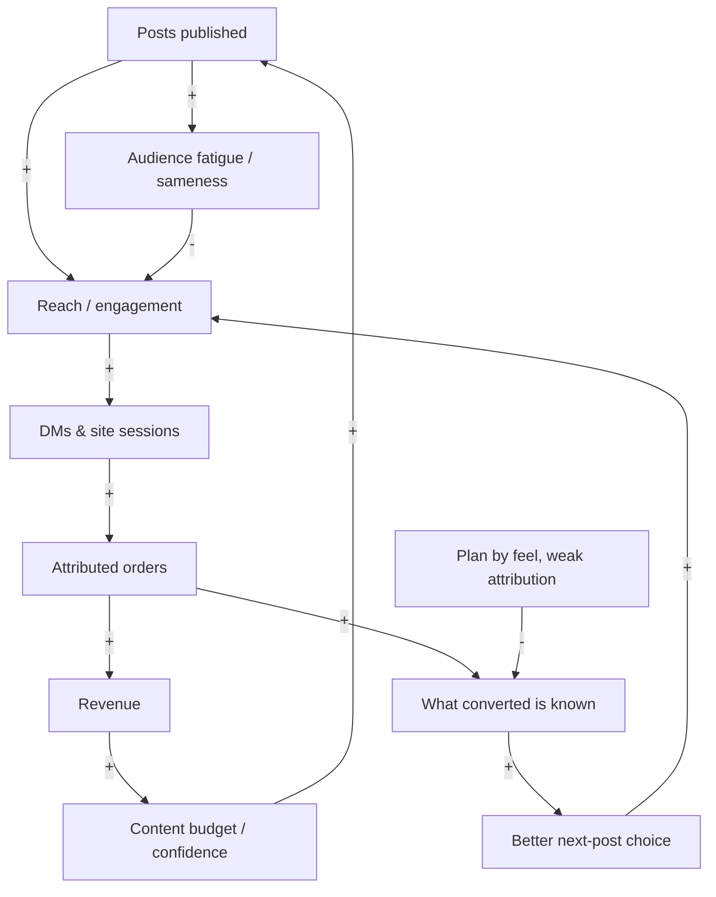

- **R1, the virtuous content flywheel (reinforcing).** `Posts → Reach → Inquiries → Orders → Revenue → Budget → Posts`. When content works, it funds more content. The batik_reel is this loop firing.
- **R2, the learning loop (reinforcing, currently weak).** `Orders → What converted is known → Better next choice → Reach → … → Orders`. It *should* compound, but `Plan by feel → (−) learning` keeps its gain near zero.
- **B1, the fatigue brake (balancing).** `Posts → Audience fatigue → (−) reach`: posting more of the same decays reach.

**Delays.** Attribution delay: the link from a post to the orders it caused is blurry and arrives late, starving R2.

**Systemic insight.** The constraint is not creativity or generation; LoopCycle already produces varied content. It is the **broken learning loop (R2)**. Weak attribution means the flywheel can't be *steered*. The prize is in *measurement and choice*, not in generating more posts.

### 20.3 Lens 2 — Stock & Flow

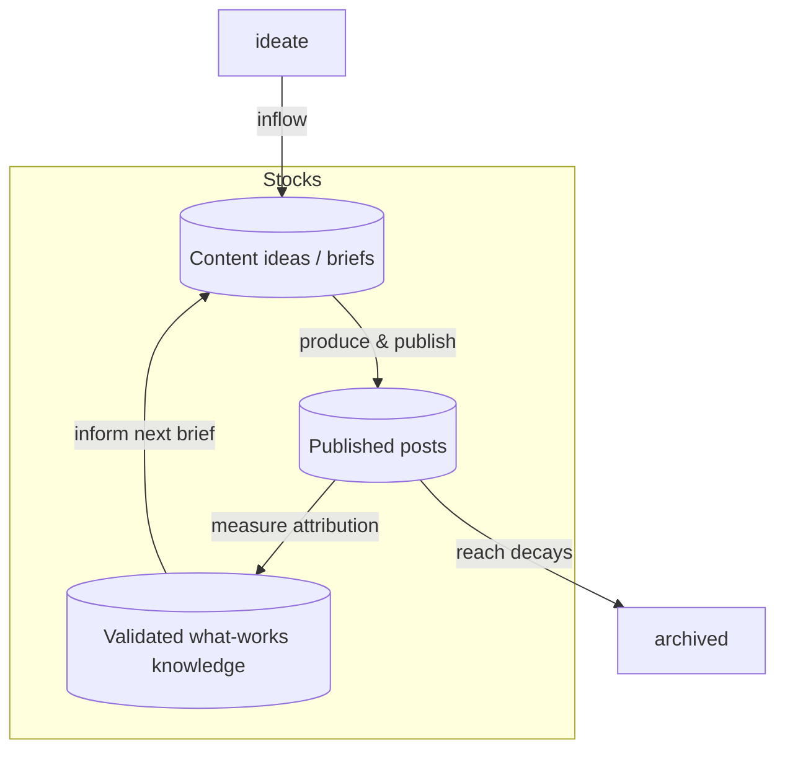

| Stock | Inflow(s) | Outflow(s) | Units |
|---|---|---|---|
| Content ideas / briefs | ideate (informed by knowledge) | produce & publish | briefs |
| Published posts | produce & publish | reach decays | posts |
| **Validated what-works knowledge** | measure attribution | (feeds briefs) | insights |

**Which flow rate the solution moves.** It raises the **"measure attribution" inflow** into *validated knowledge*. It does **not** try to raise the produce rate: generating more posts without closing R2 just hits the fatigue brake. *Amplify the learning rate, not the output rate.*

### 20.4 Lens 3 — Theory of Constraints

| Stage | What happens | Capacity / lead time today |
|---|---|---|
| 1. Ideate | Come up with post concepts | Not scarce |
| 2. Produce | Shoot/edit a post | Some cost; not the binding limit |
| 3. Publish | Post goes live | Instant |
| 4. **Attribute / learn** | Know which posts drove orders | **Weak, slow, feel-based** ← constraint |
| 5. Choose next | Decide the next brief | Starved by Stage 4 |

1. **Identify.** **Stage 4, attribution/learning.** The loud activity (publishing) hides the quiet missing capability (measuring).
2. **Exploit.** Use data already captured (`post_sales_lift.csv`, `attributed_ig_post_id` on orders, per-post reach) to rank past posts by *attributed orders per unit of reach*. That exposes that reels and batik/design pillars convert while quiz/care posts don't.
3. **Subordinate.** Brief the next posts to *replicate* proven attributes, and *stop* producing proven non-converters.
4. **Elevate.** Add a lightweight model that **predicts a new brief's expected attributed-orders band** from its attributes and flags low-confidence briefs. This is a decision/estimation model, not a generator.
5. **Repeat: migration.** The constraint moves to **production capacity** (can we shoot enough reels?) and then to **audience fatigue / the reach ceiling**, at which point *paid amplification* is the next move. *The learning model buys you a production problem, which is a good problem.*

### 20.5 Lens 4 — Throughput Accounting

| # | Assumption | Value | Basis |
|---|---|---|---|
| A1 | Posts / window | 30 | dataset |
| A2 | Attributed orders across lift events | 972 (sum of 8 events) | dataset |
| A3 | GP per order | 135,811 IDR | dataset |
| A4 | Share of posts that are weak converters | ~40% | dataset (quiz/care/some image ≈ low lift) |
| A5 | Reallocating effort to proven shapes lifts attributed orders by | 25% | modelled |
| A6 | Analytics + estimation model cost | 2.0M IDR / window | modelled |
| A7 | Production cost unchanged (reallocated, not increased) | 0 Δ | modelled |

| Metric | Before | After | Δ |
|---|---|---|---|
| T (content-attributed GP) | 972 × 135,811 ≈ 132M | 165M (+243 orders) | **ΔT ≈ +33M IDR / window** |
| OE | content cost C | C + 2.0M | **ΔOE ≈ +2.0M IDR** |
| **Net = ΔT − ΔOE** | | | **≈ +31M IDR / window** |

**ROI** = 31 ÷ 2.0 ≈ **~15×** per window (the source quotes ~16×, computed as ΔT ÷ ΔOE), *if* the attribution signal is real.

**Sensitivity.** This is the **shakiest** case in the book, and the honesty matters. ΔT rests on **A2/A5** and on attribution modelled from **only 8 lift events and 30 posts**. If the reallocation lift is 10% rather than 25%, ΔT falls to ~13M: still net-positive, but with a wide confidence interval. If attribution is largely spurious (reels reach more people *because they're reels*, not because of content choice), ΔT could approach zero. Concentration makes this worse: **one post, `batik_reel`, carries 545 of the 972 attributed orders (56%)**, so any "what works" model is, statistically, mostly a model of a single outlier. **The sign is likely positive but is the least certain in the book.** *This case must start as measurement, not automation.*

### 20.6 Automation vs Agentic — An Honest Assessment

| Step | Nature | Throughput contribution | Build effort | Build priority |
|---|---|---|---|---|
| Join posts ↔ attributed orders ↔ reach/engagement | **Automation** | **Enabler for all of ΔT** | Low | **1** |
| Rank posts by attributed orders per reach | **Automation** | Surfaces what works | Low | **1** |
| Classify post attributes (format/pillar/hook) | **Automation** (metadata) + light model | Enabler | Low | 1 |
| **Predict a brief's expected attributed-orders band** | **Decision / estimation model** | **Carries ΔT** | Medium | 2 |
| Flag low-confidence briefs for a human | **Decision model (abstain)** | Protects against bad bets | Low | 2 |
| Generate caption / hook variants for a chosen brief | **Agentic (LLM)** | Marginal (speeds production) | Low–Med | 3 |
| Decide the paid-amplification budget | **Automation** (ROAS rule) | Addresses the migrated constraint | Low | 3 |

**Effort decision.** The prize sits in **measurement (automation) + an outcome-estimation model**. Generative caption-writing, the thing most teams would call "the AI content strategy tool", is the **lowest-value row**. Build the join + ranking first (pure SQL/pandas); it may be enough on its own.

**Verdict: Decision model + measurement, NOT generative.** This is the case most likely to be mis-sold as "generative AI for content", and the one where that framing is most wrong. *A `GROUP BY format, pillar` over the existing data is the single highest-ROI first move, and it contains no model at all.*

**Break-even.** Net ≈ **31M IDR/window ≈ 93M IDR/yr (~$5,900/yr)** at the modelled lift. With a 50% haircut for attribution uncertainty that is **~$2,950/yr**, which funds **≈ 0.06 developers**, or **~3 weeks** of one developer's time. That is exactly the right size: the first deliverable is an analytics notebook, not a product.

### 20.7 Solution Design

**Automation layer** (build first; it may be enough):
- `attribution_table()`: joins `instagram_posts_flat` + `post_sales_lift` + orders' `attributed_ig_post_id` into one row per post.
- `rank_posts()`: attributed orders per 1k reach, sliced by format and pillar. It emits "do more of / stop doing" lists (today: more reels + batik/design; fewer quiz/care static images).
- `brief_metadata(brief) → {format, pillar, hook_type, timing}`.

**Decision-model layer:** **Q1, expected outcome band.** Estimate {low / medium / high} attributed orders for a proposed brief, with calibrated confidence. **Abstain → a human picks** when the brief is novel. That will be common with only 30 training posts, and the model must *know* its data is thin. **Laya** fits better than a managed API here (small data, calibration-first).

**Deep-agent layer** (optional, built last): a **skill-based** caption/hook generator that drafts variants *for a brief the decision model rated high*. Generation serves a validated selection; it never leads it.

### 20.8 Run It Yourself

```bash
# The highest-ROI first move needs no model — just the join:
python3 - <<'PY'
import csv
lift=list(csv.DictReader(open('Data/Sales_Data/loopcycle_tote_post_sales_lift.csv')))
for r in sorted(lift, key=lambda x:-int(x['modeled_attributed_orders'])):
    print(f"{r['post_tag']:18} {r['format']:9} reach={r['ig_reach']:>6} attr_orders={r['modeled_attributed_orders']:>4}")
PY
# Then: GROUP BY format & pillar to get the "do more / stop" lists before any model.
```

---

# Part VI — Synthesis

## Chapter 21 — Patterns Across Nine Cases

Each source field book closed with its own synthesis chapter, comparing three cases, one case, or four. Read together, the nine cases from four companies show patterns that no single book could: across industries (manufacturing, refining, industrial procurement, consumer commerce), across scales (a 40,000-person multinational to a 160-person social enterprise), and across currencies. This chapter is the reason the books were merged.

### 21.1 The constraint is almost never the obvious step

| Company | Case | Loud symptom / obvious "fix" | **Actual constraint** | Constraint family |
|---|---|---|---|---|
| Danfoss | Supplier Performance Review | "We don't have the data" | Judgement-heavy **meeting prep** (the data was always there) | Scarce judgement |
| Danfoss | 8D Report | "Root-cause analysis takes 45 days" | **Engineer classification + drafting labour** (lab time runs in parallel) | Scarce judgement |
| Danfoss | Customs Clearance | "The merge is slow" | The once-daily **batch cadence** | Latency / cadence |
| Crestmount | Planner Bottleneck | "Hire more planners" | **Planner attention** spent on noise and context-gathering (capacity is 8× inflow) | Scarce judgement |
| Meridian | Vendor-Pool Collapse | "The team is overloaded; prices are up" | The **responding/bidding vendor pool** (invitations flat, bids −30%) | Degraded stock / feedback |
| LoopCycle | Delivery Monitor | Angry calls, compensation | **Detection latency** (finding out through the customer) | Latency / cadence |
| LoopCycle | Support Triage | SLA breaches at first response | **Triage latency + accuracy** upstream | Latency / cadence |
| LoopCycle | Cart Recovery | Low recovery rate → "AI recovery emails" | **Checkout friction + reply latency** | Latency / cadence (+ structure) |
| LoopCycle | Content Planning | "Post more / post better" | The **broken attribution/learning loop** | Degraded stock / feedback |

The nine constraints fall into **three families**, and each family points to a different kind of solution:

1. **Scarce judgement** (UC-1, UC-2, Crestmount). A small group of experts spends attention on the wrong work. *Fix:* filter, pre-assemble and draft, so the experts edit instead of author. This is where agents earn their keep.
2. **Latency and cadence** (UC-3, delivery, support, cart). The work is fast, but it *starts too late* or runs in batches. *Fix:* move the moment of detection or processing upstream. This is mostly automation and decision models; an LLM appears only where the *detection itself* needs open-ended research (delivery).
3. **Degraded stocks and feedback** (Meridian, content). An accumulation that should feed the system (willing vendors, validated knowledge) is draining, and the loop that should refill it is broken or slow. *Fix:* repair the loop, by policy (on-time payment) or by measurement (attribution). Agents shorten delays here but do not supply the missing structure.

> **The one habit to keep:** *don't automate the loud step; find the gating step.* In nine cases out of nine, the naive answer was wrong.

### 21.2 Where the money shows up — and what that says about the step

| Case | ΔT | ΔOE | Net | ROI / payback | Dominant term |
|---|---|---|---|---|---|
| Danfoss UC-1 | +€176k/yr | +€141/yr | +€176k/yr | ~11.6× | **ΔT** (OE flat) |
| Danfoss UC-2 | +€532k/yr (€161k reports + €370k warranty) | −€260k/yr | ≈ +€797k/yr (€426k without warranty) | ~28.7× (9.4× on OE alone) | **ΔT largest but softest; ΔOE is the defensible floor** |
| Danfoss UC-3 | +£2,250/mo | −£2,788/mo | +£5,038/mo | ~3.4×, payback ~1.2 mo | **ΔOE** |
| Crestmount | +$3.37M/yr | +$9.1k/yr | +$3.36M/yr | ~36×, payback ~10 days | **ΔT** |
| Meridian (diagnosis) | **−$289k** lost over 10 mo | +$14k over 10 mo | break-even budget ≈ $303k | — | **ΔT** (the pain was never OE) |
| LoopCycle delivery | +16.8M IDR/window | +6.9M | +9.9M | ~1.4× | **ΔT** |
| LoopCycle support | +34.6M IDR/window | −6.9M | +41.5M | ~10× | **ΔT + ΔOE** |
| LoopCycle cart | +41.9M IDR/window | +5.0M | +36.9M | ~7.4× | **ΔT** (55% from no-AI UX) |
| LoopCycle content | +33M IDR/window* | +2.0M | +31M* | ~15×* | **ΔT** (*attribution-gated) |

*Currencies and periods differ by design; compare signs and ratios, not absolute values.*

Three readings:

1. **ΔT is the largest term in eight of nine cases.** The win in knowledge work is amplifying a scarce resource, not cutting it. Meridian is the purest example: the team *felt* the pain as overtime (OE), but OE moved $14k while Throughput fell $289k.
2. **Where ΔOE carries the case, the step is consolidation or labour-heavy drafting.** UC-3 (pure consolidation) is the only OE-led case, and it is *automation*. UC-2's ΔT is larger but rests on the softest assumption (a 12% warranty reduction), so its *defensible* case is the 90% OE collapse on 8 h of drafting per report. When you see an OE-led business case, ask first whether the step is really automation.
3. **Match the pitch to the dominant term.** "Throughput amplifier" (UC-1, Crestmount), "cost + quality" (UC-2, support), "automate the toil" (UC-3), "protect the margin" (Meridian, delivery), "learn, don't generate" (content). The same technology gives very different financial stories, and the wrong pitch loses the budget.

### 21.3 The constraint always migrates — plan for Step 5

| Case | After elevation, the constraint migrates to… | The design's answer |
|---|---|---|
| Danfoss UC-1 | **Action-item closure** (~18%) | `get_action_items`: redeploy freed hours to chasing 75 open actions |
| Danfoss UC-2 | **Physical lab / root-cause time** (~45 d) | None in software; redirect to process redesign |
| Danfoss UC-3 | **Upstream SAP CDS data quality** (18/30 blocked days) | `get_open_issues_summary` surfaces clustered gaps |
| Crestmount | **Scheduler, parts and permit lead times** | `check_execution_readiness`, the migration probe |
| Meridian | **Foresight about exogenous shocks** (editor's reading) | Pair the Oracle (statistics) with the Tactician (causal reasoning) |
| LoopCycle delivery | **Source trust → operator approval throughput** | `verified`/`confidence` flags; batched, severity-filtered approvals |
| LoopCycle support | **Resolution expertise** on hard categories | Explicit human route for resin / CoA / disputes |
| LoopCycle cart | **Offer economics → inventory** | Voucher margin rule; out-of-stock → merchandising flag |
| LoopCycle content | **Production capacity → audience fatigue** | ROAS / paid-amplification rule; abstain on novel briefs |

In every case, the best-designed component is the one that **makes the next constraint visible** (`get_action_items`, `get_open_issues_summary`, `check_execution_readiness`, `verified` flags). **An agent that doesn't help you see the next constraint is a dead end.** Two of the migrations, UC-2's lab time and Meridian's exogenous shocks, cannot be fixed by software at all, and saying so is part of the analysis.

### 21.4 The honest scorecard: automation, decision model, or agent?

| Case | Automation | Decision model | Agentic (LLM) | Other | **Verdict** |
|---|---|---|---|---|---|
| Danfoss UC-1 | KPI pull, flagging, risk-ranking | — | **Prep drafts, meeting summaries** | — | Hybrid, leaning agentic |
| Danfoss UC-2 | Q2/Q3 retrieval | **4-way classification** | **8D drafting** | — | Hybrid — all three |
| Danfoss UC-3 | **Merge + 4 rules + export** | — | — (gap analysis at most) | — | **Automation** |
| Crestmount | **Dedup, context brief, ranking, readiness probe** | **Severity, false-positive, duplicate** | WO drafting (bounded) | Human verdict | Hybrid, decision-model-heavy |
| Meridian | Health/payment data layer, flags | Inbox triage (Front Door) | **Watchdog, Tactician** | **Policy** (pay on time); TimesFM forecaster | Hybrid — top lever is policy |
| LoopCycle delivery | Load, group, delay maths (~70%) | Severity | **Open-web research** + approved drafts | — | Hybrid, agentic nub |
| LoopCycle support | Ingest, route, SLA clock | **Category, priority, reopen risk** | Thin first-response draft | Human experts | Decision-model-heavy |
| LoopCycle cart | **Shipping, payment, auto-ack (55% of ΔT)** | Reason + action selection | Thin copy | — | Automation-first hybrid |
| LoopCycle content | **Join + ranking** | Outcome estimation | Caption variants (last) | — | Decision model + measurement |

**Count what carries the money:**

| Where the prize sits | Cases | Count |
|---|---|---|
| The **LLM** is the primary value carrier | UC-1, LoopCycle delivery, Meridian (Watchdog/Tactician, behind a policy) | **3** |
| The LLM **shares** the prize with a decision model | UC-2 | **1** |
| The LLM is a **thin, last layer**; the money is in automation and decision models | Crestmount, support, cart, content | **4** |
| **No LLM** belongs in the critical path | UC-3 | **1** |

All nine cases were shipped or pitched as "AI agents". In **five of nine**, a team that built generation-first would have spent most of its budget in the wrong place. This contrast is the most valuable finding of the merged book, and it only becomes visible at scale.

> **The discipline, restated:** most "AI projects" are an automation core, often a decision-model front end, and a small irreducibly agentic nub, with a human at the gate. Reach for the LLM *only* for the nub.

### 21.5 One architecture keeps recurring: System 1 in front of System 2

Strip the domain away and five cases converge on the same three-layer shape:

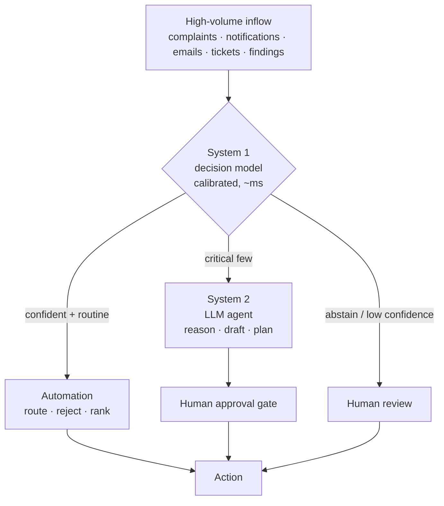

| Case | System 1 (decides) | System 2 (reasons / writes) | Human gate |
|---|---|---|---|
| Danfoss UC-2 | 4-way FC classifier with abstention | 8D drafting | `LOW CONFIDENCE — HUMAN REVIEW` banner |
| Crestmount | Severity + false-positive + duplicate | WO drafting | Planner keeps the convert/reject/escalate verdict |
| Meridian | Front Door: queue, urgency 0–5, language | Watchdog + Tactician | Recommendations, not actions |
| LoopCycle delivery | Severity of a verified finding | Open-web research + email drafts | Operator approves every send |
| LoopCycle support | Category + priority + reopen risk | First-response draft | Agent sends |

**Abstention is the hinge.** In each case, the decision model's right to say *"I'm not sure"* is what makes automation safe near the costly errors: a rejected real failure near a T1 asset, a misrouted B2B quality complaint, a REPEAT that is really a CA_FAILURE. In the CLDs, abstention often works as a *designed balancing loop*. It turns a silent wrong guess, which would feed a reinforcing spiral, into an explicit escalation.

### 21.6 Check the signs: the brake is often the intervention

Re-checking every Causal Loop Diagram edge by edge (counting minus signs around each closed loop, as [Chapter 3](#chapter-3--the-four-lenses) teaches) turned up a finding that recurs across the sources:

- In **Meridian** and **Danfoss UC-2**, *every* loop that closes in the drawn structure is **reinforcing**. Loops labelled "balancing" in the source text turn out to be the reinforcing loops traced in their virtuous direction, or they need an edge the diagram omits. In **UC-1**, the only closing balancing loops are the *automation-adoption* loops.
- In several LoopCycle diagrams, the "brake" (early detection, fast triage, fixing friction) enters as an **exogenous lever**, an arrow from outside, rather than as a closed loop.

That is not just a drafting error; it is the story. **These systems have no internal brake.** Their vicious spirals ran until something outside the loop intervened. The solutions are best understood as **designed balancing loops**: Meridian's Watchdog + payment policy, UC-2's abstention gate, LoopCycle's detection run. In a workshop, make participants *draw the loop the intervention closes*. If they can't close it, the intervention is a one-off push, not a structural fix. (The corrections are listed in [Appendix C](#appendix-c--editors-notes-and-reconciliations).)

### 21.7 Where to Point AI: Workforce and Data Density

Two of the companies give opposite but complementary advice on *where* in an organisation to aim AI.

**Danfoss: follow the work character.** The largest function, Finance & Operations (43.2%, ~17,300 people), is the *most automatable*: high-volume, rule-based and repetitive. UC-3 is its archetype. Engineering (29.0%) is where the irreducibly agentic nubs cluster (8D drafting). Sales & Marketing (27.8%) was untouched by the Danfoss cases.

| Function | Dominant work character | First-reach tool | Cases in this book |
|---|---|---|---|
| **Finance & Operations** | High-volume, rule-based, repetitive | **Automation** (+ decision models) | UC-1 data layer, UC-3, Crestmount automation, Meridian data layer |
| **Engineering / technical** | Judgement, synthesis, document generation | **Agentic** (+ decision models) | UC-2 drafting, Crestmount WO drafting |
| **Sales, marketing & service** | Relationship + content, scoring, triage | **Decision models** first; agentic content last | All four LoopCycle cases, Meridian Front Door |

LoopCycle fills the Sales & Marketing gap, and it confirms the prediction: three of its four cases are decision-model or automation problems, not generative ones.

**LoopCycle: point AI where the instrumented data already is.** LoopCycle's deepest value is its 3,500 pickers and 12 hubs, yet all four cases aim at the thin consumer layer on top, because that is where the digital exhaust (orders, carts, tickets, comments) is dense enough to model. The highest-*mission* work (fair picker payment, resin quality) may be the *least* data-rich, and so the *least* ready for a model. It is a candidate for automation (payment reliability) long before an agent.

**Meridian: beware the instrumented-but-blind metric.** The gauge everyone watched, invitations per RFQ, was dense, clean and completely uninformative. Data density tells you where a model *can* go, not where it *should*. Only the constraint analysis tells you that.

> **Combined rule:** match the tool to the *work character* of each function; aim first where data is dense *and* the constraint lives; and never let a comfortable metric stand in for the constraint.

### 21.8 Break-even Across the Portfolio

All nine cases use the same formula ([Chapter 7](#chapter-7--sizing-the-build-break-even-and-team-size)). The results diverge because the *economic frame* differs:

| Case | Frame | Key assumptions (labelled) | Break-even team | Build effort | Verdict |
|---|---|---|---|---|---|
| Danfoss UC-1 | Product vendor | €35k ARR × 5, 18 mo, €44k/dev | 2.4–3.6 | ~2 devs | Clears at 2 |
| Danfoss UC-2 | Product vendor | same | 2.4–3.6 | ~2–2.5 | Clears at ~2–2.5 |
| Danfoss UC-3 | Product vendor | same | 2.4–3.6 | ~1 | Widest margin; breaks even first |
| Crestmount | Product vendor | $150k ARR × 8, 3 yr, $180k/dev | 4.0–6.1 | ~2.5 | Clears at ~2.5 |
| Meridian | Remediation ceiling | $303k budget, $150k/dev (editor) | ≤ ~1.8 dev-years | ~2 devs for months | Fits, after the policy lever |
| LoopCycle delivery | Single tenant → product | $1,880/yr prize, $45k/dev | 0.04 (1 tenant) | High | Needs ~26–40 tenants |
| LoopCycle support | Single tenant | $7,880/yr | 0.16 | ~2 months, 1 dev | Clears |
| LoopCycle cart | Single tenant | $7,000/yr | 0.14 | ~6–8 weeks, 1 dev | Clears |
| LoopCycle content | Single tenant | $2,950/yr (haircut) | 0.06 | ~3 weeks, 1 analyst | Clears as a notebook |

Four lessons:

1. **The automation-heavy case always breaks even first.** UC-3 (pure automation) has the widest Danfoss margin. LoopCycle's cart and support cases, mostly automation and decision models, clear as single-tenant builds, while the most agentic case (delivery) does not.
2. **Tenant count dominates headcount.** The same delivery monitor fails as a LoopCycle-only build and succeeds as a product across 26–40 shippers. Doubling Crestmount's customers doubles the sustainable team while the build barely changes. Price × customers is the lever; developers are the cost.
3. **Size at the portfolio level.** Danfoss recommends ~2 developers *for the whole three-case portfolio*. LoopCycle's four cases together (~$19,700/yr) justify one developer for ~5 months, phased cheapest-first (cart automation → support triage → content measurement → delivery agent). Shared automation and decision-model infrastructure is what makes each additional case cheap.
4. **Sometimes the cheapest "build" is zero developers.** Meridian's highest-leverage move costs a payment-policy decision. Crestmount's first capacity gain is rejection discipline. LoopCycle's biggest cart gain is a shipping-cost label.

> **Honesty note.** ARR, developer cost, customer counts and horizons are *stated assumptions* in every source, not sourced figures. The conclusions are robust in *direction*: automation-heavy work breaks even with smaller teams, and the tenant count moves break-even more than headcount does. Substitute your real numbers for a decision-grade answer.

### 21.9 Code-based vs skill-based — the governance call

| If you need… | Choose | Seen in |
|---|---|---|
| Approval gates before output reaches a customer, supplier or plant | Code-based | UC-1, UC-2, UC-3, Crestmount, LoopCycle support & delivery drafting |
| To *measure* accuracy against ground truth | Code-based + eval harness | UC-2 (`--all --sample`), Crestmount (`run_agents.py`), LoopCycle (`evaluate_against_key.py`) |
| To add capability without touching orchestration | Skill-based (registry) | UC-1 |
| A human-guided decision-tree procedure, no live loop | Skill-based (declarative spec) | UC-2 |
| To decouple the skill from a backend and verify it first | Skill-based (tool server + `--verify`) | UC-3 |
| Open-ended exploration where a human reviews before consequences | Skill-based | LoopCycle delivery research, cart copy, content captions |

Every runnable case ships an **evaluation harness** that works without an API key. That is a pattern worth copying: *prove the deterministic layer before you trust the agentic one.*

### 21.10 The method, distilled

```
Problem
  → CLD        (why does it persist? which loops dominate? does any loop actually brake it?)
  → Stock&Flow (where does it pile up? which ONE rate moves the pile?)
  → ToC        (what one step gates everything? elevate it — and name where it moves)
  → TA         (what is the prize — ΔT, ΔI, ΔOE — and does the sign survive doubt?)
  → Decompose  (policy? automation? decision model? irreducibly agentic?)
  → Size       (build effort per layer → break-even team at your ARR × customers)
  → Build      (policy first; automation as code; decision model for typed choices; LLM for the nub)
  → Instrument (build the probe that shows you the next constraint)
  → Repeat     (the constraint moved — go again)
```

---

## Chapter 22 — Running This as a Workshop

This chapter is for the **facilitator**. The book doubles as the participant handbook; this chapter is your run-sheet. It merges the facilitation guides of all four source books.

### 22.1 Formats

| Format | Scope | Audience |
|---|---|---|
| **Executive, 2 h** | Facilitator pre-runs the lenses on one case; the room debates only the scorecard (§21.4) and portfolio break-even (§21.8) | Sponsors, budget holders |
| **Half-day, 3.5 h** | Part I + one case in depth (UC-1 or Crestmount recommended) | Leaders who need the *why* |
| **One day, 7 h** | Part I + two contrasting cases: one agentic (UC-1 or delivery) and one automation (UC-3 or cart) | Practitioners who will build |
| **Build-and-pitch, ~4 h** | Crestmount format: 3 h build · 30 min prep · 10 min pitch to a panel of senior architects | Engineering + product teams |
| **Challenge lab, 1–2 days** | Meridian format: 6 independent challenges (2 analytical, 4 agentic), done in sequence or split across groups | Mixed analyst/engineer cohorts |
| **Two days** | Part I + one case per company (four cases) + synthesis on the final afternoon | Full enablement cohort |
| **Three days** | All nine cases, in the order from [§2.1](#21-as-a-self-study-guide), with Chapter 21 as the capstone | Train-the-trainer |

### 22.2 The per-case rhythm

The golden rule: **withhold the diagrams.** Participants must *struggle to produce their own* CLD before seeing the book's. The struggle is the learning; the reveal is the reward.

| Phase | Activity | Time |
|---|---|---|
| **Frame** | Present *only* §.1 (The Problem) and the raw dataset counts. Ask: "What makes this hard?" | 10 min |
| **Diverge: CLD** | Groups of 3–4 draw a CLD on a whiteboard. Prompt: "Name one thing that, when it gets worse, makes itself worse." | 20–25 min |
| **Converge** | Groups present; *then* reveal §.2. **Sign-check** every loop together (§21.6). | 15 min |
| **Model: Stock & Flow + ToC** | Agree on the *one* flow rate to move. **Vote on the constraint** before revealing §.4; capture the wrong guesses. | 30 min |
| **Quantify** | Groups fill a blank ΔT/ΔI/ΔOE table with their *own* assumptions, then compare with §.5. Did anyone's sign flip? | 20–25 min |
| **Decompose** | Fill the automation / decision / agentic (/ policy) scorecard as a group. | 20 min |
| **Build** | Run the artifact (§.8); map each tool to a ToC step. "Which tool elevates the constraint? Which one reveals the *next* one?" | 30 min |
| **Debrief** | *"How did the analysis change the solution you would have built?"* | 10–15 min |

### 22.3 The three questions a panel will ask

From the Crestmount pitch format, these apply to every case:

1. **Where is the constraint?** Show one piece of data (a backlog-age chart, capacity vs inflow, invitations vs bids).
2. **What does your agent do, and what does it *not* do?** State what stays human. Show it on 5–10 real records. Name the failure modes.
3. **The math.** ΔT, ΔOE, ΔI, with assumptions visible and a sensitivity swing. "$3.37M" without the assumption table fails the exercise; "$1.2M–$3.4M, here is the lower bound and the assumptions we'd pilot" passes.

The panel rewards **intellectual honesty over architectural bravado**.

### 22.4 Discussion prompts that reliably land

- "If you had six weeks of engineering budget, which *rate* would you spend it on, and how do you know it's the constraint and not just the loudest complaint?"
- "Which loop is the *delay* hiding in, and who sees the information too late?"
- "Name the constraint. Now argue the opposite. Which one is upstream?"
- "Does the conclusion's *sign* survive halving the shakiest assumption?"
- "For each step: function, scorer, or writer? Prove it needs the model class you assigned."
- "Which metric here is a *blind spot with a green light*?" (Meridian's invitations; Crestmount's nameplate capacity.)
- "The merge became instant. Where did the problem *go*?" (UC-3 → CDS data quality.)
- "When would you *not* build the agent at all?" (When the constraint is physical, external, or a policy: UC-2's lab time, Meridian's payment terms.)
- "Draw the balancing loop your intervention closes. If you can't, is it a structural fix or a one-off push?"

### 22.5 Facilitator pre-flight checklist

```bash
# Danfoss (PBC2.0) — every case runs offline, no API key needed:
cd usecases/uc_1 && python generate_synthetic_data.py && python test_agents.py --category unit
cd ../uc_2 && python generate_data.py && python agents/validate_data.py && pytest tests/ -q
cd ../uc_3 && python generate_synthetic_data.py && python agent_skill_based.py --verify

# Crestmount (synthetic_oil_gas) — regenerate seed 42 and run the harness:
python data_generator/generate_data.py --seed 42 --output-dir ./output --build-db
python data_generator/run_agents.py --db ./output/crestmount.db --run-date 2026-06-30

# Meridian (RFQ_Agent_Workshop) — Challenges 1–2 need only pandas (run from the challenge dir;
# starters resolve data as ../../output_v2):
cd challenges/challenge_01_toc && python starter.py

# LoopCycle — the delivery monitor's deterministic pipeline:
cd Data/Agent/hermes-delivery-disruption-monitor && \
  python3 scripts/load_orders.py --orders examples/demo_orders.csv --out run --as-of 2026-10-13
```

- [ ] Dataset counts verified against the data, not the slide. (Crestmount: confirm 1,866 open / ~90-day oldest / 15 T1 from the *live DB*; the committed `SUMMARY.md` is older; see Appendix C.)
- [ ] Load-bearing assumption identified for each case *before* the room sees numbers.
- [ ] At least one step per case that looks "obviously AI" but is really automation, ready to surface.
- [ ] Break-even inputs (ARR / volume / cost / horizon) written up as *assumptions*.
- [ ] Mermaid renders on participant machines (GitHub, or VS Code + a Mermaid extension).
- [ ] Decide whether the Build phase uses live API keys (budget ~€0.05–0.08 per UC-2 complaint) or stays on the offline `--verify` / unit-test paths.
- [ ] Whiteboards or large paper for the CLD phase; digital tools kill the pace.

### 22.6 Common pitfalls

- **Revealing the CLD too early.** It kills the struggle, and with it the learning. Hold the line.
- **Jumping to the solution before the constraint.** This is the cardinal sin.
- **Letting groups debate euros in the Quantify phase.** The point is *does the sign survive doubt*, not precision. Timebox hard.
- **Treating a typed choice as a generation task** (8D classification, ticket triage, cart action selection).
- **Confusing activity with throughput** (publishing posts vs attributed orders; sending invitations vs receiving bids).
- **Feeding ground-truth columns to the agent** (Crestmount): your numbers will lie.
- **Over-confident auto-rejection**, the single most expensive failure mode in Crestmount and UC-2. Abstain near criticals.
- **Building downstream of the constraint** (e.g. a scheduler at Crestmount), then claiming its value in the math.
- **Asserting team size** instead of deriving it from the break-even formula.
- **Treating the agent as the finale.** The finale is the *debrief*: the realisation that the constraint moved and the analysis must start again.

---

# Appendices

## Appendix A — Glossary

| Term | Meaning |
|---|---|
| **8D** | Eight Disciplines problem-solving process (D1–D8) used in quality management (Danfoss UC-2) |
| **Abstention / confidence-gating** | Accepting a model's answer only above a confidence threshold; below it, the case goes to a human |
| **Agentic (LLM)** | A step that needs open-ended reasoning, synthesis, retrieval orchestration or natural-language generation |
| **Automation** | A step that can be a correct, testable function with no model (lookup, join, rule, sort, maths) |
| **Autoregressive** | Generates a sequence step by step, each step conditioned on the previous ones (how LLMs produce text) |
| **Balancing loop (B)** | A goal-seeking loop with an odd number of `-` signs; resists change |
| **Break-even team** | The *derived* maximum number of developers a prize funds = revenue over horizon ÷ dev cost per dev over horizon |
| **Calibration** | A model's stated probabilities match reality (right ~80% of the time when it says 0.80) |
| **CLD** | Causal Loop Diagram: a signed feedback map of a system |
| **Code-based agent** | Your code drives the agentic loop (e.g. via the Anthropic SDK); auditable, deterministic, testable |
| **Constraint migration** | After elevating the constraint, a *new* step becomes the constraint (ToC Step 5) |
| **Decision model** | A non-generative, encoder-only model that scores fixed options in one forward pass, returning a calibrated probability per option and able to abstain (e.g. Laya, Microsoft-Decision-1) |
| **Delay (`||`)** | A lag in a loop; why vicious loops out-run corrective ones |
| **Encoder-only** | A transformer that keeps the "read/understand" half and omits the text generator |
| **Five Focusing Steps** | Identify → Exploit → Subordinate → Elevate → Repeat |
| **Flow** | A rate that fills or drains a stock (a tap or a drain): the *only* way a stock changes |
| **Foundation forecaster** | A time-series model pre-trained on very large corpora that forecasts zero-shot (e.g. TimesFM in Meridian's Oracle) |
| **GTS / CDS** | SAP Global Trade Services export / CDS supplementary View (Danfoss UC-3 sources) |
| **Leverage point** | (Meadows) A structural place where a small change yields a large change in behaviour: loop gain, delay length, information flow |
| **LLM** | Large Language Model: a generative, autoregressive model (e.g. Claude) |
| **Net (process)** | T − OE; **ΔNet** = ΔT − ΔOE |
| **Non-autoregressive** | Produces its whole output in one forward pass, with no step-by-step loop |
| **Payback** | ΔI ÷ Δ(T − OE), expressed in time |
| **Policy (as a solution class)** | A step whose best fix is a human decision rather than software (e.g. paying vendors on time) |
| **PPM / OTD** | Parts Per Million defects / On-Time Delivery % (Danfoss UC-1 KPIs) |
| **Reinforcing loop (R)** | A self-amplifying loop with an even number of `-` signs; a vicious or virtuous spiral |
| **ROI** | ΔNet ÷ incremental spend |
| **Sensitivity** | Whether the conclusion's *sign* survives a swing in the load-bearing assumption |
| **Skill-based agent** | A Claude Code (or Hermes) skill; the harness drives the loop. Fast iteration, weaker audit trail |
| **Stock** | A quantity that accumulates (a bathtub): open tickets, abandoned carts, willing vendors |
| **System 1 / System 2** | (Kahneman, as used in Meridian) Fast calibrated reflex (decision model) vs slow deliberate reasoning (LLM) |
| **T / I / OE** | Throughput / Investment (Inventory) / Operating Expense, from Goldratt's Throughput Accounting |
| **ToC** | Theory of Constraints: every system has exactly one gating step at a time |
| **Typed choice** | A decision whose valid answers are a fixed, known set of options |
| **ΔT win vs ΔOE win** | Amplifying a scarce resource vs cutting cost; knowledge work usually favours ΔT |

## Appendix B — Artifact Index

### Danfoss — [`jayanthbagare/PBC2.0`](https://github.com/jayanthbagare/PBC2.0) *(private)*

| Case | README | Analysis | Agents / entry points | Offline verification |
|---|---|---|---|---|
| UC-1 SPR | [`uc_1/README.md`](https://github.com/jayanthbagare/PBC2.0/blob/main/usecases/uc_1/README.md) | [`uc_1/analysis/`](https://github.com/jayanthbagare/PBC2.0/tree/main/usecases/uc_1/analysis) | `agent_code_based.py`, `agent_skill_based.py` | `python test_agents.py --category unit` |
| UC-2 8D | [`uc_2/README.md`](https://github.com/jayanthbagare/PBC2.0/blob/main/usecases/uc_2/README.md) | [`uc_2/analysis/`](https://github.com/jayanthbagare/PBC2.0/tree/main/usecases/uc_2/analysis) (incl. `decision-model-architecture.md`) | `agents/complaint_agent.py`, `agents/decision_classifier.py`, `skills/8d-complaint.md` | `pytest tests/`, `decision_classifier.py --benchmark` |
| UC-3 Customs | [`uc_3/README.md`](https://github.com/jayanthbagare/PBC2.0/blob/main/usecases/uc_3/README.md) | [`uc_3/analysis/`](https://github.com/jayanthbagare/PBC2.0/tree/main/usecases/uc_3/analysis) | `agent_code_based.py`, `agent_skill_based.py`, `.claude/skills/customs-clearance/SKILL.md` | `agent_skill_based.py --verify` (29 tests) |
| Method | — | [`.claude/skills/usecase-field-book/SKILL.md`](https://github.com/jayanthbagare/PBC2.0/blob/main/.claude/skills/usecase-field-book/SKILL.md): the reusable skill that generates chapters in this house style and defines the mega-book assembly rules this edition follows | — | — |

Each `analysis/` folder contains `systems-thinking-cld.md`, `systems-thinking-stock-flow.md`, `theory-of-constraints.md` and `throughput-accounting.md`, the full loop-by-loop and line-by-line treatments that the Danfoss chapters summarise.

### Crestmount — [`jayanthbagare/synthetic_oil_gas`](https://github.com/jayanthbagare/synthetic_oil_gas)

| Artifact | Location | Purpose |
|---|---|---|
| Workshop brief | [`README.md`](https://github.com/jayanthbagare/synthetic_oil_gas/blob/main/README.md) | The scene, the task, the evaluation rubric |
| Data generator | [`data_generator/generate_data.py`](https://github.com/jayanthbagare/synthetic_oil_gas/blob/main/data_generator/generate_data.py) | Seed-42 canonical dataset + SQLite DB (14 tables, FK-validated) |
| Agent framework | [`data_generator/agents/`](https://github.com/jayanthbagare/synthetic_oil_gas/tree/main/data_generator/agents) | `TriageAgent`, `ContextGatherer`, `PlannerAssistant`, `Evaluator` |
| Agent runner | [`data_generator/run_agents.py`](https://github.com/jayanthbagare/synthetic_oil_gas/blob/main/data_generator/run_agents.py) | Pipeline + eval report (`output/agent_eval_report.md`) |
| Dashboard | [`data_generator/dashboard/app.py`](https://github.com/jayanthbagare/synthetic_oil_gas/blob/main/data_generator/dashboard/app.py) | Streamlit bottleneck / backlog / cost views |
| Schemas | [`data_generator/output/*_schema.md`](https://github.com/jayanthbagare/synthetic_oil_gas/tree/main/data_generator/output) | Column descriptions |
| Summary | [`data_generator/output/SUMMARY.md`](https://github.com/jayanthbagare/synthetic_oil_gas/blob/main/data_generator/output/SUMMARY.md) | Facilitator sanity-check metrics (*older than the book; see Appendix C*) |

### Meridian — [`itsbharathp/RFQ_Agent_Workshop`](https://github.com/itsbharathp/RFQ_Agent_Workshop)

| Artifact | Location | Purpose |
|---|---|---|
| Dataset | [`output_v2/`](https://github.com/itsbharathp/RFQ_Agent_Workshop/tree/main/output_v2) | 24 CSVs, 18 months |
| Challenges | [`challenges/`](https://github.com/itsbharathp/RFQ_Agent_Workshop/tree/main/challenges) | 6 challenges (01 ToC, 02 Throughput, 03 Watchdog, 04 Tactician, 06 Oracle, 07 Front Door), each with `BRIEFING.md` + `starter.py` |
| Skills | [`skills/`](https://github.com/itsbharathp/RFQ_Agent_Workshop/tree/main/skills) | 9 pre-built Claude skills (`.zip`): orchestrator, vendor selector/finalizer, bid evaluator, email composer/tracker, disruption monitor, tactician planner, vendor watchdog |
| Demos | [`demo/`](https://github.com/itsbharathp/RFQ_Agent_Workshop/tree/main/demo) | Laya routing demos (incidents, vendor risk, compliance, localisation), pipeline flowcharts, `SYSTEM_1_VS_SYSTEM_2.md` |
| Solutions | [`solutions/`](https://github.com/itsbharathp/RFQ_Agent_Workshop/tree/main/solutions) | PDFs for Challenges 1–4; guides + code for 6 and 7 |

### LoopCycle — [`itsbharathp/LoopCycle`](https://github.com/itsbharathp/LoopCycle)

| Case | Datasets | Shipped artifact | Entry point |
|---|---|---|---|
| Ch 17 Delivery | [`hermes-delivery-disruption-monitor/examples/`](https://github.com/itsbharathp/LoopCycle/tree/main/Data/Agent/hermes-delivery-disruption-monitor/examples) (100 orders, answer key, sample findings) | **Hermes skill** (`SKILL.md`) + 4 Python scripts + references | `scripts/load_orders.py` → `assess_orders.py` → `evaluate_against_key.py` |
| Ch 18 Support | [`Data/CallCentre_Ticket_Data/`](https://github.com/itsbharathp/LoopCycle/tree/main/Data/CallCentre_Ticket_Data) (37 tickets, 155 messages, 26 calls) | Design only (pilot plan) | Label → Laya → shadow-run |
| Ch 19 Cart | [`Data/Sales_Data/Abandoned_Carts/`](https://github.com/itsbharathp/LoopCycle/tree/main/Data/Sales_Data/Abandoned_Carts) (1,326 checkouts, 979 conversations, platform funnels) | Design only (staged pilot) | Stage 1 automation → Stage 2 decision model |
| Ch 20 Content | [`Data/Post_Data/`](https://github.com/itsbharathp/LoopCycle/tree/main/Data/Post_Data) + `post_sales_lift.csv` (8) + comments (1,515) | Design only (analytics-first) | `attribution_table()` → `rank_posts()` |
| Context | [`docs/`](https://github.com/itsbharathp/LoopCycle/tree/main/docs), [`Prestentations/`](https://github.com/itsbharathp/LoopCycle/tree/main/Prestentations) | Agent prompt, combined FAQ, data dictionary and strategy decks | — |

## Appendix C — Editor's Notes and Reconciliations

This edition was assembled from the four source `BOOK.md` files following the *mega-book assembly* rules in PBC2.0's `usecase-field-book` skill: shared front matter written once, one chapter per case with consistent `N.1`–`N.8` numbering, and a cross-case synthesis. Changes from the sources are listed here so that every figure stays traceable.

### C.1 Verification performed

| Source | What was checked | Result |
|---|---|---|
| Meridian | Bids/RFQ (m5, m15), T-margin pre/post, actual vs counterfactual T, T lost, vendor arc counts, recomputed from `output_v2/` | **Reproduced exactly** (6.40 / 4.50; 20.0% / 16.4%; $1,622,124; $1,910,780; $288,656 ±$1 rounding; 15/4/3/1/1) |
| LoopCycle | Row counts (2,867 orders, 37 tickets, 1,326 checkouts, 979 conversations, 8 lift events / 972 orders); the Ch 20 snippet run against the data | **Reproduced exactly** |
| LoopCycle | All TA arithmetic in Chapters 17–20 | Consistent, with the exceptions in C.2 |
| Danfoss UC-2 | Book TA table against `uc_2/analysis/throughput-accounting.md` | **Mislabelled net gain**; corrected (C.2) |
| Danfoss UC-1, UC-3 | Internal TA arithmetic (T + I constant, ROI ratios) | Consistent |
| Crestmount | TA arithmetic (A1 × A3 × A4, payback, ROI, break-even) | Consistent. **The dataset could not be regenerated in the editing environment** (numpy unavailable), so the dataset-anchored counts are taken from the source book unverified |
| All | Every Causal Loop Diagram, loop by loop (closed cycles enumerated, minus signs counted) | See C.3 |

### C.2 Corrections and restatements

1. **Danfoss UC-2 net gain.** The source book's TA table showed ΔOE ≈ −€260k and ΔT ≈ +€370k with "Net gain ≈ +€426k". In the underlying model, **€426k is the net gain *excluding* the warranty term** (€161,280 report value + €260,208 OE + €5,184 carry). The full net is **≈ +€797k/yr** (ROI ≈ 28.7×; 9.4× on OE alone). Chapter 10 shows both figures.
2. **Crestmount `SUMMARY.md` is out of date.** The committed facilitator summary (generated 2026-06-30) shows 1,869 open, ~104/wk inflow and $25.8M rolling-12-month downtime cost. The source book (2026-10-14), computed from the live DB, shows 1,866, ~154/wk and $24.1M. This edition uses the book's figures and tells facilitators to verify against the regenerated DB (§22.5).
3. **Crestmount stock labels.** The source Stock & Flow diagram labelled "Open notifications: 1866" and "In-review: 781" as separate stocks, but 1,866 is open *plus* in-review. Relabelled as ~1,085 open + 781 in review.
4. **Crestmount scenario vs data.** The workshop README narrates ~1,900 notifications/week and ~600/week backlog growth. The dataset shows ~154/week. This edition follows the data and flags the difference (Chapter 12).
5. **LoopCycle cart and content ROI.** The source computed ROI as ΔT ÷ ΔOE (~8×, ~16×). Restated with the house formula ΔNet ÷ incremental spend (~7.4×, ~15×); both values are shown.
6. **LoopCycle support sensitivity.** The source said the sign "survives down to ~28% residual breach". Under its own model, the OE saving (≈ 6.9M IDR) keeps Net positive **even with no change in breach rate**, so the restated claim is stronger and simpler.
7. **LoopCycle content concentration.** Added: one post carries 56% of attributed orders (verified from the CSV).
8. **Meridian automation-vs-agentic and break-even** (§15.6) are **new in this edition**, derived only from figures in the source and labelled where modelled ($150k/dev is an editor's assumption). The Meridian constraint migration (§15.4 step 5) is likewise an editor's reading of the Oracle chapter.

### C.3 Causal-loop sign check

Each diagram's closed loops were enumerated and classified by counting minus signs (even → R, odd → B).

| Diagram | Source label | As drawn | Treatment |
|---|---|---|---|
| Meridian | B1 "admin firefighting" | **Reinforcing** (4 minus signs; the source text says 3) | Relabelled **R3** |
| Meridian | B2 "response-rate governor" | Is R1 traced in its virtuous direction (2 minus signs; the source says 1) | Explained: no balancing loop closes; the recovery comes from outside the structure |
| Danfoss UC-2 | B1 closure drains repeats; B2 satisfaction pressure | **Reinforcing** as drawn (both need an omitted edge) | Sign-check note added (§10.2) |
| Danfoss UC-1 | B1 review-controls-risk | Path closes as reinforcing; only the adoption loops (B3) balance | Sign-check note added (§9.2) |
| LoopCycle cart | R2 "confidence erosion" | **Balancing** (1 minus sign) | Relabelled **B3, the confidence ceiling** (a limit to growth) |
| LoopCycle delivery, support | R2/B1/B2 | Open causal chains (no return edge drawn) | Noted in the text as narrative loops / exogenous levers |
| Crestmount, LoopCycle content, Danfoss UC-3 (R1, R2, B2) | — | Match their labels | — |

These are kept as teaching material rather than silently redrawn. §21.6 explains why the pattern ("the brake is the intervention") matters.

### C.4 Things this edition did *not* change

- **Model identifiers** (e.g. `claude-opus-4-8` in Danfoss) are reproduced as in the source code.
- **Company facts** for Danfoss (headcount, H1 2026 sales, workforce split) are as stated in the source book and were not re-verified.
- **Currencies** are not converted. Danfoss is in € (UC-3 in £), Crestmount and Meridian in $, LoopCycle in IDR.
- **Synthetic data.** All four datasets are synthetic. The businesses are fictional (Crestmount, Meridian, LoopCycle) or used as a realistic setting (Danfoss); case-specific people and vendors come from the synthetic datasets.

## Appendix D — Sources and Credits

| Part | Source repository | Owner | Commit used | Visibility |
|---|---|---|---|---|
| II — Danfoss | [`PBC2.0`](https://github.com/jayanthbagare/PBC2.0) — *From Problem to Agent: A Systems-Thinking Field Book* | jayanthbagare | `44b8ba1` | private |
| III — Crestmount | [`synthetic_oil_gas`](https://github.com/jayanthbagare/synthetic_oil_gas) — *The Crestmount Field Book* | jayanthbagare | `abe2ff6` | public |
| IV — Meridian | [`RFQ_Agent_Workshop`](https://github.com/itsbharathp/RFQ_Agent_Workshop) — *The Meridian Industrial Systems Field Book* | itsbharathp | `b2fc751` | public |
| V — LoopCycle | [`LoopCycle`](https://github.com/itsbharathp/LoopCycle) — *The LoopCycle Field Book* | itsbharathp | `666047f` | public |

**Method.** Systems thinking after Donella Meadows (*Thinking in Systems*; leverage points). Theory of Constraints and Throughput Accounting after Eliyahu M. Goldratt (*The Goal*; the Five Focusing Steps). System 1 / System 2 after Daniel Kahneman (*Thinking, Fast and Slow*).

**Models and tools.** **Claude** (Anthropic) drives the LLM agents. **Laya**, the open-weights (Apache-2.0) decision engine used across the decision-model layers, was created by **Nandakishor Mukkunnoth**, Founder & CEO of **ConvAI Innovations** (<https://laya.convaiinnovations.com/>, <https://github.com/NandhaKishorM/laya>). **Microsoft-Decision-1** is a managed decision-model API. **TimesFM** is Google's open time-series foundation model. **Hermes** hosts the LoopCycle delivery skill.

---

*End of the Complete Field Book. Find the constraint, then build at it. And when the constraint moves, go back to [Chapter 3](#chapter-3--the-four-lenses) and begin again.*
