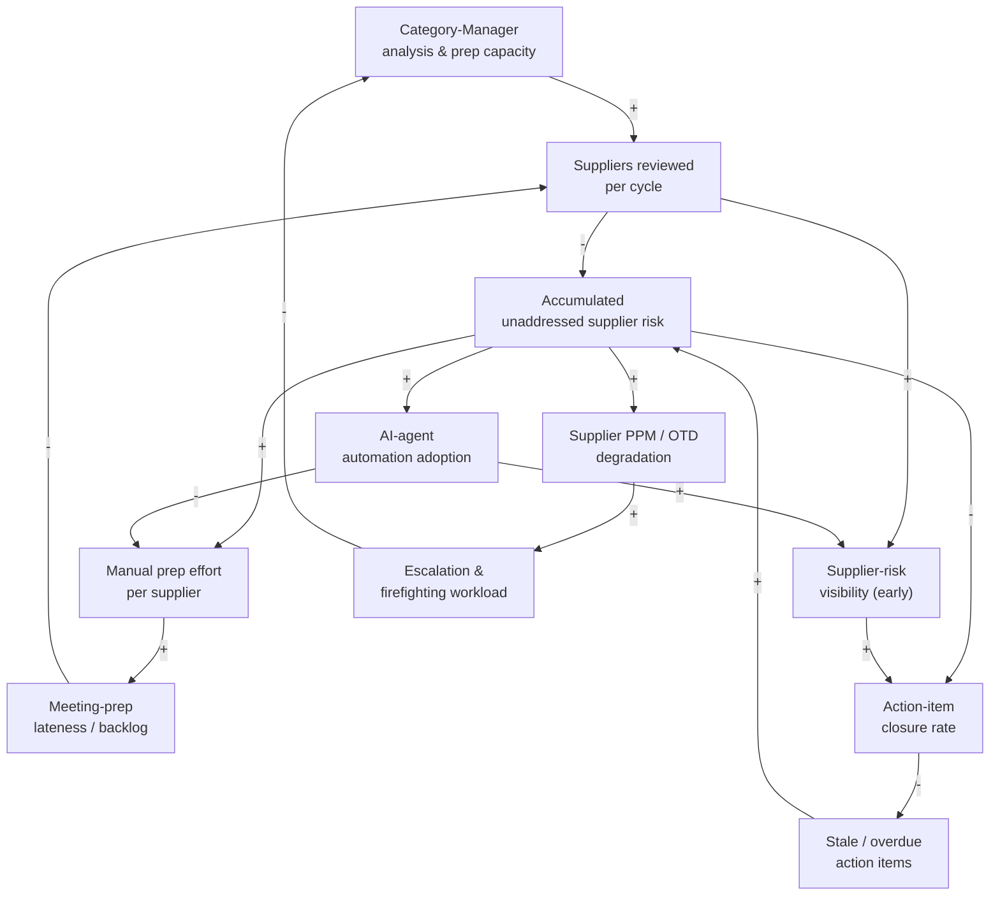
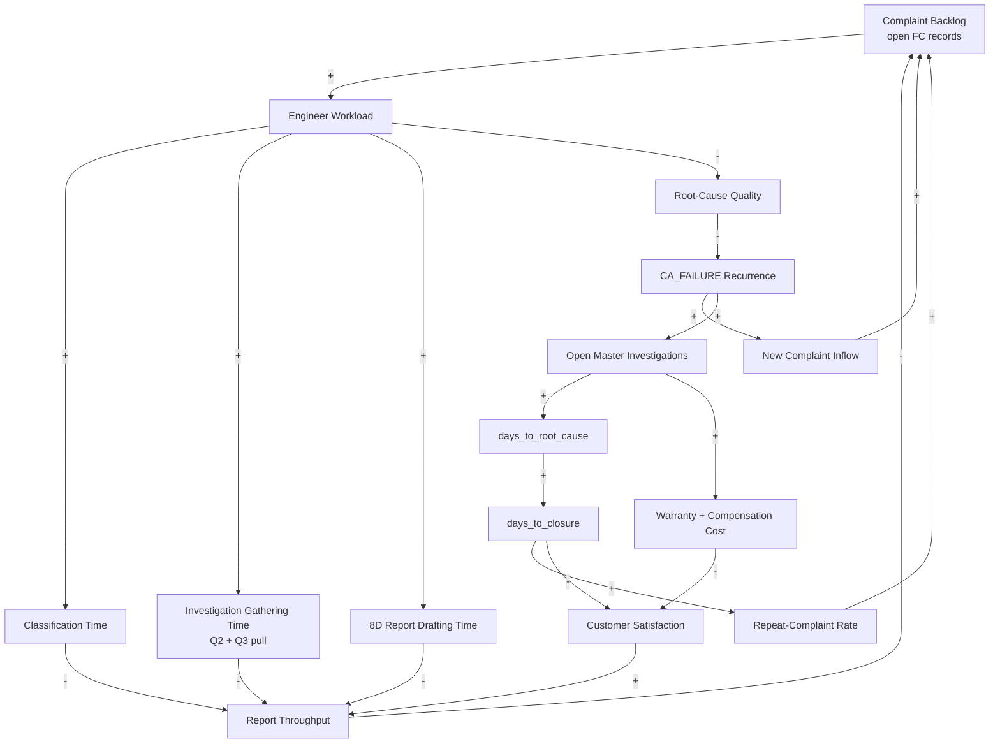
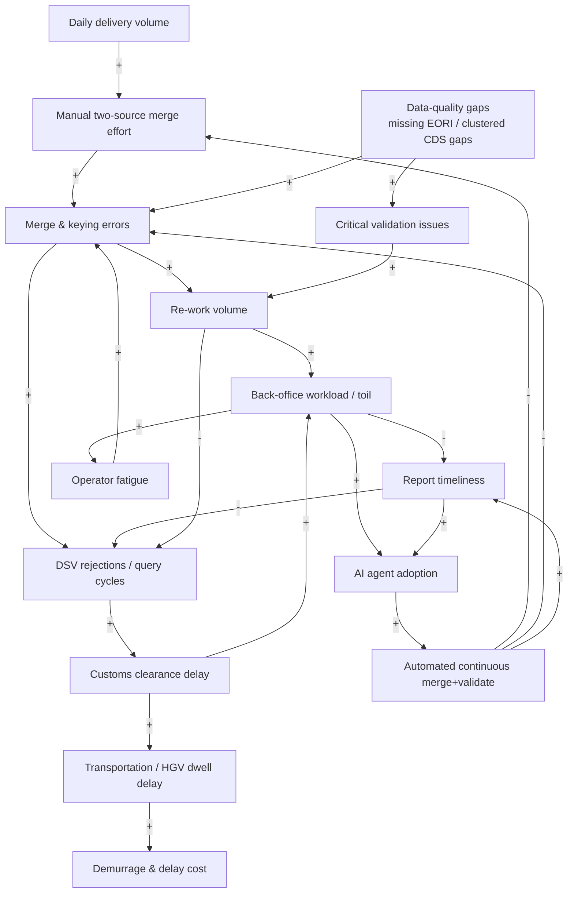

# Part II — Danfoss: Procurement, Quality and Logistics

> **Source:** [`jayanthbagare/PBC2.0`](https://github.com/jayanthbagare/PBC2.0) (private repository; links resolve for collaborators). Three self-contained reference implementations, each shipped as a code-based **and** a skill-based agent, with full `analysis/` artifacts per use case.

Each Danfoss chapter follows the same map: **§.1 The Problem → §.2 CLD → §.3 Stock & Flow → §.4 ToC → §.5 Throughput Accounting → §.6 Automation vs Agentic → §.7 Solution Design → §.8 Run It Yourself.** Read them in order, because the constraints get subtler.

## Chapter 8 — Meet Danfoss

All three cases in this part are set inside **[Danfoss](https://www.danfoss.com/en/)**. You don't need to know the company to follow the method, but a little context sharpens every case. Each one lives in a *different* part of the business, and those differences explain why the three constraints turn out so different.

### 8.1 Who Danfoss is

Danfoss is a Danish engineering company founded in **1933** by Mads Clausen in **Nordborg, Denmark**, where it is still headquartered. It began as a one-man refrigeration-valve workshop and grew into a global industrial manufacturer. Three traits matter here:

- **Family-owned, long-horizon.** Danfoss remains controlled by the founding family through the Bitten & Mads Clausen Foundation. It optimises for durable operational excellence, not quarterly theatrics, which makes it fertile ground for systems thinking.
- **Global and physical.** It has ~**40,000 employees**, sales in **more than 100 countries**, and a worldwide network of factories and Application Development Centers (H1 2026 sales ~**EUR 5.3 billion**). Physical products crossing real borders are why UC-3 (customs) exists at all.
- **Purpose: competitive decarbonisation.** Danfoss engineers solutions that *"increase machine productivity, reduce emissions, lower energy consumption, and enable electrification."*

### 8.2 How the business is structured

| Segment | What it makes | Typical customers |
|---|---|---|
| **Power Solutions** | Mobile & industrial hydraulics, fluid conveyance, electrification, control software | Off-highway machinery, agriculture, construction, marine, data centers |
| **Climate Solutions** | Energy-efficient heating, cooling and refrigeration components | Buildings, cold chain / food retail, district energy, data centers |
| **Power Electronics and Drives** | Variable-speed drives, power semiconductor modules, power conversion | Industrial automation, HVAC, renewables, electrification |

Beneath the product segments run the **shared operational functions** of a global manufacturer: procurement, quality management, and supply chain/logistics. That is where this part's cases sit. By headcount, the workforce splits across three functions:

| Function | Share | ≈ headcount | This part's cases |
|---|---|---|---|
| **Finance & Operations** | **43.2%** | ~17,300 | UC-1 (procurement), UC-3 (supply chain) |
| **Engineering** | **29.0%** | ~11,600 | UC-2 (quality engineering) |
| **Sales & Marketing** | **27.8%** | ~11,100 | — (not addressed by these three; see LoopCycle, Part V) |

Hold on to one fact: the **largest** function, Finance & Operations, is also the one densest in repetitive, rule-based process work. [§21.7](#217-where-to-point-ai-workforce-and-data-density) returns to this.

### 8.3 Why these three cases, and why they differ

| Case | Danfoss function | Segment flavour | The constraint turns out to be… |
|---|---|---|---|
| **UC-1**: Supplier Performance Review | **Procurement** | Power Solutions components (hydraulics, pumps) | human **analysis/prep capacity** |
| **UC-2**: Technical Customer Report (8D) | **Quality Management** | Compressors & components | engineer **drafting labour** |
| **UC-3**: UK Customs Clearance | **Supply Chain / Logistics** | Physical goods, Denmark → UK | a once-daily **batch cadence** |

A procurement constraint is a *capacity* problem. A quality constraint is a *labour-and-rigour* problem. A logistics constraint is a *timing/cadence* problem. If the method only ever found "add an agent to go faster", it would be a cliché. Instead it finds three structurally different answers, which is the strongest argument for doing the analysis before reaching for the agent.

> Facts in this chapter are summarised from the [Danfoss website](https://www.danfoss.com/en/about-danfoss/company/) and public company sources, as stated in the source field book. Total headcount is approximate; consult the latest Danfoss annual report for current numbers.

---

## Chapter 9 — Supplier Performance Review

> **Project:** [`usecases/uc_1/`](https://github.com/jayanthbagare/PBC2.0/tree/main/usecases/uc_1) · **Analysis:** [`uc_1/analysis/`](https://github.com/jayanthbagare/PBC2.0/tree/main/usecases/uc_1/analysis) · **Domain:** Procurement · **Dataset:** 10 suppliers, 3 category managers, 91 action items, 120 targeted reviews/yr

### 9.1 The Problem

Danfoss category managers run periodic **Supplier Performance Reviews (SPRs)** across 10 suppliers. They assess quality (**PPM** defect rate), delivery (**OTD %**) and a composite quality score. The manual rhythm per supplier is: pull KPI data, read the trend, assemble a meeting agenda and talking points, conduct the meeting, summarise it, and track the resulting action items.

The dataset tells a stark story. **7 of 10 suppliers already sit at High overall risk.** Sun Hydraulics is at **1383 PPM**, and Bosch Rexroth at **1046 PPM / 71.5% OTD**. Only **16 of 91 action items are Closed (~18%)**. The team is not short of data, since the risk is plainly visible in the KPI series. It is short of the *hours* needed to turn visible risk into mitigated risk.

### 9.2 Lens 1 — Causal Loop Diagram



Three **reinforcing vicious loops** drive the pain:

- **R1, the Firefighting Death Spiral:** accumulated risk → defects → escalation → *less* capacity → fewer reviews → *more* accumulated risk. Escalation draws on the same finite pool of hours as proactive prep.
- **R2, the Prep-Debt Spiral:** higher-risk suppliers need more hand-assembled prep exactly when the backlog is largest. Late reviews mean staler data and more rework next time.
- **R3, Stale-Action Erosion:** at ~18% closure, the corrective actions that would bleed off risk go stale. That raises risk, which crowds out attention for closing *other* actions.

Against these stands one **balancing control loop, B1 (Review-Controls-Risk)**, which is what the whole SPR process is *for*: review → early visibility → corrective action → less risk. The trouble is that **B1 is choked by a capacity throttle (B2)**: 3 managers, 10 suppliers, recurring cycles. The intervention introduces **B3 (Automation Relief)**, which cuts prep effort and raises visibility *without* consuming manager hours.

> **Sign check** (edge by edge, as drawn): the review → visibility → closure path closes through `Escalation −→ CMcap` with two minus signs, so it is R1/R3 running in their *virtuous* direction, not a separate goal-seeking loop. The only loops that close with an odd count are the **adoption loops (B3)**. Read the diagram this way: without the intervention, nothing in the drawn structure brakes the spirals. B1 is the *intended* control loop, and its gap-to-goal ("reviews due vs done") is implicit. Drawing it explicitly is a good workshop exercise.

**Systemic insight:** the vicious loops out-run the one corrective loop *because that loop is capacity-limited*. The highest-leverage move is not "faster meetings". It is raising the **gain** of the capacity loop so the control loop can finally outpace the spirals.

### 9.3 Lens 2 — Stock & Flow

| Stock | Inflow (rate) | Outflow (rate) | Units |
|---|---|---|---|
| Unreviewed Suppliers | new cycle starts | review completion `r_rev` | suppliers |
| Meeting-Prep Backlog | prep requests | prep completion `r_prep` | prep-jobs |
| Accumulated Supplier Risk | risk accrual `r_in` | risk mitigation `r_mit` | risk-units |
| Open Action Items | action creation `r_open` | action closure `r_close` | items |

Accumulated risk is the integral of (`r_in` − `r_mit`). You can't reverse it by exhortation, only by **bending the rates**. The solution raises `r_rev` and `r_prep` (automated KPI pull + prep draft), raises `r_mit` and `r_close` (surfaced, chased actions), and lowers effective `r_in` (earlier detection). Because the stock responds to the *integral* of the gap, reversing the trend means moving several rates at once.

### 9.4 Lens 3 — Theory of Constraints

| Step | Manual hours/supplier | Capacity-limiting? |
|---|---|---|
| Pull KPI data | ~1.0 | no (data is available) |
| Analyse trend | ~1.0 | contributes |
| **Prepare meeting draft** | **~2.0** | **← the constraint** |
| Conduct meeting | ~1.0 | no (fixed slot) |
| Summarise | ~0.5 | contributes |
| Track actions | ongoing | downstream |

1. **Identify:** the constraint is **not** data availability or meeting slots, because the risk is already visible. It is the **judgement-heavy prep/draft step** (~2.0 h/supplier), which gates how many suppliers get a quality review per cycle.
2. **Exploit:** standardise prep, triage High-risk suppliers first, and stop re-pulling the same data.
3. **Subordinate:** align cadence and data refresh to the prep step's pace.
4. **Elevate:** automated KPI pull + draft cuts the full review from **~5.5 h → ~1.5 h/supplier**.
5. **Repeat:** once prep is cheap, the constraint **migrates to action-item closure** (the ~18% rate). If the freed hours aren't redeployed to chasing the 75 open actions, throughput under-delivers. *This migration is the most important output of the analysis.*

### 9.5 Lens 4 — Throughput Accounting

> Full model: [`analysis/throughput-accounting.md`](https://github.com/jayanthbagare/PBC2.0/blob/main/usecases/uc_1/analysis/throughput-accounting.md), with 13 explicitly labelled assumptions.

Grounded in real counts (10 suppliers, 3 managers, 120 targeted reviews/yr, 91 action items):

| Metric | Before (manual) | After (AI) | **Δ** |
|---|---|---|---|
| **T** — risk value mitigated/yr | €277,200 | €453,600 | **+€176,400** |
| **OE** — process cost/yr | €27,225 | €27,366 | **+€141** |
| **I** — unmitigated-risk WIP tied up | €562,800 | €386,400 | **−€176,400** |
| Open action items (WIP count) | 75 | ~30 | **−45** |
| Reviews completed at quality/yr | 66 | 108 | **+42** |
| **Net Profit = T − OE** | €249,975 | €426,234 | **+€176,259** |

**ROI ≈ €176,259 ÷ €15,216 incremental spend ≈ 11.6× in year one.**

**The lesson in one line:** OE barely moves (+€141). This is a **throughput amplifier**, not a cost-saver: it reallocates the *same* manager hours from data-wrangling to risk-mitigating reviews. The result survives a 4× swing in the key assumption (the value of an unmitigated High-risk supplier-year), and the sign never flips.

### 9.6 Automation vs Agentic — An Honest Assessment

| Step | Nature | Throughput contribution | Build effort | Build priority |
|---|---|---|---|---|
| Pull KPIs, trends, action items | **Automation** | enables T (no direct Δ) | Low | **Do first** (cheap, unblocks everything) |
| Flag vs thresholds; risk-rank | **Automation** | enables triage (subordinate step) | Low | **Do first** |
| Draft meeting agendas / talking points / risk narratives | **Agentic** | **the bulk of ΔT ≈ +€176k/yr** | Medium | **Highest value — the reason to build** |
| Summarise meetings into follow-ups | **Agentic** | lifts action closure (R3) → protects T | Medium | High |

**Effort decision.** ΔT ≈ **+€176k/yr**, ΔOE ≈ **+€141** (flat), ROI ≈ **11.6×**. Almost all of the prize sits on the two *agentic* rows, the generation steps. The automation rows are cheap plumbing that merely *enable* them. So the build order is clear: stand up the deterministic data layer quickly, then put the real engineering into prep/summary **generation**. That is where the throughput lives, and therefore where an LLM is justified.

**Break-even.** At €35k ARR × 5 customers over 18 months and ~€44k/dev loaded (SAP Labs India; both *stated assumptions*), the sustainable team is **~2.4–3.6 developers**. UC-1's hybrid build needs **~2** (one on the data/automation layer, one on the agentic nub), so it **clears break-even at a 2-developer team**.

**Verdict: Hybrid, leaning agentic.** The data layer is automation and should stay deterministic. UC-1's *value*, the reason it earns an LLM at all, is the generation step: no rules engine writes a good talking point.

### 9.7 Solution Design

The analysis dictates the design. The agent must **attack the prep constraint** and **surface stale actions** (the migration). Both patterns expose the same six tools, and the skill-based version adds a seventh.

| Tool | Layer | Elevates… |
|---|---|---|
| `list_suppliers` | automation | triage (subordinate capacity to High-risk first) |
| `get_supplier_details` | automation | prep step (data) |
| `get_kpi_trend` | automation | analysis step (data) |
| `prepare_meeting_draft` | **agentic** | **the constraint** (prep/draft) |
| `get_action_items` | automation | R3 / action closure, **the migrated constraint** |
| `get_meeting_summary` | **agentic** | summarise step |
| `record_meeting_notes` *(skill-based only)* | automation | conduct → close the loop |

- **Code-based** ([`agent_code_based.py`](https://github.com/jayanthbagare/PBC2.0/blob/main/usecases/uc_1/agent_code_based.py)): manual loop with explicit tool dispatch. Best when you want approval gates before a draft is shown to a supplier.
- **Skill-based** ([`agent_skill_based.py`](https://github.com/jayanthbagare/PBC2.0/blob/main/usecases/uc_1/agent_skill_based.py)): `SkillRegistry` dispatch; you add a capability by registering one `skill_*()` function. Supports the end-to-end `full_workflow` task.

### 9.8 Run It Yourself

```bash
cd usecases/uc_1
python generate_synthetic_data.py                 # no API key needed
python agent_code_based.py --task dashboard        # risk-ranked triage (the "subordinate" step)
python agent_code_based.py --task at_risk          # deep-dive the 7 High-risk suppliers
python agent_code_based.py --task prepare --supplier "Bosch Rexroth AG"   # elevate the constraint
python agent_skill_based.py --task full_workflow --supplier "Parker Hannifin Corp"
python test_agents.py --category unit              # ~100 tests, no API key
```

**Watch for:** the `prepare` task doing in seconds the ~2.0 h/supplier step that the ToC analysis named as the constraint. That is the elevate move, made concrete.

---

## Chapter 10 — Faster Technical Customer Report (8D)

> **Project:** [`usecases/uc_2/`](https://github.com/jayanthbagare/PBC2.0/tree/main/usecases/uc_2) · **Analysis:** [`uc_2/analysis/`](https://github.com/jayanthbagare/PBC2.0/tree/main/usecases/uc_2/analysis) · **Domain:** Quality Management · **Dataset:** 40 complaints (10 SINGLE, 6 MASTER, 16 REPEAT, 8 CA_FAILURE), 8 master issues, 8 Q2 + 8 Q3 investigations

### 10.1 The Problem

Danfoss receives customer complaints (**FC records**) about compressors. Each must be **classified** (SINGLE / MASTER / REPEAT / CA_FAILURE), **investigated** by pulling internal (Q3) and supplier (Q2) investigations from QIR Cloud, and **reported** back as an 8D Technical Customer Report (D1–D8). Done manually, this takes **days**.

Mean `days_to_root_cause` is ≈ **45 days** (range 21–87), and warranty exposure is ≈ **€257k** across the masters. In the data, the symptom, root cause and corrective action are deliberately *decoupled*: the agent must reason, not pattern-match an index.

### 10.2 Lens 1 — Causal Loop Diagram



- **R1, Backlog Overload (reinforcing):** more backlog → engineers spread thinner → slower classify/gather/draft → lower throughput → more backlog.
- **R2, Rushed Root Cause → CA Failure (reinforcing, and the dangerous one):** overload → weaker 5-Why rigour → corrective actions that don't hold → **CA_FAILURE** recurrence → new masters and complaints → more backlog. Its damage is *hidden* because it surfaces only after `clean_date`.
- **B1, Closure Drains Repeats (balancing, long delay):** closing a master removes the condition producing repeats, but only after `days_to_root_cause` (~45 d) plus validation. While a master is open, every match lands as a REPEAT.
- **B2, Satisfaction / Warranty Pressure (balancing, lagging):** slow closures and warranty cost erode satisfaction, which *eventually* forces resourcing.

> **Sign check** (edge by edge, as drawn): all seven loops in this diagram close with an *even* number of minus signs, so B1 and B2 are reinforcing *as drawn*. B1 needs an explicit `master closed −→ REPEAT inflow` edge to become balancing, and B2 needs a `satisfaction pressure −→ engineer workload` (resourcing) edge. The text describes both; the diagram omits them. The finding sharpens the insight below: in the structure as it stands, *nothing* brakes the backlog. That makes the decision-model abstention gate (§10.7.1) a designed balancing loop.

**Systemic insight:** the vicious loops act *immediately*, while the stabilising loops correct only after long root-cause and closure delays. So **backlog growth is the system's default behaviour.** The fix is to attack the *fast* edges, classification time and drafting time, where a small cut compounds.

### 10.3 Lens 2 — Stock & Flow

| Stock | Inflow | Outflow | Units |
|---|---|---|---|
| Open Complaints Backlog | new FC inflow + repeat re-inflow | classification + close `f2` | complaints |
| Open Master Investigations | master opened | master closed | investigations |
| Unclosed 8D Reports | report started | report completed `f4` | reports |
| Accumulated Warranty Cost Exposure | exposure accrual | closure drains exposure | € |

The pipeline is a **series chain**: complaints → classification → investigation gathering → drafting → closure. The solution doesn't change the chain's *structure*. It is a **rate multiplier** on three flows: `f2` classify, `f3` gather, `f4` draft. Because the stocks are in series, speeding those flows lowers *all* downstream WIP **and** shrinks warranty exposure and the repeat re-inflow.

### 10.4 Lens 3 — Theory of Constraints

| Pipeline stage | Nature | Lead time |
|---|---|---|
| Classify | engineer labour | hours |
| Gather Q2 + Q3 from QIR Cloud | engineer labour | hours |
| **Draft 8D report (D1–D8)** | **engineer labour** | **longest sub-step** |
| Confirm root cause (lab) | physical | ~45 d, but *parallel* |
| Close master | validation | days |

1. **Identify:** the constraint is **quality-engineer labour** concentrated in classify + gather + draft (~8 h/report), with **drafting the single longest sub-step**. The long physical `days_to_root_cause` is *not* the constraint, because it runs in parallel across masters.
2. **Exploit → Subordinate → Elevate:** the solution compresses the ~8 h labour step to ~0.6 h, a capacity gain of roughly **13×** (187 → 2,500 reports per engineer-year).
3. **Repeat:** once labour is elevated, the **next** constraint is the physical root-cause/lab time. That is a different kind of constraint, and no amount of drafting speed can fix it.

### 10.5 Lens 4 — Throughput Accounting

> Full model: [`analysis/throughput-accounting.md`](https://github.com/jayanthbagare/PBC2.0/blob/main/usecases/uc_2/analysis/throughput-accounting.md), with 12 labelled assumptions. The key ones are: 8.0 h → 0.6 h per report at €75/h; 480 reports/yr (A7: the 40-complaint dataset treated as one month × 12); €1,200 value per on-time report; a 12% warranty/repeat reduction.

| Metric | Before (manual) | After (AI) | **Δ (annual)** |
|---|---|---|---|
| **OE**, engineer labour + tooling | €288,000 | €27,792 | **−€260,208** (−90%) |
| **T**, report value (on time 70% → 98%) | €403,200 | €564,480 | **+€161,280** |
| **T**, avoided warranty/repeat cost | — | — | **+€370,493** |
| **I**, WIP tied up in open reports | €38,400 | €3,840 | **−€34,560** (carrying saving €5,184/yr) |
| **Net gain (ΔT + ΔOE saved + carry)** | — | — | **≈ +€797k/yr** |
| Net gain **excluding** warranty | — | — | **≈ +€426k/yr** |

**ROI ≈ 28.7× on the full model, and ≈ 9.4× on OE alone** (€260,208 ÷ €27,792). The case is positive **even if the warranty benefit is zero.** Unlike UC-1, where OE was flat, here OE *does* fall ~90% because the manual step was so labour-heavy. The largest *and softest* term is avoided warranty cost: at a 4% reduction it falls to ~€123k, and at 20% it rises to ~€617k.

**Honest caveats.** (1) The stored `days_to_closure` fields are negative, a synthetic-data artifact, so closure improvement is modelled from `days_to_root_cause` instead. (2) If the dataset actually spans the ~6 months shown in receipt dates, annual volume is nearer 80 than 480. That scales all absolute figures down ~6× but leaves the ROI *ratios* unchanged.

### 10.6 Automation vs Agentic — An Honest Assessment

The three steps of the 8D pipeline are three *different kinds* of problem, and only one of them needs a generative LLM.

| Step | Nature | Throughput contribution | Build effort | Build priority |
|---|---|---|---|---|
| Classify SINGLE / MASTER / REPEAT / CA_FAILURE | **Decision model** (not an LLM) | gates the OE collapse + protects T (fewer CA failures) | Low–Med (adopt Laya/Decision-1) | **High — small spend, large leverage** |
| Retrieve master / Q2 / Q3 records | **Automation** | enables T (no direct Δ) | Low | **Do first** (prerequisite plumbing) |
| Draft the 8D report (D1–D8, portal prose) | **Agentic** | the OE collapse + report-speed value | Medium | **Highest value — the generative nub** |

**Effort decision.** The money splits across two layers, not one. A *cheap* decision model unlocks the OE collapse and dampens the dangerous CA-failure loop, while the *agentic* drafting step captures the report-speed and quality value. The retrieval row is nearly free and merely enables the rest. So fund the decision model early (highest leverage per euro) and make the drafting agent the main build. Don't waste effort "agentifying" the retrieval.

**Break-even.** Under the same Danfoss assumptions (€35k ARR × 5, 18 months, ~€44k/dev), the sustainable team is **~2.4–3.6 devs**. UC-2 needs **~2–2.5**: automation, plus a *part-time* decision-model integration that you adopt rather than train, plus the drafting agent. It **clears break-even at ~2–2.5 developers**.

**Verdict: Hybrid. This is the most interesting Danfoss case because it needs all three model classes.** Classification is a typed choice routed to a decision model. Gathering is pure automation. The one irreducibly **agentic** step is drafting. "Put an agent on it" is the wrong instinct; break the work down instead.

### 10.7 Solution Design

| Tool / layer | Layer | Attacks… |
|---|---|---|
| Decision model (Laya / Decision-1) | **decision** | classification (R1 fast edge) with calibrated confidence + abstention |
| `search_complaints_by_symptom` / `find_similar_issues` / `list_all_master_ids` | automation | the evidence the classifier/agent reasons over |
| `get_master_issue` | automation | investigation gathering (`f3`) |
| `get_q2_investigation` / `get_q3_investigation` | automation | the two-source QIR Cloud pull (`f3`) |
| 8D report drafting | **agentic** | the generative nub: portal-correct D1–D8 prose |

- **Code-based** ([`agents/complaint_agent.py`](https://github.com/jayanthbagare/PBC2.0/blob/main/usecases/uc_2/agents/complaint_agent.py)): hybrid by default. The decision model classifies first, then the agent investigates and drafts. Results are **scored against ground truth** (`--all --sample N`), which makes this the best case for *measuring* accuracy. `--no-classifier` runs the legacy all-LLM path.
- **Skill-based** ([`skills/8d-complaint.md`](https://github.com/jayanthbagare/PBC2.0/blob/main/usecases/uc_2/skills/8d-complaint.md)): a *declarative spec*. Claude Code follows a decision tree and reads the JSON directly, with no running loop.

#### 10.7.1 Sharpening the classify step with a decision model

The original agent classified by having the LLM write text and then scanning that text for a keyword. UC-2's own technical guide flags this as brittle: no structured output, no confidence, easy to fool. Classifying an FC into one of four classes is a **typed choice over fixed options**, exactly what [Chapter 5](#chapter-5--understanding-decision-models) introduced.

| Step | Nature | Best tool |
|---|---|---|
| Classify (SINGLE / MASTER / REPEAT / CA_FAILURE) | typed choice | **decision model** |
| Gather Q2 / Q3 from QIR Cloud | retrieval / tool use | automation (called by the agent) |
| Draft the 8D report (D1–D8) | long-form generation | Anthropic agent |

This buys three things the keyword scan cannot: **structured output**, a **calibrated confidence**, and, most important for the systems story, **abstention**. A model that *refuses to guess* on ambiguous REPEAT-vs-CA_FAILURE cases turns a silent wrong guess into an explicit, flagged escalation. That attacks loop **R2** at its source instead of its symptom.

**This is wired into the agent, not bolted on.** `complaint_agent.py` calls the decision model first, then gives the agent a system prompt that says *"the classification is already made — do not re-classify; investigate and draft."* If the decision model abstained, the agent opens its report with a `LOW CONFIDENCE — HUMAN REVIEW REQUIRED` banner. The pluggable classifier (a real `LayaBackend` plus a dependency-free offline `HeuristicBackend`) benchmarks itself against UC-2's ground-truth labels. It reports overall accuracy, *auto-processed* accuracy and abstention rate, so the confidence gate works as a dial. The full design, and an honest account of what the offline prototype does and does not prove, is in [`analysis/decision-model-architecture.md`](https://github.com/jayanthbagare/PBC2.0/blob/main/usecases/uc_2/analysis/decision-model-architecture.md).

> **The lesson in method terms:** the ToC analysis said classification is a *fast reinforcing-loop edge*. A decision model doesn't just make that edge faster. It adds *calibrated doubt*, which is what actually dampens the dangerous loop.

### 10.8 Run It Yourself

```bash
cd usecases/uc_2
python generate_data.py                      # creates data/ (seed 42, reproducible)
python agents/validate_data.py               # structural validation, no API calls
python agents/complaint_agent.py --fc FC-0E64D259     # hybrid: decision model classifies, agent drafts
python agents/complaint_agent.py --fc FC-0E64D259 --no-classifier   # legacy all-LLM path
python agents/complaint_agent.py --all --sample 5     # batch + accuracy + abstention vs ground truth
python agents/complaint_agent.py --all --sample 5 --threshold 0.8   # stricter gate → more human-review flags
python agents/decision_classifier.py --benchmark      # the classifier alone, scored offline
pytest tests/ -v                             # tests, no API key
# Skill-based, inside Claude Code:  /8d-complaint random
```

**Watch for:** the **decision model classifying before the agent speaks**. Then raise `--threshold` and watch complaints get flagged `⚠ABSTAIN → HUMAN REVIEW`: the system choosing to escalate rather than guess.

---

## Chapter 11 — UK Customs Clearance Declaration

> **Project:** [`usecases/uc_3/`](https://github.com/jayanthbagare/PBC2.0/tree/main/usecases/uc_3) · **Analysis:** [`uc_3/analysis/`](https://github.com/jayanthbagare/PBC2.0/tree/main/usecases/uc_3/analysis) · **Domain:** Supply Chain / Logistics · **Dataset:** ~89 shipments, ~405 deliveries over 30 days, ~353 CDS rows, 62 validation issues

### 11.1 The Problem

Post-Brexit, every Danfoss shipment from Denmark to the UK needs import customs clearance. Danfoss's UK GS Back Office team produces a **daily** UK Customs Clearance Declaration Preparation Report for DSV, its customs broker and carrier. Today the work is **fully manual, every working day**. The team merges two SAP sources (GTS export + CDS View) joined on `delivery_number`, validates against four business rules, flags criticals, and produces a DSV-ready report.

The dataset averages **~13.5 lines/day**. Its ~353 CDS rows have gaps that are *clustered* by plant and category. There are **62 validation issues** (52 EORI_MISSING, 7 LICENCE_MISSING, 3 malformed HS codes). A report is **READY TO SUBMIT** only when `critical_count == 0`. The pain: the manual merge is error-prone, delays block clearance and transport, and the task is pure rule-based consolidation with *no added value*.

### 11.2 Lens 1 — Causal Loop Diagram



- **R1, the Merge-Error / Fatigue Death Spiral (reinforcing):** manual merge → errors → rework → workload → fatigue → *more* errors. The clustered CDS gaps feed it constantly, because the operator can't tell a "legitimately absent row" from "I missed the join" without manual cross-checking.
- **R2, the Rejection → Delay → Late-Report Spiral (reinforcing):** errors → DSV rejections → clearance delay → workload → *worse* timeliness → more rejections. A defect missed before the daily cut-off costs about a full working day.
- **B1, the Validation Gate (balancing):** the four rules catch defects before submission, but the gate's strength is capped by human capacity and weakens exactly when overload is highest.
- **B2, Automation Relief (balancing, the intervention):** continuous merge+validate → fewer errors, better timeliness → more trust → more adoption.

**Systemic insight:** two reinforcing spirals run against a single, capacity-limited **once-daily batch**, and the batch cannot out-run them. The deepest lever is **not "merge faster"**. It is *collapsing the batch delay* and *decoupling rework from the production team*.

### 11.3 Lens 2 — Stock & Flow

| Stock | Inflow | Outflow | Units |
|---|---|---|---|
| Unmerged Deliveries Backlog | daily delivery arrivals (~13.5/day) | merge rate `f2` | deliveries |
| Open Validation Issues | issues flagged `f4` | issues resolved | issues |
| Shipments Awaiting Clearance | merged & submitted | DSV clearance | shipments |
| Rejected / Reworked Lines | DSV rejection `f7` | rework completion | lines |

The manual process is a **once-daily batch valve**. Inflow is continuous (~13.5 lines/day) but drains in a single evening pulse, so a backlog is *structurally guaranteed*, independent of operator skill. The value lies almost entirely in **`f2` (batch → continuous)**, plus shifting defect detection from **`f7` (external DSV rejection)** to **`f4` (internal flag)**.

### 11.4 Lens 3 — Theory of Constraints

| Pipeline stage | Nature | Constraint? |
|---|---|---|
| Fetch GTS rows | automatable | no |
| Fetch CDS rows | automatable | no |
| **Manual merge + validate (once/day, one team)** | **human batch** | **← the constraint** |
| Submit to DSV | handoff | no |
| Clear customs | external (DSV/HMRC) | downstream |

1. **Identify:** the binding constraint is **one Back-Office team doing the manual merge+validate once per day.** The *hidden* throttle is the **batch cadence itself**, the daily quantisation, not just the per-line effort.
2. **Exploit → Subordinate:** run the merge as early as the data allows, and triage the 62 criticals.
3. **Elevate:** move to **near-continuous processing** instead of a once-daily pulse. This is about *cadence*, not speed.
4. **Repeat:** the constraint then **migrates upstream to SAP CDS data quality**: 18 of 30 report-days are blocked by missing CDS rows. *The win only locks in if Danfoss then fixes the source gaps.*

### 11.5 Lens 4 — Throughput Accounting

> Full model: [`analysis/throughput-accounting.md`](https://github.com/jayanthbagare/PBC2.0/blob/main/usecases/uc_3/analysis/throughput-accounting.md), in GBP.

| Metric | Before (manual) | After | **Δ** |
|---|---|---|---|
| **OE**, analyst hours/mo | 94.8 h | 21.5 h (−77%) | **≈ −£2,788/mo** |
| **T**, delay value recovered | baseline | — | **≈ +£2,250/mo** |
| **I**, avg WIP (cash-cycle) | high | low | **≈ −£3.94M** |
| **ΔNet** | — | — | **≈ +£5,038/mo** |

**ROI ≈ 3.4×, payback ≈ 1.2 months.** Crucially, the **labour saving alone** (−£2,788 against ~£1,480 spend) justifies the change *even if the softer delay-cost estimates are wrong*, so the sign never flips. Unlike UC-1, OE *is* the clear win here, because the manual task was pure, repetitive consolidation: the textbook profile for automation.

### 11.6 Automation vs Agentic — An Honest Assessment

Be blunt: **UC-3 is automation, not an agentic problem.** The test, *could you write this step as a correct, testable function with no LLM?*, comes out "yes" for every step.

| Step | Nature | Throughput contribution | Build effort | Build priority |
|---|---|---|---|---|
| Fetch GTS rows / fetch CDS rows | **Automation** | enables T | Low | Do (plain code) |
| Merge on `delivery_number` | **Automation** | **ΔOE −£2.8k/mo** (−77% analyst hrs) | Low | **Do (plain code)** |
| Validate the 4 rules | **Automation** | shifts defects to internal flag → delay value | Low | Do (plain code) |
| Produce the DSV report | **Automation** | timeliness | Low | Do (plain code) |
| *Investigate clustered CDS gaps* | analysis (lightly agentic) | attacks the **next** constraint (18/30 blocked days) | Medium | **Where any AI effort belongs** |

**Effort decision.** Every row that earns the money is **automation**: a scheduled script captures the entire prize at low effort. Spending LLM-agent effort on the consolidation would add cost and non-determinism for **zero extra throughput**. The only row worth AI effort is the data-quality investigation, the migrated constraint, and even that is analysis rather than autonomous agency.

**Break-even.** Against the same ~2.4–3.6-dev sustainable team, UC-3's build needs **~1 developer**. That is the widest margin of the three, so it breaks even first.

**Verdict: Automation.** There is no ambiguity to reason over and no prose to generate. In the repo's own words, it is *"pure rule-based data consolidation... no added value."* A deterministic scheduled job is the **correct** production architecture: faster, cheaper, auditable, and *repeatable*, which an LLM is not. Repeatability is vital for customs compliance.

### 11.7 Solution Design

UC-3 ships as an agent for teaching contrast, but the honest production design is a deterministic pipeline. All eight tools are automation, and the agent framing simply lets you drive and verify them conversationally:

| Tool | Layer | Role |
|---|---|---|
| `list_available_dates` | automation | orient |
| `get_gts_declarations` | automation | fetch source 1 (SAP P53) |
| `get_cds_view_data` | automation | fetch source 2 (CDS supplementary) |
| `merge_and_build_report` | automation | **the constraint**: the two-source join on `delivery_number` |
| `validate_report` | automation | the B1 validation gate (4 rules) |
| `get_shipment_details` | automation | drill-down |
| `get_open_issues_summary` | automation → **analysis** | **surface clustered gaps** → attack the *next* constraint |
| `export_dsv_report` | automation | DSV-ready output |

- **Code-based** ([`agent_code_based.py`](https://github.com/jayanthbagare/PBC2.0/blob/main/usecases/uc_3/agent_code_based.py)): manual loop with `max_iterations=15`. It always states READY TO SUBMIT vs BLOCKED and flags criticals in ALL CAPS.
- **Skill-based** ([`agent_skill_based.py`](https://github.com/jayanthbagare/PBC2.0/blob/main/usecases/uc_3/agent_skill_based.py) + [`SKILL.md`](https://github.com/jayanthbagare/PBC2.0/blob/main/usecases/uc_3/.claude/skills/customs-clearance/SKILL.md)): a **tool server** (stdin/stdout JSON) decouples the skill from the Python backend. A `--verify` harness proves tool correctness *with no API key* before the skill is trusted.

> **Design takeaway:** for production, implement UC-3 as plain scheduled code and point any AI effort at the data-quality investigation, not the consolidation.

### 11.8 Run It Yourself

```bash
cd usecases/uc_3
python generate_synthetic_data.py                     # 7 JSON files, seed 42, ~30s
python agent_code_based.py --task today               # full report for latest date
python agent_code_based.py --task validate --date 2025-10-31   # ready-to-submit check
python agent_code_based.py --task issues              # cross-date gap summary (the NEXT constraint)
python agent_skill_based.py --verify                  # 29 correctness tests, NO API key
# Skill-based, inside Claude Code:  /customs-clearance 2025-10-31
```

**Watch for:** `--task issues`. It surfaces the clustered CDS gaps, pointing at the constraint that *migrates upstream* once the merge is automated. That is ToC Step 5 (Repeat) in action.

---
