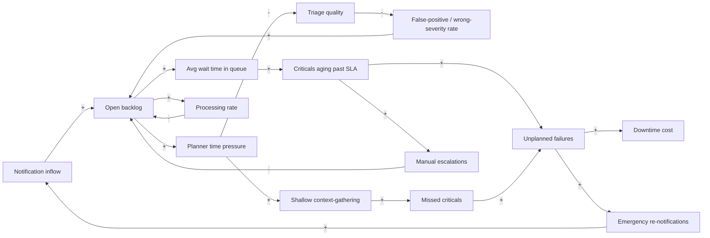
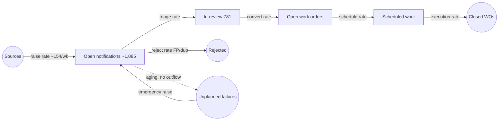
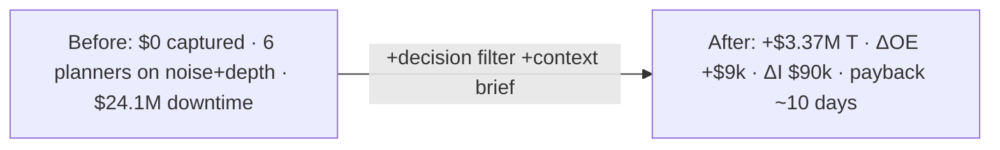

# Part III — Crestmount Refinery: Maintenance Planning

> **Source:** [`jayanthbagare/synthetic_oil_gas`](https://github.com/jayanthbagare/synthetic_oil_gas). A seed-42 synthetic refinery dataset (14-table SQLite DB), a reference agent pipeline with an evaluation harness, and a Streamlit bottleneck dashboard. Every number in this part is computed from the generated database and the evaluation harness; [§13.8](#138-run-it--reproduce-the-figures) shows how to reproduce them.

## Chapter 12 — Meet Crestmount Refinery

Crestmount is a fictional mid-sized refinery in West Texas, processing ~100,000 barrels/day at design capacity. The dataset mean is **89,675 bbl/day** across 730 days; the gap is derates, turnarounds and unplanned downtime. It runs **500 physical assets** across process units, tiered by criticality:

| Tier | Assets | Share | Meaning |
|---|---|---|---|
| T1 | 25 | 5.0% | Plant-stopping; 24 h SLA |
| T2 | 74 | 14.8% | Unit-stopping |
| T3 | 120 | 24.0% | Significant |
| T4 | 163 | 32.6% | Routine |
| T5 | 118 | 23.6% | Cosmetic / deferrable |

The maintenance organisation is paced by a **planning team of six**. Notifications about asset problems arrive from four sources: operators (4,894), sensors (3,506), inspection rounds (2,417) and predictive models (1,183). A planner must triage each one, classify it, scope the work, identify parts, crew skills and permits, then draft and release a work order. That judgement work is the subject of this part.

The dataset spans **24 months** (2024-10-14 → 2026-10-13): 12,000 notifications, 8,565 work orders, 1,200 failure events, 940 sensors with 676,800 hourly readings, a 1,581-edge P&ID connectivity graph, and daily weather and production. Two columns, `ground_truth_severity` and `ground_truth_category`, hold the *actual* answers and are reserved for evaluation only. The observed fields disagree with ground truth **12.5%** of the time. That noise is the problem made visible.

> **The workshop brief vs the data.** The workshop README dramatises the scene ("~1,900 notifications/week", "backlog growing ~600/week"). The *dataset* tells a quieter and more interesting story: inflow is ~154/week against a nameplate capacity of 1,260/week. This part follows the data, and the gap between the two stories is itself the lesson of [§13.1](#131-the-problem).

---

## Chapter 13 — The Planner Bottleneck

> **Project:** [`synthetic_oil_gas`](https://github.com/jayanthbagare/synthetic_oil_gas) · **Domain:** Refinery maintenance planning · **Dataset:** 12,000 notifications · 8,565 work orders · 1,200 failures · 500 assets · 6 planners · 676,800 sensor readings (seed 42)

### 13.1 The Problem

Crestmount's maintenance pipeline is paced by six planners doing cognitively intensive triage-and-scope work. Notifications arrive at **~154/week** (2,000 raised in the trailing 90 days). Together the planners have a nameplate capacity of **252 notifications/day → 1,260/week**, at ~20–25 minutes each. On paper, capacity (1,260) dwarfs inflow (154). So why is the backlog **1,866 open**, with the oldest item **90 days** old and **15 tier-1 criticals** aging past their 24-hour SLA?

Because nameplate capacity is not *effective* capacity. 12.5% of notifications carry the wrong observed severity. 12.0% are false positives and 5.2% are duplicates, and both consume judgement before being rejected. And the planner's real time sink is *context-gathering*, not deciding. The constraint is not throughput of easy items. It is the planner's attention on the *hard and critical* ones, and that attention is being spent on noise. Rolling-12-month unplanned downtime cost is **$24.1M** (1,200 events over 24 months total **$46.96M**), and a material slice of it traces to criticals that aged in this very queue.

| Metric | Value | Source |
|---|---|---|
| Open backlog (open + in_review) | 1,866 | `notifications.status` |
| Oldest open item | 89.9 days | `MAX(now − raised_at)` |
| Tier-1 criticals in backlog | 15 | join `assets` |
| Tier-2 criticals in backlog | 342 | join `assets` |
| Avg planning time / item | 24.9 min (median 20.1) | `planning_duration_minutes` |
| Planner weekly capacity | 1,260 | 6 planners × 252/day ÷ wk |
| Weekly inflow | ~154 | last-90-day raise rate |
| Observed ≠ ground-truth severity | 12.5% | eval columns |
| False positives / duplicates | 12.0% / 5.2% | terminal statuses |
| Rolling-12mo downtime cost | $24.1M | `failure_events` |
| Implied downtime cost | $9,376 / hour | cost ÷ hours |

### 13.2 Lens 1 — Causal Loop Diagram



- **R1, the rework spiral (reinforcing).** `INFLOW → + QUEUE → + WAIT → + AGING → + FAIL → + REWORK → + INFLOW`. Zero minus signs, so the loop is reinforcing. Every critical that ages into a failure generates *new* emergency notifications, which lengthen the very queue that caused the failure. This is the dominant vicious loop.
- **R2, the quality collapse (reinforcing).** `QUEUE → + PRESSURE → − QUALITY → − FALSEPOS → + QUEUE`. Two minus signs, so reinforcing. A fuller queue pressures planners and degrades triage quality, which *raises* the false-positive and wrong-severity rate and feeds more junk back into the queue. The backlog manufactures its own noise.
- **R3, the missed-critical spiral (reinforcing).** `QUEUE → + PRESSURE → + SHORTCUT → + MISSCRIT → + FAIL → + REWORK → + INFLOW → + QUEUE`. Pressure forces shallow context-gathering, shallow gathering misses the subtle criticals, and those become the expensive failures. This is the costliest loop in dollars.
- **B1, the processing drain (balancing).** `QUEUE → + PROC → − QUEUE`. The planners draining the queue are the system's primary corrective. That drain is **capacity-limited**, and its gain is sapped by R2 (noise it must process) and R3 (depth it can't afford).
- **B2, the escalation relief valve (balancing).** `AGING → + ESCALATE → − QUEUE`. Manual escalation pulls aged criticals forward, but it is reactive, fires only after aging, and steals capacity from B1.

**Delays** (`||`): between `AGING` and `FAIL` (criticals don't fail the day they age; they fail weeks later), and between `PROC` and queue relief. The cost of a shortcut shows up long after the shortcut was taken, so the feedback that should discipline it arrives too late.

**Leverage points** (Meadows, strongest first):
1. **Reduce the gain of R2/R3 by filtering noise *before* the planner.** Strip the 17.2% false-positive-plus-duplicate load and correct the 12.5% severity noise. This is a structural change to information flow.
2. **Shorten the context-gathering delay.** A pre-assembled brief turns R3's "shortcut" into "informed in 30 seconds".
3. **Raise B1's effective gain** by returning planner minutes lost to noise and gathering, not by hiring.

**Systemic insight:** the backlog is not an inflow problem (154 ≪ 1,260). It is a *noise-and-depth* problem. R2 and R3 drag the planner's effective capacity far below nameplate, and the delays hide the damage.

### 13.3 Lens 2 — Stock & Flow



| Stock | Inflow(s) | Outflow(s) | Units |
|---|---|---|---|
| Open notifications (with in-review: 1,866) | Source raise rate (~154/wk) + emergency re-raises | Triage rate (→ in-review), reject rate (→ FP/dup) | notifications |
| In-review | Triage rate | Convert rate (→ WO), reject rate | notifications |
| Open work orders | Convert rate | Schedule rate | work orders |
| Scheduled work | Schedule rate | Execution rate | work orders |
| (Leak) Unplanned failures | Aging of un-triaged criticals | Emergency raise → back to Open | failures |

**Which flow rate does the solution move?** The constraint stock is **open notifications**, and its outflows are the *triage rate* and the *reject rate*. The solution raises the **effective triage rate** in two ways: (1) a decision-model reject lane removes the 17.2% FP+dup load from the planner's path, and (2) a context brief shortens per-item triage time. It also seals the **leak**, the dashed aging path that turns un-triaged criticals into failures that come back as emergencies (R1). There is no new tap and no new drain: the same six planners, pointed only at real work, with the context pre-fetched.

### 13.4 Lens 3 — Theory of Constraints

| Stage | Effective capacity / wk | Demand | Utilisation |
|---|---|---|---|
| Sources (raise) | — | — | — |
| **Planner triage/scope** | **1,260 nameplate → ~940 effective** | ~154 steady + 1,866 backlog | **constraint** |
| Scheduler (fit to ops window) | ~2,000 | = planner output | slack |
| Crew (execute) | ~1,500 | = scheduled | slack |
| Closure | high | = executed | slack |

1. **Identify.** The constraint is the **planner station**: not crews, not parts, not the scheduler. The sharper finding is that nameplate capacity (1,260) is not the binding number. *Effective* capacity is ~940/wk once you subtract the 17.2% consumed by FP/duplicate judgement and the depth tax on criticals. The constraint is **planner attention on real, correctly prioritised work**, a cognitive resource rather than a clock.
2. **Exploit.** Stop feeding the planners noise. Rejection discipline alone returns ~17 percentage points of capacity, and no model is needed for clear duplicates (exact-match detection is a function). Reorder the queue by throughput-weighted criticality so T1/T2 items never age past SLA.
3. **Subordinate.** The scheduler and crews have slack. They should pull from a planner output ranked by business intent and never push rework back up. Parts and permit lead times get pre-checked *for* the planner.
4. **Elevate.** Elevation is *not* more planners. It is removing the two taxes the CLD identified: a decision-model noise filter (R2) and an automated context brief (R3). That raises effective capacity from ~940 back towards 1,260+ without new headcount.
5. **Repeat: the constraint migrates** **downstream to the scheduler and to parts/permit lead times.** Once planners emit clean, well-scoped work orders at full rate, the binding question becomes *can the plant execute them within ops windows, with parts in stock and permits approved?* The design (§13.7) explicitly instruments this migration.

### 13.5 Lens 4 — Throughput Accounting

**Definitions here.** **T** = business value the maintenance system converts per year, chiefly *avoided unplanned-downtime cost* from processing criticals in time. **I** = the one-time investment to build and productionise the solution. **OE** = the annual cost of running it.

| # | Assumption | Value | Basis |
|---|---|---|---|
| A1 | Rolling-12mo unplanned downtime cost | $24.1M | dataset `failure_events` |
| A2 | Implied downtime cost | $9,376/hr | cost ÷ hours, dataset |
| A3 | Share of downtime from criticals that **aged in-queue** (addressable) | **35%** | **modelled** (R1/R3 attribution) |
| A4 | Fraction of that the solution captures (timely processing) | **40%** | **modelled** (recall-limited) |
| A5 | FP+duplicate load removed from planners | 17.2% | dataset terminal statuses |
| A6 | Planner fully-loaded cost | $120k/yr each (6 = $720k) | modelled, US refinery band |
| A7 | Per-notification model/decision cost | $0.01 avg | modelled from prompt sizes |
| A8 | Annual notification volume | ~8,000 | ~154/wk × 52 |
| A9 | Build effort | 3.5 dev-months → $70k + $20k integration/security | modelled |

| Term | Before | After | Δ |
|---|---|---|---|
| **T**, addressable aged-critical downtime captured (A1 × A3 × A4) | $0 | $3.37M | **+$3.37M/yr** |
| **OE**, planner labour | $720k | $720k | 0 (unchanged headcount) |
| **OE**, inference (A7 × A8) | $0 | $80 | +$80 |
| **OE**, monitoring/eval/retraining (~10% of I) | $0 | $9k | +$9k |
| **I**, one-time build (A9) | — | $90k | **$90k** |

- **ΔT ≈ +$3.37M/yr** (= $24.1M × 0.35 × 0.40). A **ΔT win, not a ΔOE win**: the solution amplifies six scarce planners rather than cutting their cost.
- **ΔOE ≈ +$9.1k/yr. ΔI ≈ $90k one-time.**
- **Δ(T − OE) ≈ $3.36M/yr. Payback ≈ $90k ÷ $3.36M ≈ 10 days. First-year ROI ≈ ($3.36M − $90k) ÷ $90k ≈ 36×.**

A **conservative floor** that doesn't depend on the modelled downtime attribution comes from **recovered planner capacity**: A5 returns ~17% of 1,260/wk ≈ 214 notification-equivalents per week, worth roughly $720k × 0.17 ≈ **$122k/yr** of planner time redirected to depth on criticals.

**Sensitivity.** The load-bearing assumptions are **A3** and **A4**. At a pessimistic A3 = 20% and A4 = 25%, ΔT = **$1.21M/yr**, still a ~27-day payback and ~13× first-year ROI. The sign holds because ΔI and ΔOE are tiny compared with even one avoided tier-1 failure (an average 4.17-hour failure ≈ $39k). *A production case must replace A3/A4 with piloted measurements.*



### 13.6 Automation vs Agentic — An Honest Assessment

| Step | Nature | Throughput contribution | Build effort | Build priority |
|---|---|---|---|---|
| Deduplicate notifications (exact/near match) | **Automation** | High (5.2% load removed) | Low | **1** |
| Pull asset history, failures, parts, permits, weather, downstream P&ID | **Automation** (joins/lookups) | High (kills R3 context delay) | Low–Med | **1** |
| Rank queue by throughput-weighted criticality | **Automation** (deterministic sort) | High (SLA protection) | Low | **1** |
| Predict *true* severity 1–5 from raw text | **Decision model** | High (fixes 12.5% noise) | Medium | **2** |
| Classify false-positive vs real | **Decision model** | High (12.0% load removed) | Medium | **2** |
| Root-cause category hypothesis | Decision model *or* light LLM | Medium | Medium | 3 |
| Draft work-order text + reasoning trail | **Agentic (LLM)** | Medium (planner → editor) | Medium–High | 3 |
| Final convert/reject/escalate verdict | **Human** (keep) | — (governance) | — | — |

**Effort decision.** The prize sits overwhelmingly in the **Automation** and **Decision model** rows. Removing noise (dedup, FP classification) and killing the context-gathering delay (lookups, briefs) are what return planner attention to criticals. The single agentic row, WO drafting, is real but is the *smallest* dollar contributor and the *most* expensive to build. **Build order:** (1) ship the deterministic automation in days, capturing the $122k floor immediately; (2) add the two decision models, which unlock the bulk of the $3.37M; (3) only then add LLM drafting, and keep the final verdict human.

**Verdict: Hybrid, decision-model-heavy.** *Most of this "agent" is plain code and two calibrated classifiers. The LLM earns one job, drafting, and even that stays under a human.*

**Break-even.** Four *stated assumptions*: ARR per customer **$150k** (a refinery maintenance-ops contract), **8** customers, a **3-year** horizon, developer fully-loaded cost **$180k/yr**.

```
Dev cost over horizon (1 dev) = $180k × 3 × 1.10 (run/API uplift) = $594k
Revenue (full-ramp)           = 8 × $150k × 3        = $3.60M
Revenue (conservative, ×2/3)  = 8 × $150k × 2        = $2.40M
Max break-even team (full)    = $3.60M ÷ $594k ≈ 6.1 devs
Max break-even team (consv.)  = $2.40M ÷ $594k ≈ 4.0 devs
```

The build effort implied by the layers is ~1 dev for automation (weeks), ~0.5 dev for an *adopted* decision model (labelling and threshold tuning), and ~1 dev for the agentic nub: **≈ 2.5 devs.** Against a conservative break-even of 4.0 and a full-ramp 6.1, the programme **clears break-even at ~2.5 developers** with comfortable margin. Doubling customers to 16 doubles break-even to ~8–12 devs, while build effort barely changes.

### 13.7 Solution Design

Everything exists to return **planner attention to real, correctly prioritised work** and to **surface the next constraint**.

**Automation layer** (plain code, built first):
- `dedupe(notification) → {is_duplicate, canonical_id}`: exact + near-match on asset + text window.
- `gather_context(notification) → brief`: joins `assets`, `failure_events`, `spare_parts` (lead time + stock), `permits`, `weather` and downstream `asset_connections` (P&ID cascade) into a 30-second brief. **The single highest-leverage automation** (it kills R3).
- `rank_queue(notifications) → ordered`: a deterministic sort by `criticality_tier`, age vs SLA, and downstream blast radius.
- `check_execution_readiness(wo) → {parts_available, permit_lead_time, next_ops_window}`: *the migration probe*. It instruments the downstream constraint from §13.4 step 5, so you see it coming.

**Decision-model layer** (typed choice, calibrated, abstains; this is where the dollars are):
- *Severity:* "What is the true severity 1–5?" → a rating with confidence; **abstain below threshold → human**. Target: beat the baseline MAE of **1.024** (72.4% within ±1).
- *False positive:* "Is this a real failure or a false positive?" → yes/no with confidence. The baseline is weak (FP F1 **51.7%**, precision only **36.5%**). *An over-confident rejection of a real failure is the costliest error in the system*, so the abstention policy is mandatory: **never auto-reject near a T1/T2 asset**.
- *Duplicate:* baseline precision is already **100%** (F1 70.6%). Keep auto-reject only on exact matches, and route near-matches to a human.
- Backend: **Laya** (self-hosted, on-prem for sensitive plant data) or **Microsoft-Decision-1** (managed).

**Deep-agent layer** (built last, kept bounded):
- A **code-based loop** (for audit): given the brief and the decision-model outputs, the LLM drafts WO text, a crew-skills rationale and a reasoning trail. Tools: `lookup_asset`, `recent_failures`, `parts_for_symptom`, `downstream_impact`. System prompt: *"draft for a planner's review; cite the brief; never assert a reject on a critical asset."*
- The LLM **never issues the final verdict**. The planner moves from author to editor.

**Back to the constraint:** every tool either returns planner minutes (dedup, brief, ranking) or improves the quality of planner attention (severity/FP decisions). Each raises the *effective triage rate*, the one flow that drains the one constrained stock. `check_execution_readiness` is the deliberate hook for the migrated constraint.

The reference implementation in [`data_generator/agents/`](https://github.com/jayanthbagare/synthetic_oil_gas/tree/main/data_generator/agents) ships these roles as `TriageAgent`, `ContextGatherer`, `PlannerAssistant` and an `Evaluator`.

### 13.8 Run It / Reproduce the Figures

```bash
# 1. Generate the canonical dataset + SQLite DB (seed 42 → byte-identical)
python data_generator/generate_data.py --seed 42 --output-dir ./output --build-db

# 2. Run the reference agent pipeline + evaluation harness
python data_generator/run_agents.py --db ./output/crestmount.db --run-date 2026-06-30
#    → severity MAE 1.024 · within±1 72.4% · P@K 47.3% · FP F1 51.7% · dup F1 70.6%

# 3. Launch the bottleneck dashboard
streamlit run data_generator/dashboard/app.py -- --db ./output/crestmount.db

# 4. Reproduce the anchor figures directly
sqlite3 output/crestmount.db \
  "SELECT COUNT(*) FROM notifications WHERE status IN ('open','in_review');"      # 1866
sqlite3 output/crestmount.db \
  "SELECT SUM(downtime_cost_usd) FROM failure_events WHERE failed_at>='2025-10-14';"  # 24.1M
```

**Pilot plan to replace the modelled assumptions (A3/A4):** run the decision filter + brief in shadow mode for 4 weeks against live planner decisions. Measure (a) planner minutes returned, (b) which criticals the system surfaced in time vs which still aged, and (c) the false-reject rate near T1/T2 assets. Only then convert A3/A4 from modelled to measured and re-run §13.5.

---
