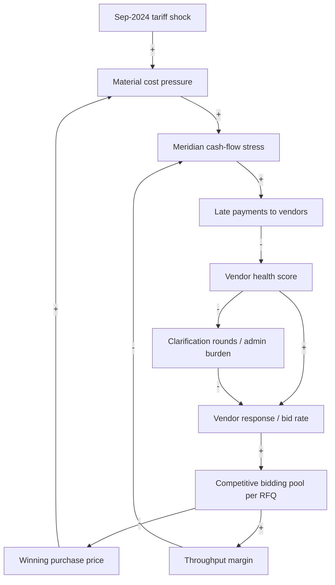
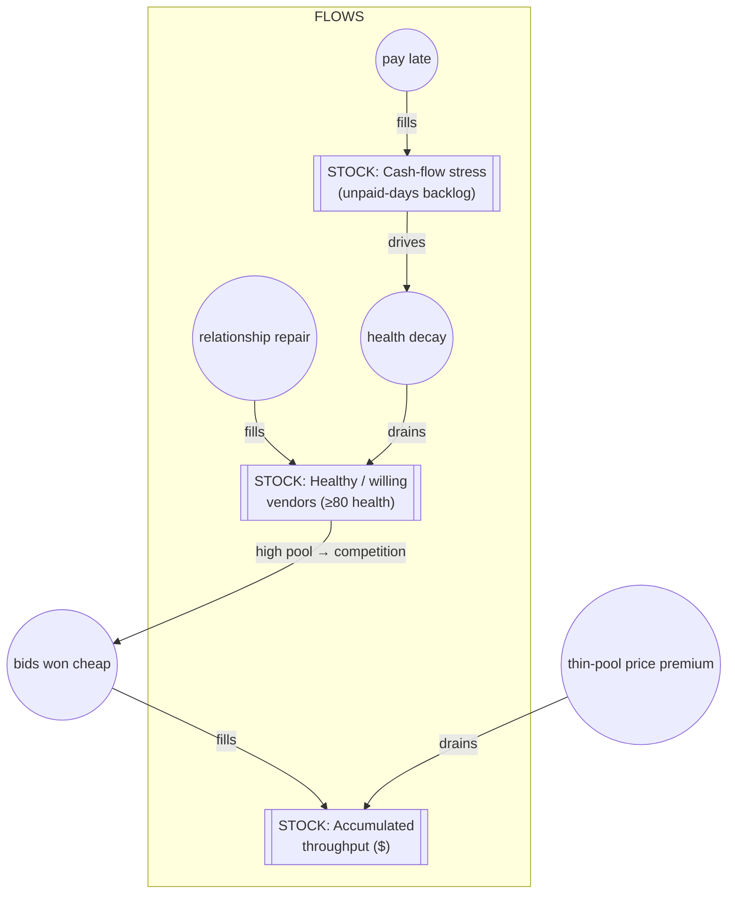

# Part IV — Meridian Industrial Systems: Procurement Under Shock

> **Source:** [`itsbharathp/RFQ_Agent_Workshop`](https://github.com/itsbharathp/RFQ_Agent_Workshop). An 18-month synthetic procurement dataset (24 CSVs), six independent challenges (Theory of Constraints, Throughput Accounting, Watchdog, Tactician, Oracle, Front Door), nine packaged Claude skills, Laya routing demos and reference solutions. Every figure is computed from `output_v2/`, with the pre-constraint period = months 0–7 (Jan–Aug 2024) and the constraint period = months 8–17 (Sep 2024–Jun 2025). This edition re-verified the headline figures against the CSVs ([Appendix C](#appendix-c--editors-notes-and-reconciliations)).

This part differs in shape from the others. Meridian is a single case told as a **cascade**: a shock enters the system at one point, and the damage surfaces somewhere else entirely, weeks later and in disguise. It also deliberately builds *four different kinds of machine intelligence* (a monitoring agent, a planning agent, a forecasting foundation model and a reflex-speed decision model), which makes it the best case in the book for comparing model classes.

## Chapter 14 — Meet Meridian Industrial Systems

**Meridian Industrial Systems** does not exist. It manufactures CNC machines and robotic assembly cells. Eighteen months of its procurement life, January 2024 through June 2025, have been reconstructed in synthetic detail: every vendor, request-for-quote, bid, late payment, clarification email and commodity price tick. That adds up to twenty-four CSV files, over four thousand email threads, and a complete event log.

Somewhere in late 2024, Meridian broke. Deliveries slipped. Purchase prices crept up. The procurement team worked harder and harder and still felt they were falling behind. And, most importantly, *nobody could name the cause.* Every individual measurement looked more or less fine. The failure lived in the relationships *between* the measurements.

### 14.1 The cast

Meridian buys from **24 vendors** worldwide, grouped into categories such as Mechanical Parts, Electrical Components and Raw Materials. Each vendor has a behavioural archetype and a *relationship arc*: `stable`, `improving`, `declining`, `new_proving`, or `collapse`.

| Vendor | Country | Category | Arc | Why they matter |
|---|---|---|---|---|
| **Kovacs Precision GmbH** (V001) | Germany | Mechanical Parts | `declining` | A nine-year, reliable partner on `Net60` terms: the kind of vendor you don't notice until they wobble. |
| **Tanaka Electrical KK** (V002) | Japan | Electrical Components | `stable` | The dependable anchor of the electrical pool. |
| **Patel Alloys Pvt Ltd** (V003) | India | Raw Materials | `improving` | A relationship-focused supplier climbing the health rankings, and the one worth locking in early. |

The human cast: **Priya Nair**, Head of Procurement ("Tell me where the system is breaking down. I want one constraint, named with evidence.") and **Arjun Desai**, CFO ("Procurement feels slow, yes. But our costs haven't exploded. Show me the business case."). The competitor **Hexagon AG** buys in the same categories.

### 14.2 The data at a glance

Everything is keyed by `month_index` (0 = Jan 2024 … 17 = Jun 2025).

| File | Rows | What it holds |
|---|---|---|
| `01_vendors.csv` | 24 | The cast: archetypes, risk tiers, relationship arcs, payment terms |
| `02_vendor_performance.csv` | 416 | Monthly KPI snapshots per vendor |
| `03_commodity_prices.csv` | 790 | Weekly prices + `shock_flag` for steel, copper, rare earths |
| `04_market_signals.csv` | 18 | Tariffs and capacity announcements: the exogenous events |
| `05_sales_orders.csv` | 225 | Customer revenue (the **R** in Throughput) |
| `07_work_orders.csv` | 202 | Internal work orders; each triggers an RFQ |
| `09_rfq_events.csv` | 202 | RFQ issue dates, deadlines, cycle times, invite counts |
| `10_rfq_vendor_invites.csv` | 1,424 | Who was invited and whether they responded |
| `12_bids.csv` | 1,120 | Actual bids: the real measure of competition |
| `13_bid_evaluation.csv` | 1,120 | Scored, ranked bids |
| `14_purchase_orders.csv` | 202 | Winning bids → POs (the **TVC** in Throughput) |
| `16_vendor_disputes.csv` | 9 | Late-delivery and quality disputes |
| `20_payment_events.csv` | 202 | Meridian's own payment behaviour (`days_late`) |
| `22_rfq_admin_burden.csv` | 1,424 | Clarification rounds per RFQ |
| `23_vendor_health_scores.csv` | 416 | Monthly composite health, `trend_3mo`, `alert_flag` |
| `24_event_log.csv` | 4,466 | The complete timeline, in order |

The volume matters. Over 4,000 email threads and 4,400 log events is more than a human can read, which sets up the agent half of the case.

---

## Chapter 15 — The Vendor-Pool Collapse

> **Project:** [`RFQ_Agent_Workshop`](https://github.com/itsbharathp/RFQ_Agent_Workshop) · **Domain:** Industrial procurement / supplier relationships · **Dataset:** 24 vendors · 202 RFQs · 1,424 invitations · 1,120 bids · 225 sales orders · 4,466 events over 18 months

### 15.1 The Problem

The dataset's generator leaves a note, a spoiler the workshop asks you to *prove* rather than accept:

> *"Sep 2024 tariff shock → Meridian cash-flow stress → late payments → vendor health scores drop → response rates fall → RFQ pool shrinks → procurement has to work harder → constraint becomes visible."*

Read the chain carefully. The shock is a **tariff**: external, exogenous, and visible in the market-signals data. The pain shows up as **an exhausted procurement team and higher prices**, three or four links downstream. If you looked only at the pain, you would try to fix the team's workload or renegotiate prices, and you would fail, because neither is the constraint.

A second shock lands in **April 2025**: a rare-earth / neodymium-magnet price spike. By then the system is still fragile.

### 15.2 Lens 1 — Causal Loop Diagram

A monthly table tells you *what* changed. It doesn't tell you *why the change fed on itself.* Meridian's crisis was not a one-time hit that the system absorbed. It was a **vicious circle** that a tariff shock set in motion and that then ran under its own power.



- **R1, the margin death spiral (the dominant loop).** `CASH → + LATE → − HEALTH → + RESP → + POOL → + MARGIN → − CASH`. Two minus signs, so it is **reinforcing**. Cash stress makes Meridian pay late. Late payment erodes vendor health. Unhealthy vendors stop bidding. A thin pool loses price competition, margin falls, and falling margin *deepens* cash stress. This loop turned a one-month tariff into a ten-month decline. Data signature: bids/RFQ **6.40 → 4.50 (−30%)**, T-margin **20.0% → 16.4%**.
- **R2, the price-cost ratchet.** `POOL → − PRICE → + COST → + CASH → + LATE → − HEALTH → + RESP → + POOL`. Two minus signs, so **reinforcing**. A thin pool raises the winning price, which *is* material cost, which feeds the same cash stress that thinned the pool. The tariff didn't need to stay elevated, because pool shrinkage kept prices high on its own.
- **R3, admin firefighting.** `HEALTH → − CLAR → − RESP → + POOL → + MARGIN → − CASH → + LATE → − HEALTH`. **Four** minus signs, so this loop is also **reinforcing**, even though the source book labels it a balancer (B1). As health drops, clarification rounds rise, which further *suppresses* response: the loop feeds the decline instead of correcting it. Admin burden isn't the disease; it's the fever. (Clarification rounds barely move, 3.37 → 3.62. The team worked harder per round, which is why they felt exhausted while the metric looked flat.)
- **The missing balancing loop.** The source also describes a "response-rate governor" (B2): if health recovers, response recovers. Traced edge by edge, though, that path is R1 run in its virtuous direction (two minus signs), not a separate corrective loop. **As drawn, every loop in Meridian's structure is reinforcing.** That is exactly why the decline ran for ten months. The partial recovery after month 10 (vendor pool 17 → 20) comes from *outside* the drawn loops: tariff pressure fading, and some vendors' own improving arcs.

> **Check the signs yourself.** This is the most instructive correction in the book. A system whose loops are all reinforcing has no internal brake. The solutions in §15.7 are best understood as *designed balancing loops*: the Watchdog and the on-time-payment policy together form `vendor health falls → detected early → repair / pay on time → health recovers`. That is a corrective loop Meridian never had.

**The delays are the whole story.** Health scores are a `trend_3mo`, so they lag the payment behaviour that drives them by months. By the time health visibly dropped (trough 85.6 at month 10) and alerts fired (4 → **28**), the late payments behind it were a quarter old. Fast reinforcing loops with no timely correction are the textbook recipe for a system that overshoots and stays down.

**Leverage points, ranked (Meadows-style):**

1. **Break the `LATE → − HEALTH` edge (highest leverage).** Paying on time, or signalling payment reliability, cuts R1 and R2 at their root. It is a *structural* change to loop gain, and it needs no software.
2. **Shorten the health-information delay, and so create the missing balancing loop.** A monitoring agent that detects decline from *payment* signals (the cause), rather than waiting for the 3-month health trend (the lagged effect), lets a human correct course before R1 wins. **This is the Watchdog.**
3. **Add an external information inflow** (TimesFM / market signals). Seeing the *next* shock before it hits lets you pre-empt the cost spike that would restart R2. **This is the Oracle.**
4. **Weaken `HEALTH → − CLAR` (lowest leverage).** Tightening the clarification loop slows R3, but it is a symptom-level fix.

> **Systemic insight:** the crisis persisted because the reinforcing loops are fast, and the system's only correction came from outside its own structure, slowly. You don't fix this by working harder inside the loops (more invites, more chasing); that's running on the treadmill the loops define. You fix it by *changing the structure*: cut the late-payment edge, and shorten the information delay.

### 15.3 Lens 2 — Stock & Flow



| Stock | Inflow(s) | Outflow(s) | Units | What the data shows |
|---|---|---|---|---|
| **Healthy / willing vendor pool** | relationship repair; on-time payment | health decay (driven by late payment) | vendors ≥ 80 health | 21 (m5) → **17 (m10)** → 20 (m17): the pool drained at the trough and only partly refilled |
| **Cash-flow stress** | late / disputed payments | margin recovery; new revenue | stress index | peaks at **0.05 in month 10**, the same month the vendor pool bottoms |
| **Accumulated throughput** | cheap competitive wins | thin-pool price premium | $ | **≈ $289K** of throughput bled out over 10 months |

**Which flow rates does each intervention move?** This test tells you whether an intervention is real or cosmetic:

- **Pay on time (exploitation)** turns *off* the `health decay` drain on the vendor-pool stock. It is the highest-leverage move because the vendor-pool stock feeds the margin stock.
- **The Watchdog** doesn't change a flow directly. It *shortens the detection delay* on the decay drain, so a human can open the "repair" inflow before the stock empties.
- **The Oracle** adds an inflow of *information* that lets the Tactician pre-buy, blunting the `thin-pool price premium` drain when the next shock lands.
- **More invitations (what Meridian actually did)** moves *no* flow on any of these stocks. The invite count was never the tap. That is the structural proof of why effort inside the loop didn't help.

### 15.4 Lens 3 — Theory of Constraints

The system has several moving parts: invites per RFQ, vendors responding, bids arriving, clarification rounds, bid timeliness, bid quality. The discipline is to separate the constraint from the loud symptoms. The workshop plants a deliberate trap:

> *One of these numbers barely moves while the system falls apart. A metric that stays comfortable is not evidence of health. It is a blind spot with a green light on it.*

That number is **vendors invited per RFQ.** Meridian keeps inviting 6 to 8 vendors every single month. The raw count never leaves the band `{6, 7, 8}`, and the monthly average drifts only between **6.2 and 7.7**. Watch the invitation gauge and everything looks fine. Watch what actually *arrives* and the floor falls out:

| Signal | Pre-constraint (m0–7) | Constraint period (m8–17) | Peak → trough |
|---|---|---|---|
| Vendors invited / RFQ | 6.96 | 7.10 (+1.9%) | rangebound 6.2–7.7 (**the green light**) |
| **Bids received / RFQ** | **5.73** | **5.43** | **6.40 (m5) → 4.50 (m15) = −30%** |
| Vendor response rate | 82.4% | 76.3% | **87.5% (m3) → 66.7% (m11)** |
| Avg composite health | 89.0 | 88.1 | dips to 85.6 (m10) |
| Health alert flags raised | **4** | **28** | a **7× jump** |
| Avg RFQ cycle time (days) | 11.4 | 11.7 | essentially flat |

1. **Identify.** **The constraint is the responding/bidding vendor pool, not the invitation process.** Everything the team *does* (send invites) looks healthy, while everything the system *produces* (competitive bids) is starving.
2. **Exploit (zero budget).** The elegant answer is not "find new vendors"; that is elevation, and it costs money. It is *stop paying your existing vendors late and tighten the clarification loop*, because those are what drive response rates down.
3. **Subordinate.** Make the RFQ process serve the pool's health: prefer `improving` vendors, deprioritise `collapse`-arc vendors before their scores go critical, and widen bid windows when competitors tighten capacity.
4. **Elevate.** Detect decline earlier (Watchdog), plan RFQs adaptively (Tactician), and see knowable shocks coming (Oracle).
5. **Repeat: the constraint migrates** *(editor's reading)*. With the pool restored, the binding limit becomes **foresight about exogenous shocks**. The Oracle shows that statistics can see the April 2025 rare-earth spike but not the September 2024 tariff. The next constraint is causal reasoning over market signals, which is why the Oracle must be paired with the Tactician.

**Name names.** The pool splits cleanly: **15 stable**, 4 new/proving, **3 improving** (Patel Alloys, Indra Copper Works, Rajasthan Rare Earths), **1 declining** (Kovacs Precision GmbH) and **1 in outright collapse** (Guangzhou Mech & Elec Co.). Kovacs is the quiet tragedy: a nine-year reliable partner whose composite health decays from **88.8 (m0) → 79.9 (m8) → 73.7 (m12) → 68.6 (m17)**, a slow bleed that no single month's snapshot would flag as alarming.

### 15.5 Lens 4 — Throughput Accounting

The CFO thinks in cost accounting. You have to answer in **Throughput Accounting**, which asks a different question: not *"what does this cost?"* but *"what does this constraint do to our ability to make money?"*

| Measure | Definition | At Meridian |
|---|---|---|
| **T, Throughput** | Revenue − Truly Variable Cost | Sales-order revenue − PO material spend |
| **I, Investment** | Cash tied up in the system | Cash stuck in slow/disputed payment cycles |
| **OE, Operating Expense** | Everything else (fixed) | The procurement team's admin time |

**Assumptions given to participants:** $150 per clarification round (1.5 h @ $100/h), and a 0.8%/month holding cost on outstanding PO value.

Here is the counter-intuitive insight: **the pain is not in Operating Expense.** Clarification rounds *feel* like the problem, because the team is exhausted, but salaries are fixed whether the team answers one clarification or ten. The real damage is in **T**. When the vendor pool shrinks, competitive pressure drops and Meridian pays more for the same materials. You are bleeding margin, not overtime.

| Measure | Pre-constraint (m0–7) | Constraint period (m8–17) |
|---|---|---|
| **Throughput margin** (T ÷ Revenue) | **20.0%** | **16.4%**, a **3.6-point** erosion |
| OE friction (clarification cost) | $5,119 / mo | $6,555 / mo (≈ flat) |
| Investment tied up (late-payment cash) | $253 / mo | $438 / mo |

Over the 10-month constraint period Meridian earned **$1,622,124** of actual Throughput. Had it held its pre-constraint 20.0% margin on the *same* revenue, it would have earned **$1,910,780**.

> **▶ The number the CFO needs**
> **Throughput lost to margin erosion ≈ $288,656** over ten months. OE barely moved (≈ $14,362 incremental).
>
> **Break-even statement:** *"Meridian could spend up to ≈ $303,000 fixing vendor health (outreach, early payments, forecast sharing) and still come out ahead."* ( = $288,656 lost Throughput + $14,362 incremental OE.)

That sentence turns a vague feeling of slowness into a six-figure budget authorisation.

**Sensitivity, and a warning against a too-tidy story.** Two secondary metrics *contradict* the clean narrative, and the honest response is to say so:

- The **bid-price spread** (max − min bid per RFQ) *widens* from ~$9,300 to ~$10,200, when intuition says a shrinking pool should narrow it.
- Average **`days_late`** is roughly flat (2.3 → 2.1), even though late payment drives the causal story.

The clean signal is the **T-margin ratio**, the measure closest to the money. Treat the others as texture, not proof. The `days_late` observation also tells you something about the solution: a *fleet average* hides the per-vendor payment pattern that matters. That is exactly why the Watchdog checks payment history vendor by vendor ([§15.7](#157-solution-design--the-four-agents)).

### 15.6 Automation vs Agentic — An Honest Assessment

> *Editor's addition.* The source field book frames Meridian as a sequence of challenges and does not include this section or a break-even block. Both are added here in the house style so that Meridian can sit in the cross-case scorecard. They are derived only from figures in the source and are labelled where modelled.

| Step | Nature | Throughput contribution | Build effort | Build priority |
|---|---|---|---|---|
| **Pay vendors on time; signal payment reliability** | **Policy** (no software) | **Cuts R1/R2 at the root; the highest-leverage move** | Near zero (carrying cost of the I line: ~$253–438/mo) | **0: do before building anything** |
| Monthly health snapshot, trends, payment/dispute/participation history | **Automation** (joins, aggregates) | Enables detection | Low | 1 |
| Threshold and trend flags (level, slope, `thin_data_flag`) | **Automation** (rules) | Enables triage | Low | 1 |
| Triage the shared inbox: queue, urgency 0–5, language | **Decision model** (System 1: `choice`, `score`) | Protects System 2 cost and latency; surfaces the critical ~5% | Low–Med (adopt Laya) | 2 |
| Explain a vendor's decline: self-inflicted (our late payment) vs genuine distress | **Agentic** (System 2 reasoning across tools) | Shortens the detection delay → opens the repair inflow early | Medium | **2: the nub** |
| Plan an RFQ under a degraded pool, market spike and competitor pressure | **Agentic** (goal-directed planning) | Protects T on each new work order | Medium–High | 3 |
| Forecast commodity prices; flag breaches of the 95% band | **Specialist foundation model** (TimesFM) | Pre-buy before knowable shocks (blunts R2) | Low–Med | 3 |
| Anticipate exogenous shocks (tariffs) | **Agentic** (causal reasoning over market signals) | The migrated constraint | Medium | 4 |

**Effort decision.** The prize is ≈ **$289k of lost Throughput in ten months** (≈ $346k/yr annualised), against **$14k** of OE movement. The highest-leverage row is not a model at all. It is a **payment policy** whose carrying cost (the I line) runs to *hundreds* of dollars a month, against tens of thousands a month of lost T. *Caveat:* in the causal story, late payment is itself a *symptom* of cash stress, so "just pay on time" may need a short-term bridge. Even so, the bridge is small compared with the margin it protects. After the policy, the build order is: cheap automation for the health and payment data layer; a decision-model front door to keep LLM spend proportionate; then the two reasoning agents (Watchdog first, because detection latency is the delay that let R1 win); and the forecaster last.

**Break-even** *(editor-modelled)*. Use the **remediation-ceiling** frame from [Chapter 7](#chapter-7--sizing-the-build-break-even-and-team-size). The total justified spend over the period is the ~$303k break-even budget. At a labelled assumption of **$150k/yr** fully-loaded developer cost × 1.10 uplift, that budget would fund **~1.8 developer-years**, but only if *none* of it went to the payment policy and vendor outreach, which carry the real leverage. Build effort implied by the layers: data layer ~0.5 dev, adopted decision model ~0.25 dev, Watchdog + Tactician ~1 dev, Oracle ~0.25 dev, **≈ 2 devs for a few months**. That fits within the ceiling with room left for outreach and early payments. As in every case, the binding question is not headcount but whether the policy lever is pulled first.

**Verdict: Hybrid. The highest-leverage fix is a policy, not a model.** The agents are real and useful: the Watchdog and the Tactician need genuine System 2 reasoning, and the Front Door is a textbook decision model. But they *shorten delays* in a structure whose root edge is a human payment decision. *Decompose before you deploy, and sometimes the first component is a memo from the CFO.*

### 15.7 Solution Design — The Four Agents

Four challenges, four distinct patterns, each matched to a different kind of cognition.

#### 15.7.1 The Watchdog — a monitoring agent (System 2)

> *Meridian was blindsided. Vendor health deteriorated for months before the RFQ pool shrank. The data was there; it just wasn't being watched.*

This is a Claude-powered agent that ingests vendor health each month and fires an alert *before* a vendor becomes unusable. It follows the **sensor-to-alert loop**: `Observe → Analyse → Classify → Recommend → Alert`. It chooses among five read tools:

| Tool | Returns |
|---|---|
| `get_health_snapshot(month_index)` | Every vendor's composite score this month |
| `get_vendor_trend(vendor_id, n_months)` | A vendor's score history |
| `get_payment_history(vendor_id, n_months)` | *Meridian's own* payment behaviour towards the vendor |
| `get_dispute_history(vendor_id)` | Open delivery/quality disputes |
| `get_rfq_participation(vendor_id, n_months)` | Invite / response / win rates |

The difficulty is in the judgement calls, not in fetching data:

- **Trend beats level.** A vendor at 62 and *falling* is scarier than one stable at 55 for months.
- **Root-cause direction.** Is the vendor struggling on its own, or is Meridian *paying it late* and causing the problem? The agent must check the payment tool to tell self-inflicted wounds from genuine supplier distress.
- **Don't over-alert on new vendors.** A `thin_data_flag` / `new_proving` vendor is *supposed* to have low early scores.

A **bad** Watchdog alerts on every vendor below 70 and parrots the numbers. A **good** one alerts only where the data tells a coherent story, explains the *mechanism*, and recommends something specific. Each alert is structured JSON: `vendor_id`, `alert_severity`, `composite_score`, `trend`, `root_cause`, `supporting_evidence`, `recommended_action`, `urgency`. **Stretch:** a `positive_alerts` mode that surfaces vendors improving faster than expected (Patel Alloys, trending up 8 points) and recommends locking them in with a forecast-sharing arrangement.

#### 15.7.2 The Tactician — a planning agent (System 2)

> *A new Work Order just landed. Issue an RFQ in 24 hours. But the Watchdog flagged four vendors as unhealthy, copper spiked last week, and the competitor Hexagon AG is buying in the same category right now.*

Where the Watchdog *observes*, the Tactician *acts under a goal*: `Goal → Assess → Plan → Adapt → Execute`. It has seven tools, including an output tool: `get_work_order`, `get_vendor_pool`, `get_vendor_health`, `get_market_signals`, `get_commodity_prices`, `get_competitor_activity`, and `create_rfq_plan(...)`. The plan contains a prioritised `vendor_shortlist` with rationale, `n_vendors_to_invite` (possibly fewer than 8), `rfq_terms` with tunable `evaluation_weights` and `bid_window_days`, `market_context`, `risk_flags`, and the tell-tale sign of real adaptation: `adaptation_notes`.

The decisions that separate a planner from a ranker: **pool shortfall** (invite unhealthy vendors, expand to adjacent categories, or delay?), **market timing** (re-weight evaluation during a commodity spike), **competitor pressure** (widen the bid window), and **arc awareness** (prefer `improving` vendors over merely `stable` ones).

**The twist: run it three times.**

| Month | Conditions | What good adaptation looks like |
|---|---|---|
| 5 (Jun 2024) | Pool healthy | Standard playbook: 8 invites, balanced weights |
| 10 (Nov 2024) | Constraint active, pool degraded | Fewer healthy vendors, re-weighted terms, risk flags raised |
| 15 (Apr 2025) | Partial recovery + rare-earth shock | Market-aware budget adjustment, cautious shortlist |

If the agent produces the same plan in all three months, it isn't thinking; it's fetching. **Stretch, "what-if" mode:** re-plan with Kovacs removed, the budget cut 15%, or urgency bumped to critical.

#### 15.7.3 The Oracle — zero-shot forecasting with TimesFM

**Google TimesFM** is a *time-series foundation model*. It is pre-trained on ~100 billion real-world time-series points, so it forecasts **zero-shot**, with confidence intervals and no feature engineering.

- **Task 1, commodity anomaly detection.** Feed in the weekly price history of Neodymium Magnets through Feb 2025 and forecast 12 weeks ahead. When the *actual* April prices breach the upper 95% bound, fire a `MARKET_SHOCK_DETECTED` alert into `shock_alerts.json`, a payload the Tactician can use to pre-buy *before* the spike. The Oracle sees April 2025 coming.
- **Task 2, lead-time forecasting, and the lesson in failure.** Forecast RFQ cycle times just as the September 2024 tariff lands. **The zero-shot forecast does *not* predict the explosion.** Cycle times were stable for nine months, so a purely statistical, *univariate* model confidently projects more of the same. It is blind to an **exogenous causal event** that leaves no trace in the historical series.

That failure *is* the lesson. **Statistics (the Oracle) must be paired with causal reasoning (the Tactician).** Prediction handles the knowable; reasoning handles the novel.

#### 15.7.4 The Front Door — System 1 triage with Laya

> *The shared inbox `vendors@meridian.com` is drowning: thousands of emails a day, from invoices and delay notices to furious cancellation threats, engineering questions and spam. Running Claude on every one costs hundreds of dollars a day, takes ~3 seconds each, and keeps hitting rate limits.*

The fix is a **Front Door**: a System 1 reflex engine that triages everything instantly and forwards only the critical few to System 2.

1. **Semantic queue assignment (`choice`).** Route each email to `engineering` / `logistics` / `finance` / `procurement` / `spam` by *meaning*, not keywords.
2. **The Panic Meter (`score`).** A 0–5 ordinal urgency rubric, from 0 = routine spam or automated notification, through 3 = significant disruption or price increase, to 4 = severe threat to the partnership, a credit hold, or a supply-chain shock. The score is a calibrated expected value, not "sounds urgent".
3. **Multilingual routing.** `laya.Router(preload=True)` triages the German and Japanese emails in `vendor_inbox.json` *natively*, with no translation API and no per-language regex. You cannot write a keyword dictionary for every language on earth, but a semantic encoder reads intent regardless of script.
4. **Filter and hand off.** Keep only emails scoring ≥ 4.0 and write `critical_alerts.json`. **That file is the exact input to the Watchdog and the Tactician.** System 1 filters and System 2 reasons, closing the pipeline end to end.

**Back to the constraint.** The Watchdog shortens the delay on the vendor-pool decay drain, the leverage point ranked #2. The Tactician protects T on each new RFQ by planning around the degraded pool. The Oracle adds the external information inflow (#3) and, by failing, reveals the migrated constraint. The Front Door keeps System 2 affordable at inbox scale. None of them replaces leverage point #1.

### 15.8 Run It Yourself

```bash
pip install pandas matplotlib anthropic      # Challenges 1–4
pip install timesfm                           # Challenge 6 (needs Hugging Face creds on first run)
pip install "laya>=0.3.3"                     # Challenge 7
export ANTHROPIC_API_KEY="your-key-here"      # Challenges 3 & 4 only
```

Challenges 1 and 2 are fully standalone, with no API key needed. For each challenge, read `BRIEFING.md` before touching code, read the whole `starter.py`, run it as-is (it prints data shapes as a sanity check), work the TODOs in order, and write conclusions in prose, explaining the *why* and not just the numbers. Reference solutions are in `solutions/` (PDFs for 1–4, guides and code for 6 and 7).

**Reproduce the diagnosis:**

```python
import pandas as pd
D = "output_v2/"
rfq  = pd.read_csv(D+"09_rfq_events.csv")
bids = pd.read_csv(D+"12_bids.csv")
so   = pd.read_csv(D+"05_sales_orders.csv")
po   = pd.read_csv(D+"14_purchase_orders.csv")

# Bids per RFQ per month (the real competition signal)
bpr = bids.groupby("rfq_id")["bid_id"].count()
br  = rfq[["rfq_id","month_index"]].merge(bpr.rename("n"), on="rfq_id", how="left").fillna(0)
print(br.groupby("month_index")["n"].mean())          # m5 6.40 → m15 4.50

# Throughput margin, before vs after
rev = so.groupby("month_index")["total_value_usd"].sum()
tvc = po.groupby("month_index")["po_value_usd"].sum()
margin = ((rev - tvc) / rev)
print("pre %.1f%%  post %.1f%%" % (margin.loc[0:7].mean()*100, margin.loc[8:17].mean()*100))  # 20.0 / 16.4
```

**Watch for:** the Front Door's `critical_alerts.json` flowing into the Watchdog and the Tactician. At that point, the thing you diagnosed in §15.4 is finally being watched by the agents you built in §15.7.

---
