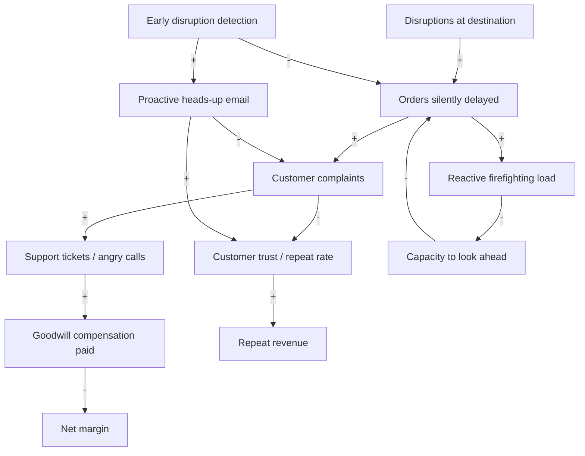
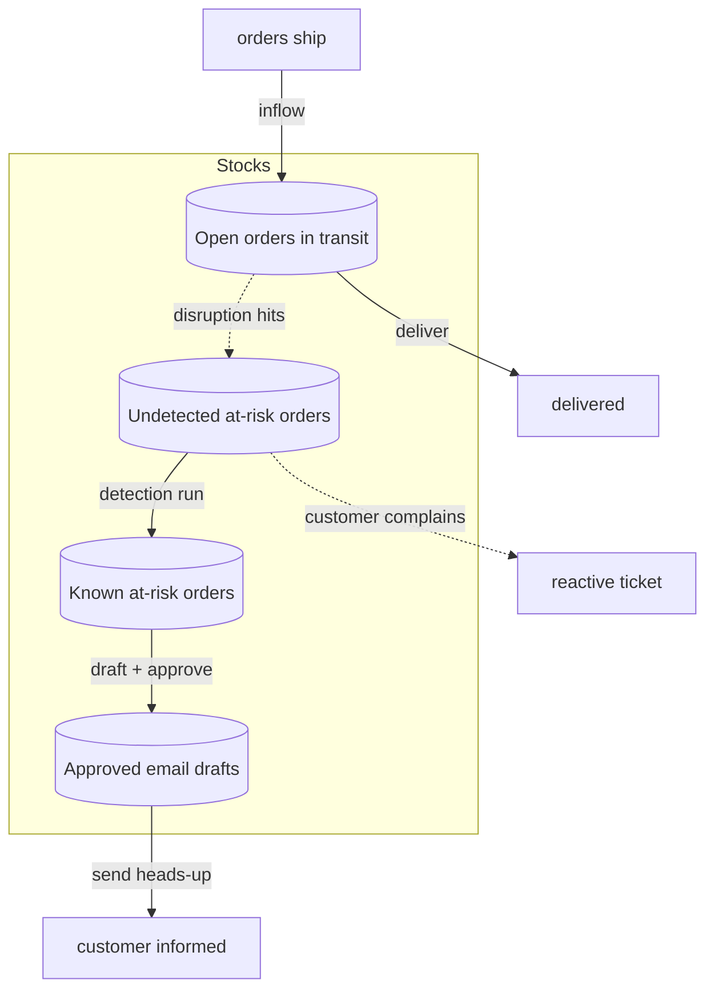
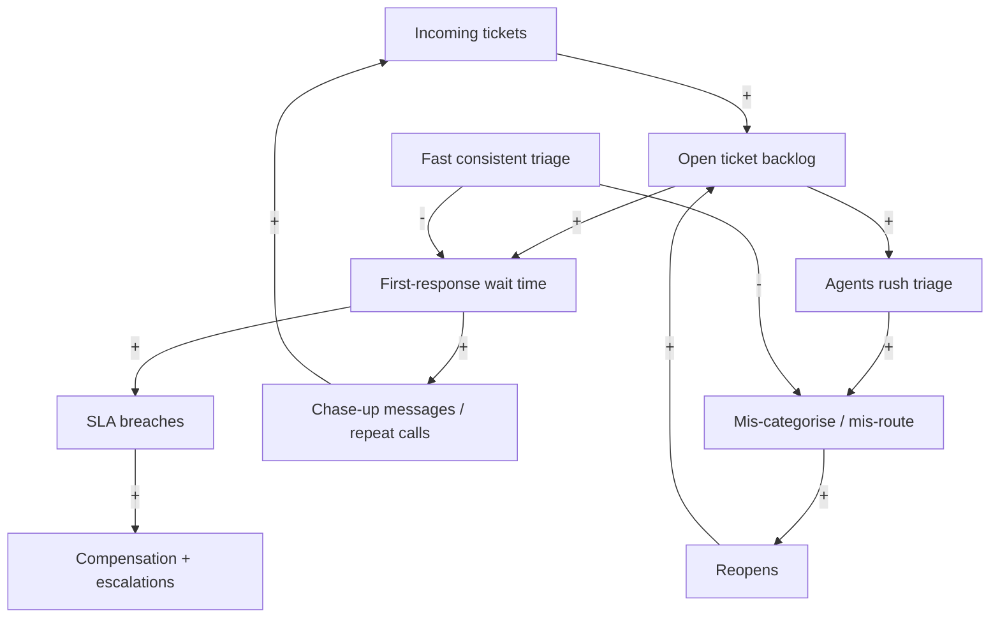
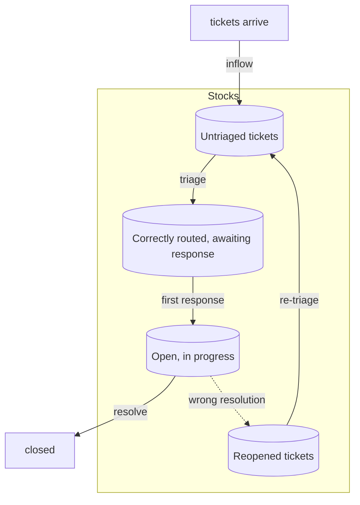
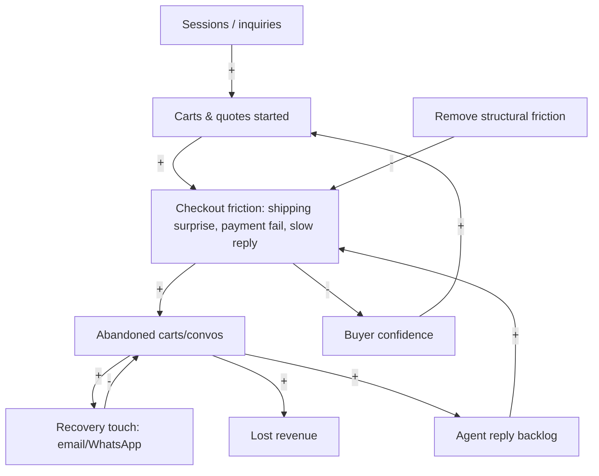
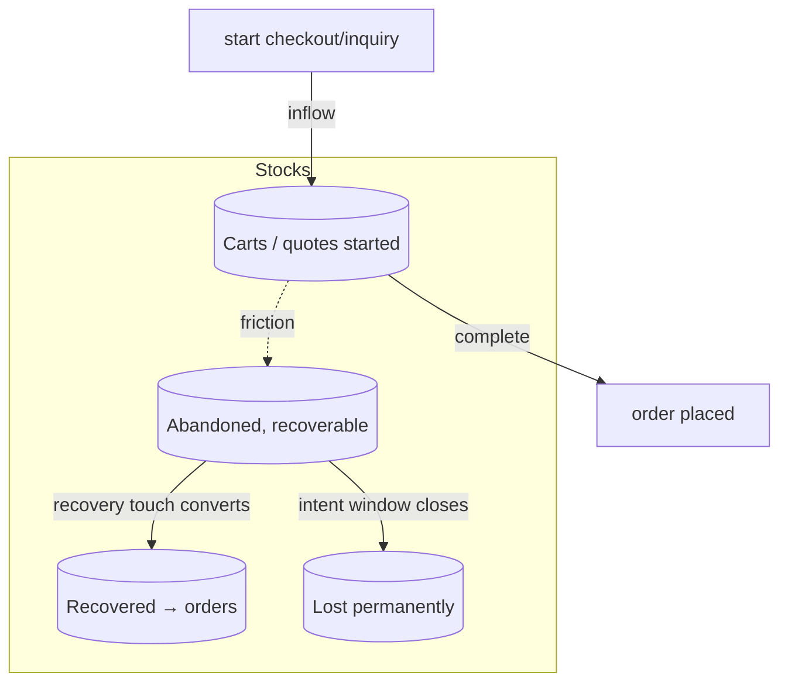
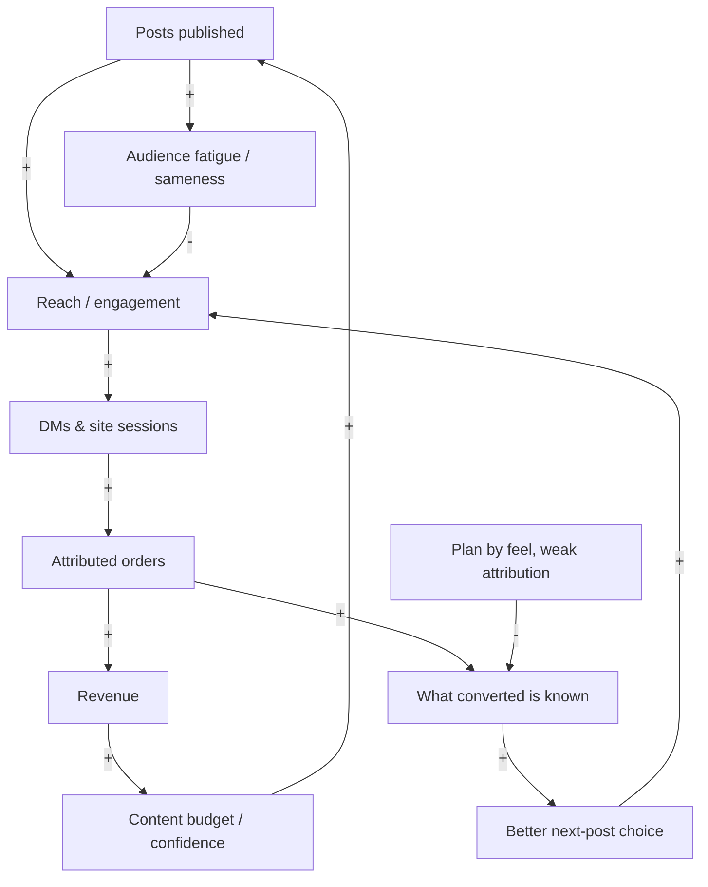
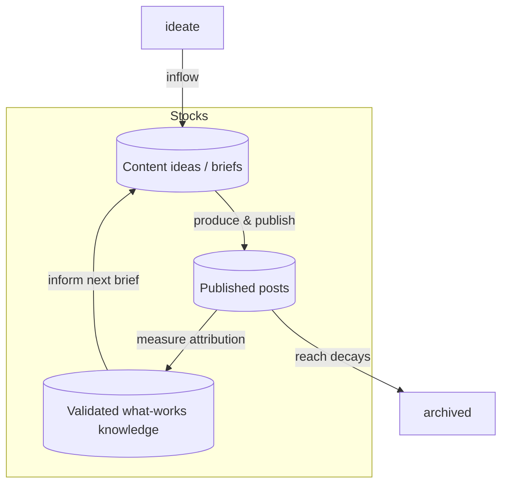

# Part V — LoopCycle Nusantara: Consumer Commerce

> **Source:** [`itsbharathp/LoopCycle`](https://github.com/itsbharathp/LoopCycle). Synthetic datasets for orders, abandoned carts, support tickets, calls, social posts and comments (June–September 2026), plus the **Hermes delivery-disruption-monitor** skill with four Python scripts and an answer key. Monetary values are in **IDR** (approximate rate **1 USD ≈ 15,800 IDR**). A "window" is the four-month data window (June–September 2026); annual figures use ×3.

## Chapter 16 — Meet LoopCycle Nusantara

**LoopCycle Nusantara** is a waste-to-value social enterprise in Bandung, West Java, Indonesia, founded in 2015. Its core business is a traceable recycling supply chain. It formalises **3,500 informal waste pickers**, buys their sorted plastic at fair-trade rates through **12 collection hubs** across West Java, pelletises it, and sells recycled resin to FMCG packaging makers. Turnover is roughly **$4.2M USD** across **160 staff**.

On top of that industrial core sits a **consumer brand**: the *Loop Tote*, a recycled-plastic tote bag sold direct-to-consumer and across nine channels (Shopify, Instagram DM/WhatsApp, Shopee, Tokopedia, TikTok Shop, Lazada, Blibli, Amazon, and a physical Bandung store). The tote is both a product line and the company's marketing engine, the visible, Instagrammable face of an otherwise invisible resin business.

| Domain | Dataset | Scale |
|---|---|---|
| Orders | `loopcycle_tote_orders.csv` | 2,867 orders, ~849M IDR revenue, 45.9% GP |
| Abandoned checkouts | `shopify_abandoned_checkouts.csv` | 1,326 (7.4% recovered) |
| Abandoned conversations | `instagram_abandoned_conversations.csv` | 979 (7.4% recovered) |
| Support | `loopcycle_support_tickets.csv` | 37 tickets, 32% SLA breach |
| Calls | `loopcycle_call_centre_log.csv` | 26 calls |
| Social | `loopcycle_instagram_posts_flat.csv` + comments | 30 posts, 1,515 comments |
| Delivery agent | `Data/Agent/hermes-delivery-disruption-monitor/` | 100 demo orders |

**Why these four cases, and why they differ.** They land in *different places* on the honest-assessment scorecard. The delivery monitor is genuinely agentic (open-web research and judgement). Support triage is a decision-model problem wearing an agent costume. Cart recovery is mostly automation with a thin generative edge. Content planning is a decision-model-and-measurement problem that the market would happily sell you as "generative AI". Reading them side by side is the fastest way to absorb the three-way split.

LoopCycle also fills a gap left by the Danfoss cases: it addresses **sales, marketing and customer service**, the function Danfoss's three cases left untouched ([§8.2](#82-how-the-business-is-structured)).

---

## Chapter 17 — The Delivery Disruption Monitor

> **Project:** [`Data/Agent/hermes-delivery-disruption-monitor/`](https://github.com/itsbharathp/LoopCycle/tree/main/Data/Agent/hermes-delivery-disruption-monitor) · **Domain:** last-mile logistics / proactive customer comms · **Dataset:** 100 demo open orders (34 Ordered · 36 Packed · 30 In-Transit); 85 Indonesian + 15 international destinations; the answer key marks 31 orders at disrupted destinations (21 "email customer", 10 monitor-only) and 69 controls.

### 17.1 The Problem

LoopCycle ships ~2,867 Loop Tote orders per window across six couriers (SiCepat, JNE, J&T, GoSend/Grab, in-store, platform couriers), with a mean ship→delivered time of **2.6 days**. West Java is exposed to floods, volcanic ash, haze, strikes and protests that stall deliveries *without the courier flagging a problem*: the parcel simply sits. The small ops/CX team finds out when the **customer complains**. "Delivery delay" is the single largest support category (5 of 37 tickets), and delivery issues drive both the angriest calls and the goodwill compensation (37 tickets carry **25.1M IDR** of compensation, a mean of **679k IDR** each).

The repo's Hermes skill reframes the problem as: *which open orders will be late, why, by how much, and what do we do?*, answered **before** the customer notices. It searches the live web for disruptions at each destination, verifies sources, estimates delay, and drafts customer emails for approval (never sending them itself).

### 17.2 Lens 1 — Causal Loop Diagram



- **R1, the firefighting spiral (reinforcing).** `Orders silently delayed → + Reactive firefighting load → − Capacity to look ahead → − Orders silently delayed`. Two minus signs, so reinforcing. The busier the team gets cleaning up late deliveries, the less time it has to *anticipate* them, so more go undetected. This is the vicious engine, and it is the only loop that closes in the diagram.
- **R2, trust erosion.** Complaints → (−) trust → (−) repeat revenue. Lower repeat revenue pushes the team to chase new orders rather than nurse existing ones, which feeds complaints. *(The return edge isn't drawn; it is a narrative loop.)*
- **B1, the compensation thermostat.** Complaints → compensation → (−) margin. Goodwill payments buy back some trust but drain margin. It caps the damage without fixing the cause, a classic "shifting the burden" brake.
- **B2, the proactive-detection brake (the one we want).** Early detection → (−) orders silently delayed, and proactive email → (−) complaints / (+) trust. *Detection enters the diagram as an exogenous lever:* the intervention *is* the brake.

**Delays.** The killer delay is between a disruption *starting* and LoopCycle *learning* about it. Today that path runs through the customer and a support ticket (hours to days). B2 collapses it from "customer-complaint time" to "web-search time".

**Leverage points (strongest first).** (1) **Information flow:** give the operator sight of disruptions *before* the customer has it. (2) **Delay length:** shrink detection lag from days to one 6-hour scheduled run. (3) **Loop gain on B2:** a proactive heads-up converts an angry complaint into a trust-building touch.

**Systemic insight.** R1 dominates today purely because of a *delay*: detection sits downstream of the complaint. Nothing is wrong with the team's effort; *the information arrives too late to act on*.

### 17.3 Lens 2 — Stock & Flow



| Stock | Inflow(s) | Outflow(s) | Units |
|---|---|---|---|
| Open orders in transit | orders ship | delivered | orders |
| **Undetected at-risk orders** | disruption hits an open order | detection run **or** customer complaint | orders |
| Known at-risk orders | detection run | draft + approve | orders |
| Approved email drafts | operator approval | send heads-up | emails |

**Which flow rate the solution moves.** Exactly one: the **detection outflow** from *undetected at-risk orders*. Today that stock drains almost entirely through the slow, damaging path ("customer complains"). The agent adds a fast drain ("detection run", every 6 hours), so orders leave the undetected stock *through LoopCycle's eyes, not the customer's inbox*. It cannot change how many disruptions occur (that inflow is the weather). It changes **how fast at-risk orders are discovered, and by whom.**

### 17.4 Lens 3 — Theory of Constraints

| Stage | What happens | Capacity / lead time today |
|---|---|---|
| 1. Detect disruption | Learn a destination is disrupted | **Reactive: hours–days (via complaint)** ← constraint |
| 2. Map to orders | Which open orders go there | Minutes (a `JOIN`) |
| 3. Estimate delay | Days late, revised window | Minutes (rubric + business-day maths) |
| 4. Decide action | Email / monitor / escalate | Minutes (rules + operator) |
| 5. Communicate | Draft + send heads-up | Minutes to draft; approval-gated |

1. **Identify.** The constraint is **Stage 1, detection latency**: not writing emails, not the maths. Every downstream stage is already fast; they just start too late.
2. **Exploit.** Run the team's awareness on a *schedule* and *group orders by destination*, so one search covers many orders (the demo's 100 orders collapse into a handful of destination groups).
3. **Subordinate.** `load_orders.py` pre-builds the search plan and source hints, so searching is frictionless the moment a run fires. `assess_orders.py` turns a finding into assessments, a report and drafts with no extra latency.
4. **Elevate.** Invest where capacity is genuinely missing: **open-web research and source verification at machine speed**, the irreducibly agentic nub.
5. **Repeat: migration.** Once detection is continuous, the binding constraint moves to **source quality / verification trust** (is the finding real and official?), and then to **operator approval throughput** (can a human approve drafts fast enough during a big event?).

### 17.5 Lens 4 — Throughput Accounting

**T** = margin saved by preventing delay-driven complaints. **I** = at-risk orders sitting undetected. **OE** = API/search cost + operator approval time.

| # | Assumption | Value | Basis |
|---|---|---|---|
| A1 | Orders per window | 2,867 | dataset |
| A2 | Share of orders hitting a disruption | 5% | modelled (the demo key's 31/100 is deliberately enriched) |
| A3 | At-risk orders / window | ~143 | A1 × A2 |
| A4 | GP per order | 135,811 IDR | dataset (GP ÷ orders) |
| A5 | Compensation per escalated delay | 679,000 IDR | dataset (mean comp/ticket) |
| A6 | Share of at-risk that escalate to comp **without** heads-up | 25% | modelled |
| A7 | Heads-up reduces escalation share to | 8% | modelled |
| A8 | Repeat-rate lift from proactive save | 10% of GP on saved orders | modelled, conservative |
| A9 | Operator approval time / run | 15 min, ~1.2 runs/day reviewed | modelled |
| A10 | Loaded ops cost | 150,000 IDR/hr | modelled |
| A11 | Search/API + infra | 1.5M IDR / window | modelled |

- **Before:** compensation = 143 × 25% × 679k = **24.3M IDR / window**.
- **After:** compensation = 143 × 8% × 679k = **7.8M IDR** → **ΔT_comp ≈ +16.5M IDR**. Repeat lift ≈ **+0.33M IDR**, deliberately conservative.
- **ΔOE:** approval 1.2 runs/day × 0.25 h × ~120 days × 150k ≈ **5.4M IDR**, plus search/infra **1.5M**, giving **≈ 6.9M IDR / window**.

| Metric | Before | After | Δ |
|---|---|---|---|
| T (margin saved) | 0 | +16.8M | **ΔT ≈ +16.8M IDR** |
| OE | ~0 (hidden in firefighting) | 6.9M | **ΔOE ≈ +6.9M IDR** |
| **Net = ΔT − ΔOE** | | | **≈ +9.9M IDR / window (~$627)** |

**ROI** = 9.9M ÷ 6.9M ≈ **1.4×** per window, before counting the unpriced trust loop.

**Sensitivity.** The load-bearing assumption is **A2, the disruption base rate**. At 2%, ΔT roughly halves to ~6.7M and Net goes to about zero. At 8%, Net clears 20M. **The sign holds for any base rate above ~3%**, and West Java's flood and haze seasonality makes 3%+ plausible. *A pilot must replace A2/A6/A7 with rates measured over one real season.*

### 17.6 Automation vs Agentic — An Honest Assessment

| Step | Nature | Throughput contribution | Build effort | Build priority |
|---|---|---|---|---|
| Load orders, filter in-scope statuses | **Automation** | Enabler | Low (`load_orders.py`) | 1 (done) |
| Group destinations, build search plan + source hints | **Automation** | Enabler | Low | 1 (done) |
| **Search the web, open & verify sources, find active disruptions** | **Agentic (LLM)** | **Carries ΔT** | High | **2 (the nub)** |
| Classify severity (High / Med / Low) | **Decision model** | Gates which orders get notified | Medium | 3 |
| Estimate delay range; compute revised window (business days, skip holidays) | **Automation** | Converts finding → action | Low (`assess_orders.py`) | 1 (done) |
| Decide action (email / monitor / escalate) | **Automation (rules) + operator** | Governs | Low | 1 |
| Draft customer email | **Agentic (LLM), human-approved** | Realises the save | Medium | 3 |
| Score against the answer key | **Automation** | Test harness | Low (`evaluate_against_key.py`) | 1 (done) |

**Effort decision.** ΔT ≈ +16.8M, ΔOE ≈ +6.9M, Net ≈ +9.9M, ROI ≈ 1.4×, and *all* of ΔT flows through one row: **open-web disruption research with verified sources.** Everything else is cheap deterministic plumbing that already exists in `scripts/`. Severity classification is a genuine *typed choice*, so it should be a **decision model** and not be left to the generative LLM. It gates customer contact, so you want calibration and abstention, not prose.

**Verdict: Hybrid, agentic nub.** This is the one LoopCycle case where the LLM carries the prize. Even so, ~70% of the surface area is automation, and the most expensive mistake would be letting the generative model also do the severity scoring and the business-day maths.

**Break-even.** This agent protects *consumer* margin, so size it on the prize: **~9.9M IDR/window ≈ 29.7M IDR/yr (~$1,880/yr)** for one LoopCycle-sized tenant. At a labelled **$45,000** loaded developer cost × 1.10 = **$49,500/dev-year**, one tenant funds **≈ 0.04 developers**. *As a bespoke build for LoopCycle alone, it does not clear break-even.* It clears only as a **product**: at $1,880/yr × N tenants, one full-time developer needs **N ≈ 26 tenants** (full-ramp) or **~40** (conservative). That is precisely why it ships as a reusable Hermes *skill* and not a LoopCycle-internal script.

### 17.7 Solution Design

**Automation layer** (deterministic and testable; already in `scripts/`):
- `load_orders.py(orders, statuses, as_of) → orders_in_scope.csv, destinations.json, search_plan.md`: filters scope, groups destinations, emits ready queries + `SOURCE_HINTS` per country.
- `assess_orders.py(orders, findings, as_of, holidays) → assessment.{csv,json}, report.md, customer_emails.csv`: joins findings to orders, applies `RUBRIC_DELAY`, computes revised windows with `common.py` business-day maths, and sets `send_allowed` blocks (opt-out, no address, demo domains).
- `evaluate_against_key.py`: scores a run against the facilitator's answer key. This harness keeps the agentic layer honest.

**Decision-model layer.** **Severity classification** (High / Medium / Low) over a finding, using a fixed rubric and a confidence threshold, with **abstain → operator review** when sources conflict or confidence is low. The skill already encodes "use the more cautious severity" and "flag single-source High as `verified:false`". Backend: **Laya** (order PII stays local) or **Microsoft-Decision-1**.

**Deep-agent layer** (the irreducible nub). A **skill-based** web-research loop. For each destination group: run queries → **open** sources (not snippets) → apply four tests (active, located, logistics-relevant, sourced) → write `findings.json` with `verified`/`confidence` flags and cited sources. It **never invents**, and it says *"none found"*, never *"safe"*. Tools: `web_search(query)`, `fetch_page(url)`, `write_findings(schema)`. Customer-email drafting is a **code-based, human-gated** step, precisely because sending is irreversible and customer-facing.

**Back to the constraint.** The agentic layer elevates detection latency. The decision model and the `verified` flags address the **migrated** constraint (source trust). Severity-filtered, batched, approval-gated drafts address the *next* migration (operator approval throughput).

### 17.8 Run It Yourself

```bash
cd Data/Agent/hermes-delivery-disruption-monitor
# Offline dry run (no web search — exercises the deterministic pipeline):
python3 scripts/load_orders.py   --orders examples/demo_orders.csv --out run --as-of 2026-10-13
python3 scripts/assess_orders.py --orders examples/demo_orders.csv \
        --findings examples/sample_findings.json --out run --as-of 2026-10-13
# Score the pipeline against the facilitator key:
python3 scripts/evaluate_against_key.py --assessment run/assessment.csv \
        --key examples/demo_answer_key.csv --out run/evaluation.md
```

Live: in Hermes, connect a web-search/fetch tool and say **"check delivery disruptions."** Review `report.md`, and approve drafts before anything is sent.

---

## Chapter 18 — Support Ticket and Contact-Centre Triage

> **Project:** [`Data/CallCentre_Ticket_Data/`](https://github.com/itsbharathp/LoopCycle/tree/main/Data/CallCentre_Ticket_Data) · **Domain:** customer-support operations / SLA management · **Dataset:** 37 tickets (2026-06-03 → 09-27), 155 threaded messages, 26 inbound calls. **32% SLA breach** (12/37); first-response median **145 min** (mean 387); resolution median **49.4 h**; CSAT mean **3.74/5**; **9 reopens**; compensation **25.1M IDR** total.

### 18.1 The Problem

LoopCycle's support runs across six channels (Phone, WhatsApp, Email, Web form, Instagram DM, Marketplace chat) feeding one ticket queue. The small CX team triages by hand: read the ticket, guess the category, set priority, route to a team, respond. The data shows the cost of doing this by hand under load. The SLA breach rate is **32%**. The first-response distribution has a **mean 2.7× its median** (387 vs 145 min), the signature of a few tickets rotting at the back of the queue. And **9 reopens** signal misrouted or half-resolved cases. With 22 distinct categories across 37 tickets, from "Delivery delay" to "Picker payment delay" to "CoA documentation", a mis-triage can send a B2B resin-quality issue to the consumer team while the clock runs out.

### 18.2 Lens 1 — Causal Loop Diagram



- **R1, the chase-up flood (reinforcing).** `Backlog → Wait → Chase-ups → Incoming → Backlog`. Slow first response *manufactures its own inbound volume*. The 26 calls and 155 messages against only 37 tickets show this multiplication.
- **R2, rush and reopen (reinforcing).** `Backlog → Rush → Mis-route → Reopens → Backlog`. Under pressure, agents triage faster and worse, and the 9 reopens flow straight back into the queue.
- **B1, the SLA/compensation brake.** Breach → compensation, which placates customers but drains margin (25.1M IDR): relief, not a fix.
- **B2, the fast-triage brake (the lever).** Fast, consistent triage → (−) wait, (−) mis-route. As in Chapter 17, *the intervention enters as an exogenous lever*: it is the brake the structure lacks.

**Delays.** The damaging delay is between *ticket arrival* and *correct routing*. Every minute there feeds both R1 and R2.

**Systemic insight.** The breach rate is not first a staffing problem. It is a *triage-latency and triage-consistency* problem that *creates* phantom volume (R1) and rework (R2).

### 18.3 Lens 2 — Stock & Flow



| Stock | Inflow(s) | Outflow(s) | Units |
|---|---|---|---|
| **Untriaged tickets** | tickets arrive; reopens | triage | tickets |
| Correctly routed | triage | first response | tickets |
| Open, in progress | first response | resolve / wrong-resolve | tickets |
| Reopened | wrong resolution | re-triage | tickets |

**Which flow rate the solution moves.** It raises the **triage outflow** from *untriaged tickets*, both its speed and its accuracy. Accuracy shrinks the `wrong-resolution → Reopened → re-triage` recirculation. The scarce resource being amplified is **agent attention**.

### 18.4 Lens 3 — Theory of Constraints

| Stage | What happens | Capacity / lead time today |
|---|---|---|
| 1. Intake | Ticket lands from a channel | Instant |
| 2. **Triage** (categorise, prioritise, route) | Human reads & classifies | **Serial on scarce agent attention** ← constraint |
| 3. First response | Agent replies | Median 145 min (tail to many hours) |
| 4. Resolve | Agent works the case | Median 49.4 h |
| 5. Close / reopen | Outcome | 9 reopens recirculate |

1. **Identify.** **Stage 2, triage.** It draws on the same scarce agent attention that Stages 3–4 need, and its errors create Stage-5 rework that re-enters Stage 2. The loud symptom (SLA breaches at Stage 3) sits downstream.
2. **Exploit.** Enforce a triage *template* (fixed category list, priority rubric, routing table), and work the queue by SLA clock rather than arrival order.
3. **Subordinate.** A correctly routed ticket with a suggested-response draft means the responding agent starts 60% of the way there.
4. **Elevate.** Add triage capacity that doesn't consume agent attention: a classifier that attaches category + priority + route the instant a ticket lands. This is where a **decision model** earns its place.
5. **Repeat: migration.** The constraint moves to **Stage-4 resolution capacity** and, for the hardest categories (resin quality, CoA, rate disputes), to **domain expertise**. The design must route *those* to humans rather than pretend to resolve them.

### 18.5 Lens 4 — Throughput Accounting

**T** = retained margin from avoided churn + avoided compensation. **I** = tickets sitting untriaged or open. **OE** = agent labour + classifier infra. *This case is scaled:* 37 tickets is a sample window, so the model reasons about 300 tickets per window.

| # | Assumption | Value | Basis |
|---|---|---|---|
| A1 | SLA breach rate (baseline) | 32% | dataset (12/37) |
| A2 | Compensation per breach-ish ticket | 679,000 IDR | dataset mean comp |
| A3 | Reopen rate | ~24% (9/37) | dataset |
| A4 | Agent triage time (manual) | 6 min/ticket | modelled |
| A5 | Agent first-response + resolve time | 45 min/ticket avg | modelled |
| A6 | Classifier auto-triage accuracy | 85%, abstains on 15% | modelled (decision-model target) |
| A7 | Breach rate after triage-at-arrival | 15% | modelled |
| A8 | Reopen rate after accurate routing | 12% | modelled |
| A9 | Loaded agent cost | 150,000 IDR/hr | modelled |
| A10 | Classifier infra (self-hosted) | 1.0M IDR / window | modelled |
| A11 | Tickets / window (consumer + picker + B2B) | 300 | modelled scale-up from the 37-ticket sample |

| Line (per 300 tickets / window) | Before | After | Δ |
|---|---|---|---|
| Compensation (300 × breach × 679k) | 65.2M | 30.6M | **ΔT ≈ +34.6M IDR** |
| Triage labour (humans triage only the 15% abstentions) | 4.5M | 0.68M | −3.8M |
| Reopen rework (300 × reopen × 45 min) | 8.1M | 4.05M | −4.05M |
| Classifier infra | — | 1.0M | +1.0M |
| **OE total** | 12.6M | 5.73M | **ΔOE ≈ −6.87M (saved)** |
| **Net = ΔT − ΔOE** | | | **≈ +41.5M IDR / window** |

**ROI** = 41.5M ÷ ~4.0M incremental spend (infra + ~3M integration amortised) ≈ **~10×** per window.

**Sensitivity.** The load-bearing assumption is **A7, the post-triage breach rate**, which drives nearly all of ΔT. If triage moves breach only from 32% to 25%, ΔT ≈ 14.3M and Net ≈ +21M. Even if the breach rate **did not move at all**, the labour saving alone (≈ +6.9M) keeps Net positive. *That restates the source's sensitivity line; see [Appendix C](#appendix-c--editors-notes-and-reconciliations).* A2 is dataset-anchored. *A pilot must measure A6/A7 over one real month and confirm the 300-ticket scale-up.*

### 18.6 Automation vs Agentic — An Honest Assessment

| Step | Nature | Throughput contribution | Build effort | Build priority |
|---|---|---|---|---|
| Ingest ticket from channel, normalise fields | **Automation** | Enabler | Low | 1 |
| **Categorise** into a fixed category list | **Decision model** | **Carries ΔT** (routing accuracy) | Medium | **2** |
| **Prioritise** (Urgent / High / Normal / Low) | **Decision model** | Carries ΔT (SLA focus) | Medium | **2** |
| **Route** to team | **Automation** (category → team map) | Converts decision → action | Low | 1 |
| Compute SLA clock, flag at-risk | **Automation** | Focuses the queue | Low | 1 |
| Draft first response | **Agentic (LLM), human-approved** | Speeds Stage 3 | Medium | 3 |
| Resolve hard cases (resin / CoA / disputes) | **Human expert** | — (route, don't automate) | — | — |
| Detect reopen risk / sentiment escalation | **Decision model** | Protects CSAT | Low | 3 |

**Effort decision.** The prize sits almost entirely in **getting category + priority right at arrival**: two *typed choices*. That is the textbook decision-model problem, **not** a generative-LLM problem. You want a fixed label set, calibrated confidence, and an **abstain → human** path for the ~15% of hard cases. The first-response draft is the only generative step, and it boosts *speed* rather than producing ΔT, so build it third, human-approved.

**Verdict: Decision-model-heavy, with a thin agentic drafting edge.** Putting "a support chatbot" on it would spend generation cost and latency on a *classification* job and lose the calibration and abstention that keep a wrong auto-route from reaching a customer. *The money is in the scorer, not the writer.*

**Break-even.** This is an internal ops tool, so size it on the Net prize: **≈ 41.5M IDR/window ≈ 124.5M IDR/yr (~$7,880/yr)**. One dev-year at $45k × 1.10 = **$49,500**, so a single tenant funds **≈ 0.16 developers**, about a **1.9-month** build for one developer that pays for itself within the first year. Price and volume (ticket count × compensation) move break-even far more than headcount does.

### 18.7 Solution Design

**Automation layer:**
- `ingest(channel_payload) → normalised_ticket`: unifies the six channels' fields.
- `route(category) → team`: a fixed category → team table (Delivery → Logistics CX, Resin quality → B2B tech, Picker payment → Hub ops, …).
- `sla_clock(ticket) → {due_at, at_risk_bool}`: deterministic SLA maths that sorts the queue by time-to-breach, not arrival.

**Decision-model layer (the core):**
- **Q1, category:** a typed choice over the category list (the dataset shows ~22; consolidate to ~10 routable buckets). **Abstain → human triage** below threshold.
- **Q2, priority:** a typed choice {Urgent, High, Normal, Low} with a rubric (keywords, `requester_type`=B2B, sentiment, order value). Abstain → default Normal + flag.
- **Q3, reopen/escalation risk:** binary; routes high-risk tickets to a senior agent.
- Backend: **Laya** (tickets carry masked PII and picker/B2B data best kept on-prem) or **Microsoft-Decision-1**.

**Deep-agent layer (thin, human-gated):** a **code-based** loop that drafts the first response *conditioned on the decided category* and pulls the matching macro or past-resolution snippet. The agent proposes and a human sends.

**Back to the constraint.** The decision-model layer elevates triage. The SLA clock subordinates the queue to it. The explicit **human route for hard categories** answers the *migrated* constraint.

### 18.8 Run It Yourself

No runnable artifact ships for this case yet; it is a design. A pilot plan:

```bash
# 1. Build a labelled set from the 37 tickets + 155 messages (category, priority).
# 2. Configure a decision model (Laya) on the label set; hold out 20%.
# 3. Measure accuracy, calibration and abstention; require abstain < 20% and
#    accuracy > 85% on held-out data before routing anything automatically.
# 4. Shadow-run for one window: classify live, compare to human triage, do not act.
# 5. Go live on category + priority + route; keep first-response drafting human-approved.
```

---

## Chapter 19 — Cart and Conversation Recovery

> **Project:** [`Data/Sales_Data/Abandoned_Carts/`](https://github.com/itsbharathp/LoopCycle/tree/main/Data/Sales_Data/Abandoned_Carts) · **Domain:** e-commerce conversion recovery · **Dataset:** 1,326 Shopify abandoned checkouts (**7.4% recovered**, mean cart **274,973 IDR**) + 979 Instagram DM/WhatsApp abandoned conversations (**7.4% recovered**, mean quote **271,805 IDR**, agent first-reply median **24 min**). Top Shopify reasons: unexpected_shipping_cost 226, payment_failed 225, distracted 163. Top IG reasons: price_concern 221, **slow_agent_reply 189**, colour/sold-out 114, shipping_cost 113.

### 19.1 The Problem

There are two parallel leaks. On the Shopify storefront, **1,326 checkouts** were started and abandoned, and only **98 (7.4%)** were recovered. On Instagram DM/WhatsApp, **979 sales conversations** reached a quote and died, and only **72 (7.4%)** were recovered. The abandonment *reasons* tell the story. On web, the top two, **unexpected shipping cost (226)** and **payment failed (225)**, are *structural and fixable without AI*. On social, the standout avoidable reason is **slow_agent_reply (189)**. At a mean cart of ~275k IDR and 45.9% GP (≈ 126k GP per cart), 1,228 unrecovered web carts park **≈ 155M IDR** of GP in a bathtub.

### 19.2 Lens 1 — Causal Loop Diagram



- **R1, friction → abandon → backlog (reinforcing).** `Abandoned convos → + reply backlog → + friction → + abandon`. On social, every un-replied inquiry worsens the backlog that causes the next slow reply. slow_agent_reply (189) is this loop made visible.
- **B3, the confidence ceiling (balancing: a limit to growth).** `Friction → − buyer confidence → + carts started → + friction`. One minus sign, so **balancing**. (The source labels it "R2, confidence erosion"; see [Appendix C](#appendix-c--editors-notes-and-reconciliations).) The behaviour is the same either way: shipping surprises and payment failures teach buyers to distrust checkout, and the loop settles the business at a *lower* level of cart starts. It is a ceiling, not a spiral.
- **B1, the recovery-touch brake (balancing).** `Abandon → recovery touch → − abandon`. It is weak today: a 7.4% recovery rate means B1 barely brakes.
- **B2, the fix-the-friction brake (the strongest lever, and *not* AI).** Remove structural friction → (−) friction. Showing shipping cost earlier and fixing the payment path attack the two biggest web reasons at the source.

**Delays.** Recovery touches that arrive hours after abandonment miss the buyer's intent window. That delay in B1 is why its gain is low.

**Systemic insight.** The headline instinct is "AI to recover carts". But the two biggest web reasons are *structural* (B2: automation/UX), and the biggest avoidable social reason is *latency* (R1: an auto-acknowledge + fast quote, barely any AI). The genuinely model-shaped slice, personalised and well-timed recovery copy, is real but *third* in size.

### 19.3 Lens 2 — Stock & Flow



| Stock | Inflow(s) | Outflow(s) | Units |
|---|---|---|---|
| Carts / quotes started | start checkout/inquiry | complete / abandon | carts |
| **Abandoned, recoverable** | friction | recovery conversion / permanent loss | carts |
| Recovered → orders | recovery touch converts | — | orders |

**Which flow rate the solution moves.** Two rates, with two different interventions. **(a)** Reduce the **abandon inflow** by removing structural friction (B2, automation/UX, the biggest effect). **(b)** Raise the **recovery conversion outflow** before the intent window closes (B1: a fast auto-touch + a thin layer of personalised copy). The scarce resource is **buyer intent**, which decays fast, so *timing* matters more than cleverness.

### 19.4 Lens 3 — Theory of Constraints

| Stage | What happens | Capacity / lead time today |
|---|---|---|
| 1. Attract | Session / inquiry arrives | OK |
| 2. **Convert checkout** | Buyer completes payment | **Structural friction: shipping surprise + payment fail (451 of 1,326 reasons)** ← web constraint |
| 2′. **Reply to inquiry** (social) | Agent quotes & answers | **slow_agent_reply (189)** ← social constraint |
| 3. Recover | Touch brings buyer back | 7.4%: weak |

1. **Identify.** There are *two* constraints on two channels. On web it is **checkout friction**: 451 of the reasons are structural, not persuasion. On social it is **agent reply latency**. Recovery copy is *not* the constraint; it sits downstream of both.
2. **Exploit.** Surface the shipping quote on the product page; add an instant payment-retry link on failure; auto-acknowledge every IG inquiry in under a minute with price and colours.
3. **Subordinate.** Recovery touches fire within minutes, pre-filled with the exact cart or quote, so the buyer can complete in one tap.
4. **Elevate.** Only *here* does a model help: choosing the *best recovery message or offer per abandoned cart*. Even this leans towards a decision model (pick the template/offer) more than open-ended generation.
5. **Repeat: migration.** Fix friction and latency and the constraint migrates to **offer economics** (is a voucher worth the margin?) and **inventory** (colour sold out, reason #3 on social, 114 cases): a *merchandising* constraint no recovery message can solve.

### 19.5 Lens 4 — Throughput Accounting

| # | Assumption | Value | Basis |
|---|---|---|---|
| A1 | Web abandoned carts / window | 1,326 | dataset |
| A2 | Social abandoned convos / window | 979 | dataset |
| A3 | GP per cart | ~126,000 IDR | dataset (45.9% of 274,973) |
| A4 | Baseline recovery rate | 7.4% | dataset (both channels) |
| A5 | Share of web abandons that are structural (shipping + payment) | 34% | dataset (451/1,326) |
| A6 | Friction removal recovers this share of structural abandons | 40% | modelled |
| A7 | Recovery rate after fast touch + personalisation | 14% | modelled |
| A8 | Personalisation infra + touch sends | 3.0M IDR / window | modelled |
| A9 | One-off friction/UX dev | 20M IDR, amortised over 10 windows → 2.0M | modelled |

- **Structural friction removal (B2, automation):** 1,326 × 34% × 40% × 126k ≈ **22.7M IDR GP / window**. *No model involved.*
- **Recovery-rate lift (B1, fast touch + light model):** 2,305 abandoned × (14% − 7.4%) × 126k ≈ **19.2M IDR GP / window.**

| Metric | Before | After | Δ |
|---|---|---|---|
| T (recovered + un-abandoned GP) | baseline 7.4% | + friction fix + lift | **ΔT ≈ +41.9M IDR / window** |
| OE | ~0 | infra 3.0M + amortised dev 2.0M | **ΔOE ≈ +5.0M IDR** |
| **Net = ΔT − ΔOE** | | | **≈ +36.9M IDR / window** |

**ROI** = ΔNet ÷ incremental spend = 36.9 ÷ 5.0 ≈ **~7.4×** per window. (The source quotes ~8×, computed as ΔT ÷ ΔOE.) Note that **~55% of ΔT (the 22.7M) needs no AI at all.**

**Sensitivity.** The load-bearing assumptions are **A7** and **A6**. If A7 is only 10%, the lift prize falls to ~7.5M, but the *structural* 22.7M is untouched, so Net stays ≈ +25M. The conclusion is robust precisely *because* its larger half is automation, not a model whose yield is uncertain.

### 19.6 Automation vs Agentic — An Honest Assessment

| Step | Nature | Throughput contribution | Build effort | Build priority |
|---|---|---|---|---|
| Show shipping cost on PDP; shipping calculator | **Automation / UX** | **Carries ~half of ΔT** | Low–Med | **1** |
| Payment-retry link on failure; expiry extension | **Automation** | Carries ΔT | Low | **1** |
| Auto-acknowledge IG inquiry (price + colours) in under 1 min | **Automation** | Kills R1 latency | Low | **1** |
| Detect abandonment + fire timed recovery touch | **Automation** (rules/trigger) | Enables B1 | Low | 1 |
| Classify abandonment reason | **Decision model** | Targets the touch | Low | 2 |
| Pick recovery template/offer per reason | **Decision model** | Lifts recovery rate | Medium | 2 |
| Write personalised recovery copy | **Agentic (LLM)** | Marginal lift | Medium | 3 |
| Decide voucher economics | **Automation** (margin rule) | Protects GP | Low | 2 |

**Effort decision.** The single most important finding is that **the biggest throughput row is pure automation/UX**. Build those rows *first*: they need no model and no data science. The *decision-model* rows carry the recovery-rate lift and are the sensible second investment. **Generative copy comes third and is the smallest**: a nice-to-have, not the prize.

**Verdict: Automation-first hybrid.** Marketed as "AI cart recovery", this case is mostly plumbing and UX, with a decision model in the middle and only a sliver of genuine generation. *A team that bought a generative "recovery AI" and skipped the shipping-cost fix would be spending model money to recover carts its own checkout was manufacturing.*

**Break-even.** Net ≈ **36.9M IDR/window ≈ 110.7M IDR/yr (~$7,000/yr)**. Against **$49,500** per dev-year, a single tenant funds **≈ 0.14 developers**: a **~1.7-month** single-developer build that pays back within year one (≈ 0.09 devs on a conservative two-thirds ramp).

### 19.7 Solution Design

**Automation layer** (the majority; build first):
- `shipping_quote(cart) → cost`, surfaced on the PDP and cart, not at the final step.
- `payment_retry_link(failed_checkout) → url`; `extend_expiry(checkout)`.
- `auto_ack(ig_inquiry) → reply` within 60 s, with price, colours, stock and a buy link.
- `on_abandon(cart) → schedule_touch(t+Δ)`: a deterministic trigger with the exact cart pre-filled.
- `voucher_ok(cart) → bool`: a margin-rule guard before any discount is offered.

**Decision-model layer:**
- **Q1, reason:** a typed choice over the reason set (the dataset ships the labels). Abstain → generic touch.
- **Q2, best action:** a typed choice {reminder, shipping-reassurance, payment-help, small-voucher, colour-alternative, no-touch}. Abstain → default reminder. Backend: **Laya** (buyer PII on-prem) or **Microsoft-Decision-1**.

**Deep-agent layer (thin):** a **skill-based** copy generator that writes the recovery message *given* the chosen action and cart. It is internal-facing and reviewed in aggregate, so skill-based iteration speed is acceptable.

**Back to the constraint.** Automation attacks the web constraint (checkout friction) and the social constraint (reply latency) head-on. The decision-model layer raises B1's gain. The **voucher margin rule** and an explicit *out-of-stock → merchandising* flag address the migrated constraints. The design refuses to paper over a sold-out colour with a recovery email.

### 19.8 Run It Yourself

There is no shipped artifact; instead, a staged pilot:

```bash
# Stage 1 (automation, no AI): add a PDP shipping estimate + payment-retry link.
#   Measure the abandon-reason mix over one window — expect shipping/payment to fall.
# Stage 2 (decision model): label abandons by reason from the dataset; configure Laya;
#   A/B timed touches (reason-aware template) vs generic. Target recovery 7.4% → 12%+.
# Stage 3 (generation): add personalised copy only where Stage 2 shows headroom.
```

---

## Chapter 20 — Content-to-Sales Planning

> **Project:** [`Data/Post_Data/`](https://github.com/itsbharathp/LoopCycle/tree/main/Data/Post_Data) + [`loopcycle_tote_post_sales_lift.csv`](https://github.com/itsbharathp/LoopCycle/blob/main/Data/Sales_Data/loopcycle_tote_post_sales_lift.csv) · **Domain:** social-content strategy / marketing attribution · **Dataset:** 30 Instagram posts (median reach **4,577**, median engagement **8.26%**), 1,515 comments, 8 modelled sales-lift events (972 attributed orders). Pillars: loop_tote 8, picker_stories 6, process_impact 6, behind_the_scenes 5, education 3, b2b_partners 2. Formats: VIDEO 11, CAROUSEL 11, IMAGE 8.

### 20.1 The Problem

Instagram is LoopCycle's demand engine. 606 orders are attributed to Instagram DM/WhatsApp, and the sales-lift file shows posts driving real spikes. But the lift is **wildly uneven**. A single `batik_reel` (reach 20,392) is credited with **545 attributed orders** and a +454% 24-hour lift, while a `care_carousel` produced **0% lift** and `quiz_image` just +14%. The content team plans by feel. With only 30 posts and 8 lift events, the data is thin, which is itself the key finding. The question: *how should LoopCycle decide what to post next, and does that decision need generative AI?*

### 20.2 Lens 1 — Causal Loop Diagram



- **R1, the virtuous content flywheel (reinforcing).** `Posts → Reach → Inquiries → Orders → Revenue → Budget → Posts`. When content works, it funds more content. The batik_reel is this loop firing.
- **R2, the learning loop (reinforcing, currently weak).** `Orders → What converted is known → Better next choice → Reach → … → Orders`. It *should* compound, but `Plan by feel → (−) learning` keeps its gain near zero.
- **B1, the fatigue brake (balancing).** `Posts → Audience fatigue → (−) reach`: posting more of the same decays reach.

**Delays.** Attribution delay: the link from a post to the orders it caused is blurry and arrives late, starving R2.

**Systemic insight.** The constraint is not creativity or generation; LoopCycle already produces varied content. It is the **broken learning loop (R2)**. Weak attribution means the flywheel can't be *steered*. The prize is in *measurement and choice*, not in generating more posts.

### 20.3 Lens 2 — Stock & Flow



| Stock | Inflow(s) | Outflow(s) | Units |
|---|---|---|---|
| Content ideas / briefs | ideate (informed by knowledge) | produce & publish | briefs |
| Published posts | produce & publish | reach decays | posts |
| **Validated what-works knowledge** | measure attribution | (feeds briefs) | insights |

**Which flow rate the solution moves.** It raises the **"measure attribution" inflow** into *validated knowledge*. It does **not** try to raise the produce rate: generating more posts without closing R2 just hits the fatigue brake. *Amplify the learning rate, not the output rate.*

### 20.4 Lens 3 — Theory of Constraints

| Stage | What happens | Capacity / lead time today |
|---|---|---|
| 1. Ideate | Come up with post concepts | Not scarce |
| 2. Produce | Shoot/edit a post | Some cost; not the binding limit |
| 3. Publish | Post goes live | Instant |
| 4. **Attribute / learn** | Know which posts drove orders | **Weak, slow, feel-based** ← constraint |
| 5. Choose next | Decide the next brief | Starved by Stage 4 |

1. **Identify.** **Stage 4, attribution/learning.** The loud activity (publishing) hides the quiet missing capability (measuring).
2. **Exploit.** Use data already captured (`post_sales_lift.csv`, `attributed_ig_post_id` on orders, per-post reach) to rank past posts by *attributed orders per unit of reach*. That exposes that reels and batik/design pillars convert while quiz/care posts don't.
3. **Subordinate.** Brief the next posts to *replicate* proven attributes, and *stop* producing proven non-converters.
4. **Elevate.** Add a lightweight model that **predicts a new brief's expected attributed-orders band** from its attributes and flags low-confidence briefs. This is a decision/estimation model, not a generator.
5. **Repeat: migration.** The constraint moves to **production capacity** (can we shoot enough reels?) and then to **audience fatigue / the reach ceiling**, at which point *paid amplification* is the next move. *The learning model buys you a production problem, which is a good problem.*

### 20.5 Lens 4 — Throughput Accounting

| # | Assumption | Value | Basis |
|---|---|---|---|
| A1 | Posts / window | 30 | dataset |
| A2 | Attributed orders across lift events | 972 (sum of 8 events) | dataset |
| A3 | GP per order | 135,811 IDR | dataset |
| A4 | Share of posts that are weak converters | ~40% | dataset (quiz/care/some image ≈ low lift) |
| A5 | Reallocating effort to proven shapes lifts attributed orders by | 25% | modelled |
| A6 | Analytics + estimation model cost | 2.0M IDR / window | modelled |
| A7 | Production cost unchanged (reallocated, not increased) | 0 Δ | modelled |

| Metric | Before | After | Δ |
|---|---|---|---|
| T (content-attributed GP) | 972 × 135,811 ≈ 132M | 165M (+243 orders) | **ΔT ≈ +33M IDR / window** |
| OE | content cost C | C + 2.0M | **ΔOE ≈ +2.0M IDR** |
| **Net = ΔT − ΔOE** | | | **≈ +31M IDR / window** |

**ROI** = 31 ÷ 2.0 ≈ **~15×** per window (the source quotes ~16×, computed as ΔT ÷ ΔOE), *if* the attribution signal is real.

**Sensitivity.** This is the **shakiest** case in the book, and the honesty matters. ΔT rests on **A2/A5** and on attribution modelled from **only 8 lift events and 30 posts**. If the reallocation lift is 10% rather than 25%, ΔT falls to ~13M: still net-positive, but with a wide confidence interval. If attribution is largely spurious (reels reach more people *because they're reels*, not because of content choice), ΔT could approach zero. Concentration makes this worse: **one post, `batik_reel`, carries 545 of the 972 attributed orders (56%)**, so any "what works" model is, statistically, mostly a model of a single outlier. **The sign is likely positive but is the least certain in the book.** *This case must start as measurement, not automation.*

### 20.6 Automation vs Agentic — An Honest Assessment

| Step | Nature | Throughput contribution | Build effort | Build priority |
|---|---|---|---|---|
| Join posts ↔ attributed orders ↔ reach/engagement | **Automation** | **Enabler for all of ΔT** | Low | **1** |
| Rank posts by attributed orders per reach | **Automation** | Surfaces what works | Low | **1** |
| Classify post attributes (format/pillar/hook) | **Automation** (metadata) + light model | Enabler | Low | 1 |
| **Predict a brief's expected attributed-orders band** | **Decision / estimation model** | **Carries ΔT** | Medium | 2 |
| Flag low-confidence briefs for a human | **Decision model (abstain)** | Protects against bad bets | Low | 2 |
| Generate caption / hook variants for a chosen brief | **Agentic (LLM)** | Marginal (speeds production) | Low–Med | 3 |
| Decide the paid-amplification budget | **Automation** (ROAS rule) | Addresses the migrated constraint | Low | 3 |

**Effort decision.** The prize sits in **measurement (automation) + an outcome-estimation model**. Generative caption-writing, the thing most teams would call "the AI content strategy tool", is the **lowest-value row**. Build the join + ranking first (pure SQL/pandas); it may be enough on its own.

**Verdict: Decision model + measurement, NOT generative.** This is the case most likely to be mis-sold as "generative AI for content", and the one where that framing is most wrong. *A `GROUP BY format, pillar` over the existing data is the single highest-ROI first move, and it contains no model at all.*

**Break-even.** Net ≈ **31M IDR/window ≈ 93M IDR/yr (~$5,900/yr)** at the modelled lift. With a 50% haircut for attribution uncertainty that is **~$2,950/yr**, which funds **≈ 0.06 developers**, or **~3 weeks** of one developer's time. That is exactly the right size: the first deliverable is an analytics notebook, not a product.

### 20.7 Solution Design

**Automation layer** (build first; it may be enough):
- `attribution_table()`: joins `instagram_posts_flat` + `post_sales_lift` + orders' `attributed_ig_post_id` into one row per post.
- `rank_posts()`: attributed orders per 1k reach, sliced by format and pillar. It emits "do more of / stop doing" lists (today: more reels + batik/design; fewer quiz/care static images).
- `brief_metadata(brief) → {format, pillar, hook_type, timing}`.

**Decision-model layer:** **Q1, expected outcome band.** Estimate {low / medium / high} attributed orders for a proposed brief, with calibrated confidence. **Abstain → a human picks** when the brief is novel. That will be common with only 30 training posts, and the model must *know* its data is thin. **Laya** fits better than a managed API here (small data, calibration-first).

**Deep-agent layer** (optional, built last): a **skill-based** caption/hook generator that drafts variants *for a brief the decision model rated high*. Generation serves a validated selection; it never leads it.

### 20.8 Run It Yourself

```bash
# The highest-ROI first move needs no model — just the join:
python3 - <<'PY'
import csv
lift=list(csv.DictReader(open('Data/Sales_Data/loopcycle_tote_post_sales_lift.csv')))
for r in sorted(lift, key=lambda x:-int(x['modeled_attributed_orders'])):
    print(f"{r['post_tag']:18} {r['format']:9} reach={r['ig_reach']:>6} attr_orders={r['modeled_attributed_orders']:>4}")
PY
# Then: GROUP BY format & pillar to get the "do more / stop" lists before any model.
```

---
