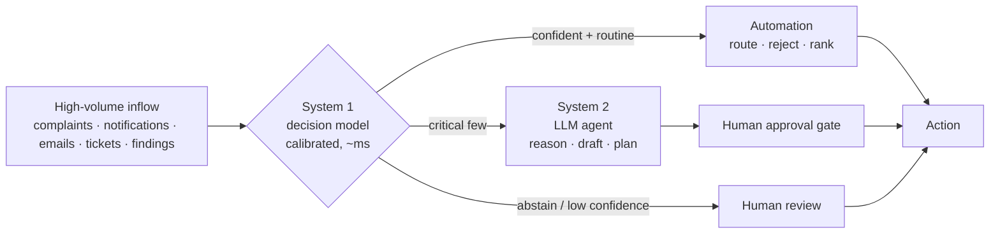

# Part VI — Synthesis

## Chapter 21 — Patterns Across Nine Cases

Each source field book closed with its own synthesis chapter, comparing three cases, one case, or four. Read together, the nine cases from four companies show patterns that no single book could: across industries (manufacturing, refining, industrial procurement, consumer commerce), across scales (a 40,000-person multinational to a 160-person social enterprise), and across currencies. This chapter is the reason the books were merged.

### 21.1 The constraint is almost never the obvious step

| Company | Case | Loud symptom / obvious "fix" | **Actual constraint** | Constraint family |
|---|---|---|---|---|
| Danfoss | Supplier Performance Review | "We don't have the data" | Judgement-heavy **meeting prep** (the data was always there) | Scarce judgement |
| Danfoss | 8D Report | "Root-cause analysis takes 45 days" | **Engineer classification + drafting labour** (lab time runs in parallel) | Scarce judgement |
| Danfoss | Customs Clearance | "The merge is slow" | The once-daily **batch cadence** | Latency / cadence |
| Crestmount | Planner Bottleneck | "Hire more planners" | **Planner attention** spent on noise and context-gathering (capacity is 8× inflow) | Scarce judgement |
| Meridian | Vendor-Pool Collapse | "The team is overloaded; prices are up" | The **responding/bidding vendor pool** (invitations flat, bids −30%) | Degraded stock / feedback |
| LoopCycle | Delivery Monitor | Angry calls, compensation | **Detection latency** (finding out through the customer) | Latency / cadence |
| LoopCycle | Support Triage | SLA breaches at first response | **Triage latency + accuracy** upstream | Latency / cadence |
| LoopCycle | Cart Recovery | Low recovery rate → "AI recovery emails" | **Checkout friction + reply latency** | Latency / cadence (+ structure) |
| LoopCycle | Content Planning | "Post more / post better" | The **broken attribution/learning loop** | Degraded stock / feedback |

The nine constraints fall into **three families**, and each family points to a different kind of solution:

1. **Scarce judgement** (UC-1, UC-2, Crestmount). A small group of experts spends attention on the wrong work. *Fix:* filter, pre-assemble and draft, so the experts edit instead of author. This is where agents earn their keep.
2. **Latency and cadence** (UC-3, delivery, support, cart). The work is fast, but it *starts too late* or runs in batches. *Fix:* move the moment of detection or processing upstream. This is mostly automation and decision models; an LLM appears only where the *detection itself* needs open-ended research (delivery).
3. **Degraded stocks and feedback** (Meridian, content). An accumulation that should feed the system (willing vendors, validated knowledge) is draining, and the loop that should refill it is broken or slow. *Fix:* repair the loop, by policy (on-time payment) or by measurement (attribution). Agents shorten delays here but do not supply the missing structure.

> **The one habit to keep:** *don't automate the loud step; find the gating step.* In nine cases out of nine, the naive answer was wrong.

### 21.2 Where the money shows up — and what that says about the step

| Case | ΔT | ΔOE | Net | ROI / payback | Dominant term |
|---|---|---|---|---|---|
| Danfoss UC-1 | +€176k/yr | +€141/yr | +€176k/yr | ~11.6× | **ΔT** (OE flat) |
| Danfoss UC-2 | +€532k/yr (€161k reports + €370k warranty) | −€260k/yr | ≈ +€797k/yr (€426k without warranty) | ~28.7× (9.4× on OE alone) | **ΔT largest but softest; ΔOE is the defensible floor** |
| Danfoss UC-3 | +£2,250/mo | −£2,788/mo | +£5,038/mo | ~3.4×, payback ~1.2 mo | **ΔOE** |
| Crestmount | +$3.37M/yr | +$9.1k/yr | +$3.36M/yr | ~36×, payback ~10 days | **ΔT** |
| Meridian (diagnosis) | **−$289k** lost over 10 mo | +$14k over 10 mo | break-even budget ≈ $303k | — | **ΔT** (the pain was never OE) |
| LoopCycle delivery | +16.8M IDR/window | +6.9M | +9.9M | ~1.4× | **ΔT** |
| LoopCycle support | +34.6M IDR/window | −6.9M | +41.5M | ~10× | **ΔT + ΔOE** |
| LoopCycle cart | +41.9M IDR/window | +5.0M | +36.9M | ~7.4× | **ΔT** (55% from no-AI UX) |
| LoopCycle content | +33M IDR/window* | +2.0M | +31M* | ~15×* | **ΔT** (*attribution-gated) |

*Currencies and periods differ by design; compare signs and ratios, not absolute values.*

Three readings:

1. **ΔT is the largest term in eight of nine cases.** The win in knowledge work is amplifying a scarce resource, not cutting it. Meridian is the purest example: the team *felt* the pain as overtime (OE), but OE moved $14k while Throughput fell $289k.
2. **Where ΔOE carries the case, the step is consolidation or labour-heavy drafting.** UC-3 (pure consolidation) is the only OE-led case, and it is *automation*. UC-2's ΔT is larger but rests on the softest assumption (a 12% warranty reduction), so its *defensible* case is the 90% OE collapse on 8 h of drafting per report. When you see an OE-led business case, ask first whether the step is really automation.
3. **Match the pitch to the dominant term.** "Throughput amplifier" (UC-1, Crestmount), "cost + quality" (UC-2, support), "automate the toil" (UC-3), "protect the margin" (Meridian, delivery), "learn, don't generate" (content). The same technology gives very different financial stories, and the wrong pitch loses the budget.

### 21.3 The constraint always migrates — plan for Step 5

| Case | After elevation, the constraint migrates to… | The design's answer |
|---|---|---|
| Danfoss UC-1 | **Action-item closure** (~18%) | `get_action_items`: redeploy freed hours to chasing 75 open actions |
| Danfoss UC-2 | **Physical lab / root-cause time** (~45 d) | None in software; redirect to process redesign |
| Danfoss UC-3 | **Upstream SAP CDS data quality** (18/30 blocked days) | `get_open_issues_summary` surfaces clustered gaps |
| Crestmount | **Scheduler, parts and permit lead times** | `check_execution_readiness`, the migration probe |
| Meridian | **Foresight about exogenous shocks** (editor's reading) | Pair the Oracle (statistics) with the Tactician (causal reasoning) |
| LoopCycle delivery | **Source trust → operator approval throughput** | `verified`/`confidence` flags; batched, severity-filtered approvals |
| LoopCycle support | **Resolution expertise** on hard categories | Explicit human route for resin / CoA / disputes |
| LoopCycle cart | **Offer economics → inventory** | Voucher margin rule; out-of-stock → merchandising flag |
| LoopCycle content | **Production capacity → audience fatigue** | ROAS / paid-amplification rule; abstain on novel briefs |

In every case, the best-designed component is the one that **makes the next constraint visible** (`get_action_items`, `get_open_issues_summary`, `check_execution_readiness`, `verified` flags). **An agent that doesn't help you see the next constraint is a dead end.** Two of the migrations, UC-2's lab time and Meridian's exogenous shocks, cannot be fixed by software at all, and saying so is part of the analysis.

### 21.4 The honest scorecard: automation, decision model, or agent?

| Case | Automation | Decision model | Agentic (LLM) | Other | **Verdict** |
|---|---|---|---|---|---|
| Danfoss UC-1 | KPI pull, flagging, risk-ranking | — | **Prep drafts, meeting summaries** | — | Hybrid, leaning agentic |
| Danfoss UC-2 | Q2/Q3 retrieval | **4-way classification** | **8D drafting** | — | Hybrid — all three |
| Danfoss UC-3 | **Merge + 4 rules + export** | — | — (gap analysis at most) | — | **Automation** |
| Crestmount | **Dedup, context brief, ranking, readiness probe** | **Severity, false-positive, duplicate** | WO drafting (bounded) | Human verdict | Hybrid, decision-model-heavy |
| Meridian | Health/payment data layer, flags | Inbox triage (Front Door) | **Watchdog, Tactician** | **Policy** (pay on time); TimesFM forecaster | Hybrid — top lever is policy |
| LoopCycle delivery | Load, group, delay maths (~70%) | Severity | **Open-web research** + approved drafts | — | Hybrid, agentic nub |
| LoopCycle support | Ingest, route, SLA clock | **Category, priority, reopen risk** | Thin first-response draft | Human experts | Decision-model-heavy |
| LoopCycle cart | **Shipping, payment, auto-ack (55% of ΔT)** | Reason + action selection | Thin copy | — | Automation-first hybrid |
| LoopCycle content | **Join + ranking** | Outcome estimation | Caption variants (last) | — | Decision model + measurement |

**Count what carries the money:**

| Where the prize sits | Cases | Count |
|---|---|---|
| The **LLM** is the primary value carrier | UC-1, LoopCycle delivery, Meridian (Watchdog/Tactician, behind a policy) | **3** |
| The LLM **shares** the prize with a decision model | UC-2 | **1** |
| The LLM is a **thin, last layer**; the money is in automation and decision models | Crestmount, support, cart, content | **4** |
| **No LLM** belongs in the critical path | UC-3 | **1** |

All nine cases were shipped or pitched as "AI agents". In **five of nine**, a team that built generation-first would have spent most of its budget in the wrong place. This contrast is the most valuable finding of the merged book, and it only becomes visible at scale.

> **The discipline, restated:** most "AI projects" are an automation core, often a decision-model front end, and a small irreducibly agentic nub, with a human at the gate. Reach for the LLM *only* for the nub.

### 21.5 One architecture keeps recurring: System 1 in front of System 2

Strip the domain away and five cases converge on the same three-layer shape:



| Case | System 1 (decides) | System 2 (reasons / writes) | Human gate |
|---|---|---|---|
| Danfoss UC-2 | 4-way FC classifier with abstention | 8D drafting | `LOW CONFIDENCE — HUMAN REVIEW` banner |
| Crestmount | Severity + false-positive + duplicate | WO drafting | Planner keeps the convert/reject/escalate verdict |
| Meridian | Front Door: queue, urgency 0–5, language | Watchdog + Tactician | Recommendations, not actions |
| LoopCycle delivery | Severity of a verified finding | Open-web research + email drafts | Operator approves every send |
| LoopCycle support | Category + priority + reopen risk | First-response draft | Agent sends |

**Abstention is the hinge.** In each case, the decision model's right to say *"I'm not sure"* is what makes automation safe near the costly errors: a rejected real failure near a T1 asset, a misrouted B2B quality complaint, a REPEAT that is really a CA_FAILURE. In the CLDs, abstention often works as a *designed balancing loop*. It turns a silent wrong guess, which would feed a reinforcing spiral, into an explicit escalation.

### 21.6 Check the signs: the brake is often the intervention

Re-checking every Causal Loop Diagram edge by edge (counting minus signs around each closed loop, as [Chapter 3](#chapter-3--the-four-lenses) teaches) turned up a finding that recurs across the sources:

- In **Meridian** and **Danfoss UC-2**, *every* loop that closes in the drawn structure is **reinforcing**. Loops labelled "balancing" in the source text turn out to be the reinforcing loops traced in their virtuous direction, or they need an edge the diagram omits. In **UC-1**, the only closing balancing loops are the *automation-adoption* loops.
- In several LoopCycle diagrams, the "brake" (early detection, fast triage, fixing friction) enters as an **exogenous lever**, an arrow from outside, rather than as a closed loop.

That is not just a drafting error; it is the story. **These systems have no internal brake.** Their vicious spirals ran until something outside the loop intervened. The solutions are best understood as **designed balancing loops**: Meridian's Watchdog + payment policy, UC-2's abstention gate, LoopCycle's detection run. In a workshop, make participants *draw the loop the intervention closes*. If they can't close it, the intervention is a one-off push, not a structural fix. (The corrections are listed in [Appendix C](#appendix-c--editors-notes-and-reconciliations).)

### 21.7 Where to Point AI: Workforce and Data Density

Two of the companies give opposite but complementary advice on *where* in an organisation to aim AI.

**Danfoss: follow the work character.** The largest function, Finance & Operations (43.2%, ~17,300 people), is the *most automatable*: high-volume, rule-based and repetitive. UC-3 is its archetype. Engineering (29.0%) is where the irreducibly agentic nubs cluster (8D drafting). Sales & Marketing (27.8%) was untouched by the Danfoss cases.

| Function | Dominant work character | First-reach tool | Cases in this book |
|---|---|---|---|
| **Finance & Operations** | High-volume, rule-based, repetitive | **Automation** (+ decision models) | UC-1 data layer, UC-3, Crestmount automation, Meridian data layer |
| **Engineering / technical** | Judgement, synthesis, document generation | **Agentic** (+ decision models) | UC-2 drafting, Crestmount WO drafting |
| **Sales, marketing & service** | Relationship + content, scoring, triage | **Decision models** first; agentic content last | All four LoopCycle cases, Meridian Front Door |

LoopCycle fills the Sales & Marketing gap, and it confirms the prediction: three of its four cases are decision-model or automation problems, not generative ones.

**LoopCycle: point AI where the instrumented data already is.** LoopCycle's deepest value is its 3,500 pickers and 12 hubs, yet all four cases aim at the thin consumer layer on top, because that is where the digital exhaust (orders, carts, tickets, comments) is dense enough to model. The highest-*mission* work (fair picker payment, resin quality) may be the *least* data-rich, and so the *least* ready for a model. It is a candidate for automation (payment reliability) long before an agent.

**Meridian: beware the instrumented-but-blind metric.** The gauge everyone watched, invitations per RFQ, was dense, clean and completely uninformative. Data density tells you where a model *can* go, not where it *should*. Only the constraint analysis tells you that.

> **Combined rule:** match the tool to the *work character* of each function; aim first where data is dense *and* the constraint lives; and never let a comfortable metric stand in for the constraint.

### 21.8 Break-even Across the Portfolio

All nine cases use the same formula ([Chapter 7](#chapter-7--sizing-the-build-break-even-and-team-size)). The results diverge because the *economic frame* differs:

| Case | Frame | Key assumptions (labelled) | Break-even team | Build effort | Verdict |
|---|---|---|---|---|---|
| Danfoss UC-1 | Product vendor | €35k ARR × 5, 18 mo, €44k/dev | 2.4–3.6 | ~2 devs | Clears at 2 |
| Danfoss UC-2 | Product vendor | same | 2.4–3.6 | ~2–2.5 | Clears at ~2–2.5 |
| Danfoss UC-3 | Product vendor | same | 2.4–3.6 | ~1 | Widest margin; breaks even first |
| Crestmount | Product vendor | $150k ARR × 8, 3 yr, $180k/dev | 4.0–6.1 | ~2.5 | Clears at ~2.5 |
| Meridian | Remediation ceiling | $303k budget, $150k/dev (editor) | ≤ ~1.8 dev-years | ~2 devs for months | Fits, after the policy lever |
| LoopCycle delivery | Single tenant → product | $1,880/yr prize, $45k/dev | 0.04 (1 tenant) | High | Needs ~26–40 tenants |
| LoopCycle support | Single tenant | $7,880/yr | 0.16 | ~2 months, 1 dev | Clears |
| LoopCycle cart | Single tenant | $7,000/yr | 0.14 | ~6–8 weeks, 1 dev | Clears |
| LoopCycle content | Single tenant | $2,950/yr (haircut) | 0.06 | ~3 weeks, 1 analyst | Clears as a notebook |

Four lessons:

1. **The automation-heavy case always breaks even first.** UC-3 (pure automation) has the widest Danfoss margin. LoopCycle's cart and support cases, mostly automation and decision models, clear as single-tenant builds, while the most agentic case (delivery) does not.
2. **Tenant count dominates headcount.** The same delivery monitor fails as a LoopCycle-only build and succeeds as a product across 26–40 shippers. Doubling Crestmount's customers doubles the sustainable team while the build barely changes. Price × customers is the lever; developers are the cost.
3. **Size at the portfolio level.** Danfoss recommends ~2 developers *for the whole three-case portfolio*. LoopCycle's four cases together (~$19,700/yr) justify one developer for ~5 months, phased cheapest-first (cart automation → support triage → content measurement → delivery agent). Shared automation and decision-model infrastructure is what makes each additional case cheap.
4. **Sometimes the cheapest "build" is zero developers.** Meridian's highest-leverage move costs a payment-policy decision. Crestmount's first capacity gain is rejection discipline. LoopCycle's biggest cart gain is a shipping-cost label.

> **Honesty note.** ARR, developer cost, customer counts and horizons are *stated assumptions* in every source, not sourced figures. The conclusions are robust in *direction*: automation-heavy work breaks even with smaller teams, and the tenant count moves break-even more than headcount does. Substitute your real numbers for a decision-grade answer.

### 21.9 Code-based vs skill-based — the governance call

| If you need… | Choose | Seen in |
|---|---|---|
| Approval gates before output reaches a customer, supplier or plant | Code-based | UC-1, UC-2, UC-3, Crestmount, LoopCycle support & delivery drafting |
| To *measure* accuracy against ground truth | Code-based + eval harness | UC-2 (`--all --sample`), Crestmount (`run_agents.py`), LoopCycle (`evaluate_against_key.py`) |
| To add capability without touching orchestration | Skill-based (registry) | UC-1 |
| A human-guided decision-tree procedure, no live loop | Skill-based (declarative spec) | UC-2 |
| To decouple the skill from a backend and verify it first | Skill-based (tool server + `--verify`) | UC-3 |
| Open-ended exploration where a human reviews before consequences | Skill-based | LoopCycle delivery research, cart copy, content captions |

Every runnable case ships an **evaluation harness** that works without an API key. That is a pattern worth copying: *prove the deterministic layer before you trust the agentic one.*

### 21.10 The method, distilled

```
Problem
  → CLD        (why does it persist? which loops dominate? does any loop actually brake it?)
  → Stock&Flow (where does it pile up? which ONE rate moves the pile?)
  → ToC        (what one step gates everything? elevate it — and name where it moves)
  → TA         (what is the prize — ΔT, ΔI, ΔOE — and does the sign survive doubt?)
  → Decompose  (policy? automation? decision model? irreducibly agentic?)
  → Size       (build effort per layer → break-even team at your ARR × customers)
  → Build      (policy first; automation as code; decision model for typed choices; LLM for the nub)
  → Instrument (build the probe that shows you the next constraint)
  → Repeat     (the constraint moved — go again)
```

---

## Chapter 22 — Running This as a Workshop

This chapter is for the **facilitator**. The book doubles as the participant handbook; this chapter is your run-sheet. It merges the facilitation guides of all four source books.

### 22.1 Formats

| Format | Scope | Audience |
|---|---|---|
| **Executive, 2 h** | Facilitator pre-runs the lenses on one case; the room debates only the scorecard (§21.4) and portfolio break-even (§21.8) | Sponsors, budget holders |
| **Half-day, 3.5 h** | Part I + one case in depth (UC-1 or Crestmount recommended) | Leaders who need the *why* |
| **One day, 7 h** | Part I + two contrasting cases: one agentic (UC-1 or delivery) and one automation (UC-3 or cart) | Practitioners who will build |
| **Build-and-pitch, ~4 h** | Crestmount format: 3 h build · 30 min prep · 10 min pitch to a panel of senior architects | Engineering + product teams |
| **Challenge lab, 1–2 days** | Meridian format: 6 independent challenges (2 analytical, 4 agentic), done in sequence or split across groups | Mixed analyst/engineer cohorts |
| **Two days** | Part I + one case per company (four cases) + synthesis on the final afternoon | Full enablement cohort |
| **Three days** | All nine cases, in the order from [§2.1](#21-as-a-self-study-guide), with Chapter 21 as the capstone | Train-the-trainer |

### 22.2 The per-case rhythm

The golden rule: **withhold the diagrams.** Participants must *struggle to produce their own* CLD before seeing the book's. The struggle is the learning; the reveal is the reward.

| Phase | Activity | Time |
|---|---|---|
| **Frame** | Present *only* §.1 (The Problem) and the raw dataset counts. Ask: "What makes this hard?" | 10 min |
| **Diverge: CLD** | Groups of 3–4 draw a CLD on a whiteboard. Prompt: "Name one thing that, when it gets worse, makes itself worse." | 20–25 min |
| **Converge** | Groups present; *then* reveal §.2. **Sign-check** every loop together (§21.6). | 15 min |
| **Model: Stock & Flow + ToC** | Agree on the *one* flow rate to move. **Vote on the constraint** before revealing §.4; capture the wrong guesses. | 30 min |
| **Quantify** | Groups fill a blank ΔT/ΔI/ΔOE table with their *own* assumptions, then compare with §.5. Did anyone's sign flip? | 20–25 min |
| **Decompose** | Fill the automation / decision / agentic (/ policy) scorecard as a group. | 20 min |
| **Build** | Run the artifact (§.8); map each tool to a ToC step. "Which tool elevates the constraint? Which one reveals the *next* one?" | 30 min |
| **Debrief** | *"How did the analysis change the solution you would have built?"* | 10–15 min |

### 22.3 The three questions a panel will ask

From the Crestmount pitch format, these apply to every case:

1. **Where is the constraint?** Show one piece of data (a backlog-age chart, capacity vs inflow, invitations vs bids).
2. **What does your agent do, and what does it *not* do?** State what stays human. Show it on 5–10 real records. Name the failure modes.
3. **The math.** ΔT, ΔOE, ΔI, with assumptions visible and a sensitivity swing. "$3.37M" without the assumption table fails the exercise; "$1.2M–$3.4M, here is the lower bound and the assumptions we'd pilot" passes.

The panel rewards **intellectual honesty over architectural bravado**.

### 22.4 Discussion prompts that reliably land

- "If you had six weeks of engineering budget, which *rate* would you spend it on, and how do you know it's the constraint and not just the loudest complaint?"
- "Which loop is the *delay* hiding in, and who sees the information too late?"
- "Name the constraint. Now argue the opposite. Which one is upstream?"
- "Does the conclusion's *sign* survive halving the shakiest assumption?"
- "For each step: function, scorer, or writer? Prove it needs the model class you assigned."
- "Which metric here is a *blind spot with a green light*?" (Meridian's invitations; Crestmount's nameplate capacity.)
- "The merge became instant. Where did the problem *go*?" (UC-3 → CDS data quality.)
- "When would you *not* build the agent at all?" (When the constraint is physical, external, or a policy: UC-2's lab time, Meridian's payment terms.)
- "Draw the balancing loop your intervention closes. If you can't, is it a structural fix or a one-off push?"

### 22.5 Facilitator pre-flight checklist

```bash
# Danfoss (PBC2.0) — every case runs offline, no API key needed:
cd usecases/uc_1 && python generate_synthetic_data.py && python test_agents.py --category unit
cd ../uc_2 && python generate_data.py && python agents/validate_data.py && pytest tests/ -q
cd ../uc_3 && python generate_synthetic_data.py && python agent_skill_based.py --verify

# Crestmount (synthetic_oil_gas) — regenerate seed 42 and run the harness:
python data_generator/generate_data.py --seed 42 --output-dir ./output --build-db
python data_generator/run_agents.py --db ./output/crestmount.db --run-date 2026-06-30

# Meridian (RFQ_Agent_Workshop) — Challenges 1–2 need only pandas (run from the challenge dir;
# starters resolve data as ../../output_v2):
cd challenges/challenge_01_toc && python starter.py

# LoopCycle — the delivery monitor's deterministic pipeline:
cd Data/Agent/hermes-delivery-disruption-monitor && \
  python3 scripts/load_orders.py --orders examples/demo_orders.csv --out run --as-of 2026-10-13
```

- [ ] Dataset counts verified against the data, not the slide. (Crestmount: confirm 1,866 open / ~90-day oldest / 15 T1 from the *live DB*; the committed `SUMMARY.md` is older; see Appendix C.)
- [ ] Load-bearing assumption identified for each case *before* the room sees numbers.
- [ ] At least one step per case that looks "obviously AI" but is really automation, ready to surface.
- [ ] Break-even inputs (ARR / volume / cost / horizon) written up as *assumptions*.
- [ ] Mermaid renders on participant machines (GitHub, or VS Code + a Mermaid extension).
- [ ] Decide whether the Build phase uses live API keys (budget ~€0.05–0.08 per UC-2 complaint) or stays on the offline `--verify` / unit-test paths.
- [ ] Whiteboards or large paper for the CLD phase; digital tools kill the pace.

### 22.6 Common pitfalls

- **Revealing the CLD too early.** It kills the struggle, and with it the learning. Hold the line.
- **Jumping to the solution before the constraint.** This is the cardinal sin.
- **Letting groups debate euros in the Quantify phase.** The point is *does the sign survive doubt*, not precision. Timebox hard.
- **Treating a typed choice as a generation task** (8D classification, ticket triage, cart action selection).
- **Confusing activity with throughput** (publishing posts vs attributed orders; sending invitations vs receiving bids).
- **Feeding ground-truth columns to the agent** (Crestmount): your numbers will lie.
- **Over-confident auto-rejection**, the single most expensive failure mode in Crestmount and UC-2. Abstain near criticals.
- **Building downstream of the constraint** (e.g. a scheduler at Crestmount), then claiming its value in the math.
- **Asserting team size** instead of deriving it from the break-even formula.
- **Treating the agent as the finale.** The finale is the *debrief*: the realisation that the constraint moved and the analysis must start again.

---
